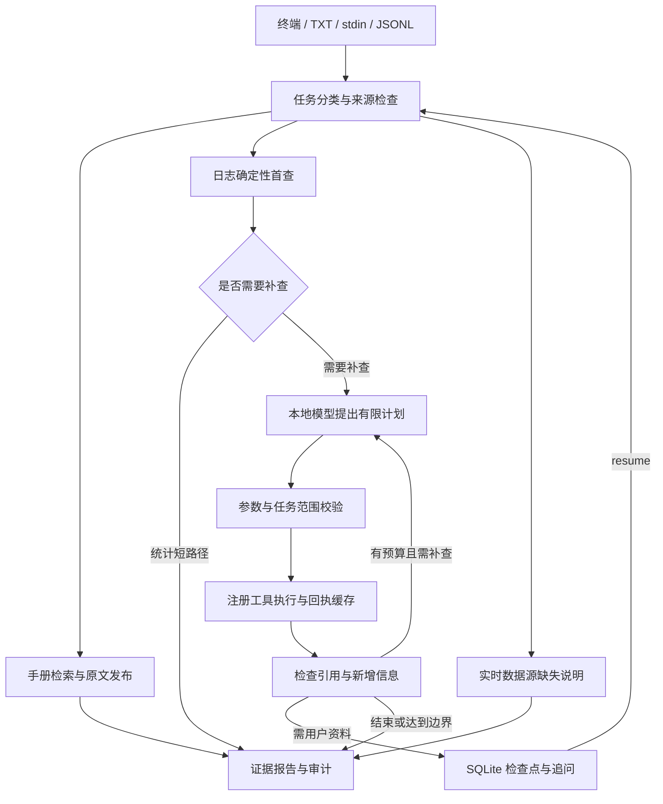

# P5：有限 Agent 与终端闭环验收

日期：2026-09-28。P5.1–P5.6 的技术出口 M5 已通过，代码和数据运行于独立 `upf-agent` 工程。P2 的人工业务签署、P6 的正式质量评测与 P7 的网络隔离/离线重建验收仍待完成。

## 已实现的组成与作用

| 组成 | 实现 | 作用 |
|---|---|---|
| 状态与参数契约 | `agent_contracts.py` | 严格校验任务、计划、工具参数、证据、预算与恢复输入 |
| 工具注册与范围校验 | `agent_tools.py` | 只允许 8 个本地只读工具；限制来源 generation、设备、时间窗和已返回的原文标识 |
| 有限调查图 | `agent_engine.py` | LangGraph 状态图负责路由、确定性首查、计划、执行、证据检查、补查、追问和结束 |
| 执行边界 | `agent_runtime.py` / `agent_worker.py` | 独立子进程执行工具及本地模型调用；超时终止本任务创建的进程组 |
| 任务审计与缓存 | `agent_store.py` | SQLite 保存任务、预算、调用回执、模型用量与事件；已完成工具可复用 |
| CLI 与报告 | `agent_cli.py` | TXT、stdin、JSONL、会话、恢复和 Markdown/JSON 报告 |

应用环境锁定 LangGraph **1.2.12**、SQLite checkpointer **3.1.1**；既有推理、检索和 OCR 环境保持各自锁定。此次真实生成使用 **Qwen3-30B-A3B-Instruct-2507**，本地 vLLM 端点 `127.0.0.1:18000`，16K 上下文。`--model target` 保留 Qwen3.8-27B 入口，本阶段未比较其业务质量；默认模型最终选择留在 P6。检索继续使用本地 Qwen3-Embedding-4B / Qwen3-Reranker-4B。



上图表示业务流程；具体恢复位置由检查点决定。手册问答走 P3 原文发布策略，普通手册问题无需提供日志。日志计数由 P4 工具计算，简单统计不调用模型。复杂调查允许模型选择下一步工具，但工具输出的范围与事实发布由代码检查。工具包括 `search_manual`、`read_manual_block`、`analyze_log_window`、`find_log_events`、`read_log_context`、`lookup_topology`、`compare_evidence`、`correlate_events`。

模型不会获得任意路径、shell 或 SQL 执行入口。读取上下文需使用本任务已经返回的真实原文标识，引用带任务前缀。时间窗不能超出任务范围，空参数继承任务限制，多设备调查应拆成独立任务。没有来源的模型解释不能进入已确认事实；候选解释明确标为未验证，事件时间接近也不能直接证明因果。

## 预算、恢复与结果边界

- 每任务最多 **3 轮计划、8 次工具尝试、8 次模型请求预算、180 秒活跃执行时间**。配置只能降低上限。工具重试最多一次，重试也占 8 次预算；全任务参数修复最多一次。
- 参数检查通过后才执行工具。重复调用复用当前任务和当前范围的回执；连续没有新信息时结束，不无限补查。模型请求在发送前预占预算，实际观测用量另存，不能把预占数当作实际请求数。
- 缺输入时通过 LangGraph interrupt 保存，CLI 立即返回 `need_input`，批处理也不会阻塞等待。`resume` 可补充已登记日志、拓扑、设备或时间窗。文字回答保留在审计中，涉及范围的字段必须显式提供。
- `data/p5/tasks.sqlite3` 保存业务审计，检查点使用独立 SQLite 文件；会话文件保存在 `data/p5/sessions/`。每个新问题创建新任务；会话只延续确认的参数，不自动沿用旧任务证据。
- 正常等待用户回复不计入 180 秒；异常崩溃后的未知活跃时段保守计入。暂停恢复不会重置轮次、调用或耗时预算。
- 同一任务不能更换不同内容的日志。对同一 SHA-256 原日志补充时区/身份或缩小范围时，旧范围证据与事实清空并重新检查；审计历史保留。已结束的任务不重跑，新增调查应建立新任务。
- 检查点绑定代码、配置及 `uv.lock` 指纹。运行版本变动时拒绝沿用旧检查点，应恢复原锁定版本或新建任务。SQLite 及原始来源需一并保存；跨版本升级迁移尚未实现。
- `--log` 的首次导入发生在 Agent 活跃预算之前，导入时间不包含在任务的 180 秒中。已有 generation 可直接复用。

报告保存在 `runs/p5/<run_id>/`：`report.md`、`report.json`、`state.json`、`manifest.json`、`events.jsonl`、`metrics.json`。恢复后更新报告时，上一版保存在 `history/`，能检查追问前后的结果。退出码：完整完成为 0；部分结果、缺资料、待输入为 2；执行或输入失败为 1。

## 实测与证据

最终全工程 **197 项测试通过（19.40 秒）**；Ruff 检查、67 个文件的格式检查与 81 个包的依赖兼容检查通过。测试日志见 [tests.log](../evidence/p5/tests.log)，逐任务信息见 [regression.json](../evidence/p5/regression.json)。

新增 119 项测试，其中 100 个固定参数请求覆盖 10 个场景族的有效参数、未知工具、外来 generation、错误类型、超限、额外路径字段、缺字段、null、bool、Unicode/SQL 文本等。它们验证代码的 schema 和范围拦截，**不是模型首轮参数正确率，也不替代 120 题业务评测**。其余测试覆盖状态路由、超时/空响应、一次修复、预算耗尽、缓存、异常恢复、任务隔离、来源损坏、TXT/stdin、批处理与会话。超时测试实际创建子进程及其子进程，检查本任务进程组被终止。测试中的故障注入和合成日志/拓扑不计为现场诊断准确率。

| 实际任务 | 最终结果 | 关键观测 | 证据 |
|---|---|---|---|
| TXT：网管如何下载实时告警 | completed | 1 次检索；3 次实际模型请求；39.67 秒；发布 3 条原文事实 | [手册报告](../evidence/p5/manual_txt/report.md) |
| TXT：PFCP 不可达与心跳调查；执行后暂停，再由新进程恢复 | partial，未降级 | 3 轮、7 次工具、3 次模型请求；59.05 秒活跃时间；17 条统计事实；保留时区/身份/拓扑缺口 | [日志调查报告](../evidence/p5/log_agent_resume/report.md) |
| 已登记真实日志的消息统计 | partial | 32539 条消息；1 次工具；0 次模型；1.65 秒 | [统计报告](../evidence/p5/deterministic_counts/report.md) |
| 当前 UPF CPU 温度 | missing_source | 没有实时遥测；0 次工具、0 次模型、0 条事实 | [缺数据源报告](../evidence/p5/missing_live_source/report.md) |
| 未提供日志的诊断，随后显式补充 generation 并恢复 | need_input → partial | 等待状态及前版报告保留，恢复后统计 32539 条消息 | [补充日志报告](../evidence/p5/missing_log_resume/report.md) |
| 四行 JSONL，其中第三行故意损坏 | partial / missing_source / failed / need_input | 输入失败后继续第四行；批处理退出码 1 为预期 | [批处理汇总](../evidence/p5/batch/summary.json) |

真实日志 generation 为 `a6f18ac81a18aa2125fa`，32539 行、6347974 字节。正常心跳请求/响应与不可达告警分别查询，没有把所有心跳计为故障。来源仍缺时区、真实设备身份和现场拓扑，因此报告保留 `partial`，没有把消息数写成独立故障次数或推断根因。

手册引用已经独立回查 source/block、来源 SHA-256、摘录与发布原文；统计事实的引用均属于当前任务。语义相关性、步骤完整性及现场适用性仍需 P6 评测。第一次真实日志试验中模型提出未知原文标识，拦截后仅发布统计；随后调整可用工具与上下文标识，重新验证。早期试验完整保存在 [archive](../evidence/p5/archive/)，保留失败记录，不将这些开发过程计算为独立模型准确率。

阶段耗时和 usage 保存在各任务的 `metrics.json`。手册实测预占 4 个模型请求预算，实际观察到 3 个，输入 4831 / 输出 264 tokens；日志调查输入 29311 / 输出 769 tokens，属于跨轮合计，并非单次上下文长度。手册进程观测 RSS 约 **5.59 GiB**，涉及检索模型加载；日志恢复进程约 **208 MiB**。该指标为进程生命周期内 parent/等待子进程的 Linux `ru_maxrss` 最大观测，不是整棵进程树的同时占用、任务独占内存或生成服务 GPU 峰值。不能用此数字证明 P6 端到端资源目标已通过；检索加载与跨进程资源采样留待 P6 优化。本次启动的生成服务已停止，结束后两张 GPU 显存均为 0 MiB。

## 终端复现

在独立工程目录执行。需要生成时先在另一个终端启动模型服务；确定性日志统计无需启动服务。

```bash
cd /home/huangxiaolin/upf-agent
uv sync --extra dev --python 3.11
uv run upf-agent serve --model baseline --gpu 0 --max-model-len 16384
```

另一个终端：

```bash
# 手册 TXT；也可把问题作为参数，或通过 stdin 输入
uv run upf-agent investigate --file examples/p5_manual.txt --product 5GC网管 --version V1.3

# 统计短路径，无模型
uv run upf-agent diagnose '统计日志消息数量' --log-generation a6f18ac81a18aa2125fa --deterministic

# 日志 TXT：执行后保存暂停，终端打印 run_id
uv run upf-agent diagnose --question-file examples/p5_diagnosis.txt \
  --log-generation a6f18ac81a18aa2125fa --pause-after execute
uv run upf-agent resume RUN_ID

# 缺日志时补充已登记来源。设备和时间窗同样使用显式选项
uv run upf-agent resume RUN_ID --log-generation a6f18ac81a18aa2125fa --answer '补充日志，时区尚未知'

# 会话中的 /new 新建任务，/exit 退出；待输入时可提交 ResumeInput JSON
uv run upf-agent chat --session demo

# 样例含一条故意损坏的 JSON；预期退出码 1，后续条目仍执行
uv run upf-agent batch --input examples/p5_batch.jsonl --output runs/my-p5-batch
```

首次日志可使用 `diagnose --log /绝对路径/日志 --question-file ...`。只有用户确认源时区后才使用 `--log-timezone Asia/Shanghai`；不得为通过验证猜测时区。时间窗同时提供带 UTC offset 的 `--start/--end`，采用 `[start,end)`。

既有 `ask/source` 仍是 P3 手册快捷接口；`investigate/diagnose/chat/resume/batch` 为 P5 完整流程。批处理输出目录必须为空；报告以原始 `runs/p5/<run_id>/` 为权威记录。尚未接入真实网管操作、任意设备执行或前端。

## 后续出口

M5 技术闭环已完成；请继续按 [P2 验收](P2_acceptance.md) 填写人工复核单。P6 需要冻结人工真值、模型与 Agent 对照、业务正确性/完整性评价及性能测试；P7 需要干净环境重建、网络隔离、Dify 不可达、备份恢复的独立验证。当前只证明本地实现和功能闭环，尚未宣称 M7 迁移最终验收完成。

框架机制参考官方 [图与节点](https://docs.langchain.com/oss/python/langgraph/graph-api)、[interrupt / resume](https://docs.langchain.com/oss/python/langgraph/interrupts) 和 [SQLite checkpointer](https://reference.langchain.com/python/langgraph.checkpoint.sqlite/SqliteSaver) 文档。项目使用本地状态图和 SQLite，不依赖托管图服务；worker 禁用远程 tracing，外联阻断的实际证明留待 P7。
