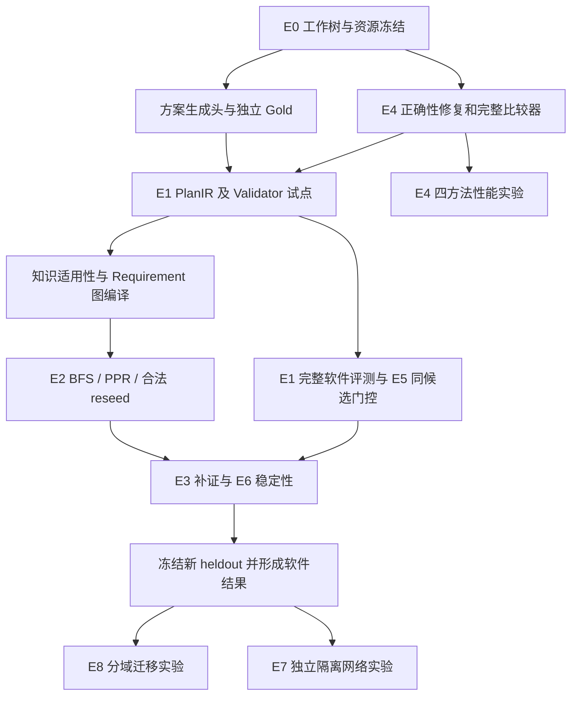

# UPF-Agent-Graph v8：升级方案 V2 可行性评估与实验推进计划

本详细计划已完整纳入 [plan.md](../../plan.md)，包括第 1–11 节。后续在 plan.md 的复选框中逐步打勾，并追加实际验收证据；本文件保留为原详细评估参考。

评估日期：2026-10-08（Asia/Shanghai）。本计划对照本机现有代码制定，实验规模、工期、接口及新增文件均为拟实施项；已经运行的核验单独列在下文。

实施进度（2026-10-08）：第一阶段工程底座已落实 WP00/WP01 的冻结、调用计数、CPU-only 入口及 F1/F2/F3 修复，最终回归 393 项通过，180 批更新与 30 类边界变更完整一致。详见[第一阶段实施与验收](../v8/第一阶段实施与验收_20261008.md)。下文原审计结果保留为改造前记录；完整 P5 对照及 PlanIR/Gold 试点继续推进后续工作包。

**结论：V2 的研究路线可行，现有 v8 应作为工程底座继续使用。需要调整执行顺序：先补基线公平性、局部更新边界和真正的方案生成，再做 PlanIR 试点；完成正确性验收后扩大样本，最后再决定是否引入 PPR 和隔离 5GC。按一名主要研发、两名领域评审可持续参与估计，第一轮完整的软件实验约需 8–10 周，隔离网络另预留 2–4 周。**

其中最有价值的主实验是 E1，最适合立即开展的是 E4 的正确性审计。PPR 属于可选算法对照，真实故障实验受测试床和独立真值限制，不能作为第一轮交付的必经依赖。

## 1. 本次评估的基线与实际核验

### 1.1 使用的是本地工作树快照

| 项目 | 本次基线 |
|---|---|
| 工作目录 | `/home/huangxiaolin/upf-agent-v8` |
| 阅读方案 | 仓库根目录的 `UPF-Agent-Graph_v8_%E5%AE%9E%E9%AA%8C%E8%AF%84%E6%B5%8B%E4%B8%8E%E5%B7%A5%E7%A8%8B%E8%A1%A5%E5%BC%BA%E6%96%B9%E6%A1%88_v2.md`，共 1,087 行 |
| 方案 SHA256 | `18827c4917b5f40b22c2aca2940a498a78d539a10a702ce4a4e3e73728c9aa6f` |
| 本地 Git HEAD | `e234bf774c5714748ab739af43cffeca87a36565` |
| 本地 origin | `https://github.com/jijigood/upf-agent.git` |
| 与方案的区别 | 方案引用 `upf-agent-graph` 的 `421d8f…`；本机 v8 源码主要位于未提交工作树，不能仅以本地 HEAD 标识实验版本 |
| 实际应用环境 | `.venv-v8`；确认导入 `/home/huangxiaolin/upf-agent-v8/src/upf_agent/__init__.py` |
| 当前运行根 | `runtime/v8/`；新实验应另建运行根，避免覆盖历史批次 |

因此，E0 要冻结 **HEAD + tracked diff + untracked 文件清单及内容 SHA + lockfile + 配置**。只记录 `git rev-parse HEAD` 会遗漏当前 v8 实现。后续创建分支或 PR 之前，先保存现有 staged/unstaged/untracked 状态，避免混入已有 P7 工作。

### 1.2 本次确实执行了什么

| 核验 | 实际结果 | 证据与适用边界 |
|---|---|---|
| 全部现有测试 | **371 passed，24.71 秒，退出码 0** | [测试记录](baseline-tests-20261008.json)；包括现有可用的 Neo4j 同语义测试；没有新增模型方案质量评测 |
| 小规模 Full/Local 对比 | **48/48** 个批次通过现有语义比较 | `S/M/L × 1/5 fields × 2 seeds × 4 batches`；未作为性能实验；48 个批次均存在至少一个旧动作 batch 标签 |
| 更新边界探针 | 复现批次标签、评估时刻、构建期漏读边三个问题 | [探针输出](feasibility-probes-20261008.json)及[复跑脚本](feasibility_probes.py)；全部输入在临时目录生成，无模型调用，无真实网络写入 |
| 图 K 绑定目的标签 | 按 `_graph` 现有字段构造的绑定被判为 `unknown_knowledge_purpose` | 是字段投影探针，**没有运行完整图取证链**；结合源码确认工程缺口 |
| 历史 16,000 批产物 | 16 份 CSV 共 16,000 行，其中保存的一致性标志均为真；9 份验收输入文件 hash 匹配 | [历史产物核对](historical-artifact-check-20261008.json)；这是历史记录重聚合，**没有重新执行完整矩阵或新盲测** |
| 本机资源/依赖 | baseline `/models` 返回 200；target 端点连接失败；当前 v8 环境无 SciPy，`nx.pagerank` 实调用失败 | [资源检查](resource-check-20261008.json)；端点就绪不代表已测推理吞吐 |

硬件检查时有两张 A100 80GB、48 个逻辑 CPU、约 230.6 GiB 可用内存和 1,245.9 GiB 剩余磁盘；第二张 GPU 的当时利用率为 100%。这些是瞬时读数，不能据此假定两张 GPU 均可独占使用。第一轮冻结已就绪的 baseline 模型即可，target 模型迁移单独成批，避免把模型变化混入机制贡献。

旧交付资料在本机存在，比 V2 所审查的公开仓库证据更完整；但仍须区分“本次回归”“历史产物核对”“重新运行实验”三个等级。

## 2. 对照代码后的可行性判断

| 实验 | 现有可复用能力 | 真正缺口 | 可行性及先后 |
|---|---|---|---|
| E0 基线与公平性 | Ledger、P5 backend、冻结脚本、运行隔离 | 工作树冻结、统一真实计数、完整 P5 对照、可公开最小环境 | 高；所有实验前置 |
| E1 多步骤方案 | Contract、Binding、K/R/P、动作模板、报告 | **方案生成头**、PlanIR、保真转换器、Gold、独立 Validator | 高但开发与标注工作最多；论文主线 |
| E2 图检索 | Memory/Neo4j、白名单、适用性排除、同 P3 seed 小实验 | Requirement 编译、知识适用性标注、查询 Gold、合法 reseed、PPR 依赖与预算 | 中高；先修证据回写，再比较算法 |
| E3 定向补证 | `route_gaps`、`compile_gap_plan`、轮数与工具预算 | 动态补证场景、无源/不可补真值、统一计数 | 高；依赖 E0 与适配器能力 |
| E4 局部更新 | 字段/状态/动作依赖、early cutoff、全量参考函数 | 初始读集完整性、统一时刻、动作批次、四方法开关、完整比较器 | 高；**正确性问题前置，性能随后** |
| E5 门控 | `gate`、影响范围、实际字段谓词、只读限定 | 独立合法/非法候选集、步骤级前置条件、可用性统计 | 高；与 E1 共用评价底座 |
| E6 鲁棒性 | 基础 fixtures、预算/恢复/来源变更测试 | 保语义扰动、分组新留出、采样参数可控 | 中高；等模型/提示/协议稳定后开展 |
| E7 隔离网络 | 可复用日志/证据模型；当前没有测试床 runner | 部署、实际日志映射、故障注入与清理、独立真值/功能测试 | 条件性可行；独立后期里程碑 |
| E8 外部基准 | 检索和模型接口 | 分域 adapter、数据版本、公开集合适配 | 中；补充迁移实验，不阻塞 UPF 主线 |

### 2.1 应立即前置的代码问题

**F1：无变化或局部变化后，未进入 affected 队列的动作保留旧 batch 标签。**

`dependency.py:199` 给全部状态写入新 batch，而 `dependency.py:261` 仅给队列内复用动作更新 batch。无变化探针中，全部状态为 `batch-1`，全部动作仍为 `batch-0`。现有 `semantic_results()` 在 `dependency.py:292` 排除了动作 `batch_id`，所以旧比较器仍给出相等。当前 `execute_authorized=False`，不能把这个问题描述为已经执行了危险动作。

修复目标：语义复用和批次认证分开保存，例如 `computed_batch` 与 `validated_batch`；所有发布动作都指向当前快照的认证批次。完整比较器检查认证批次、上下文与证据 revision，不能简单地把所有元信息都从比较中排除。

**F2：状态与 Gate 使用不同的 evaluation time，Full/Local 共用错误也可能看起来一致。**

`LocalEvaluator.update(..., now=...)` 和 `full_evaluate(..., now=...)` 支持变更时刻；`actions.py:180/211` 仍按 `task.as_of` 重新选证据，`full_actions()` 也不接收统一时刻。探针使一份冲突观测在 5 秒后过期，10 秒时 R 已恢复 `satisfied`；旧时刻 Gate 仍返回 `human_review`，统一时刻 Gate 则允许只读建议。

修复目标：显式 `EvaluationContext(as_of, batch_id, permission_digest, contract_digest, policy_version)`，传入 full/local/state/gate/PlanValidator；初始化、fallback 和补证后的 Gate 均使用同一个时刻。应同时验证“应阻断而阻断”和“应允许而允许”。

**F3：初始依赖索引的自认证不能证明真实读取完整。**

`DependencyIndex.expected_edges` 来自它自己构造的图；`LocalEvaluator.__init__()` 的初始 Full 结果没有逐 reader 验证实际读集。更新时 `check_reads()` 只覆盖被调度的 reader。本次模拟构建阶段漏掉 UPF-A 的 R 读取组共 12 条边后，自审计通过、重算 0 个状态，但 `n4_enabled=False` 的新 revision 在 Full 中要求补证，Local 仍建议允许。

这是**明确注入构建缺陷后的反例**，没有发现正常构图器当前自然漏掉这些边。它说明 V2 要求的“构建期漏边发现”尚不成立。修复目标：在初始建索引与上下文变更时，独立采集每个需求和动作的真实读集；将必要声明读集与实际读集做双向核对，并针对分支未覆盖的读集保留保守依赖。发现缺边后 Full fallback，并隔离/修复损坏索引后再恢复 local。

**F4：知识绑定缺 purpose 的问题同时存在于普通手册适配和图回写。**

`compiler.py:61` 给 K 需求设置 `purpose=task.template`；`evaluator.py:136` 在目的标签未知时保持 Unknown。`engine.py:_graph`、`adapters.py:collect` 当前创建的文档 K 绑定均未填 `purposes`；`builders.py:manual_graph` 也没有可直接使用的审定 purpose 映射。普通手册检索同样可能无法关闭 K 缺口。

修复目标：增加按文档 hash/版本/定位符登记的适用性标注，保存人工或可信规则映射的来源、版本与复核状态；普通检索和图检索读取同一份映射。**不能仅因为用户问 N4，就自动给所有命中文段填 N4 purpose。**

**F5：当前 E1 缺少真正的方案生成过程。**

`engine.py:_compile` 的模型调用只生成可选意图说明，`_report` 写入状态表和动作 ID。`OrchestrationData` 没有自然语言多步骤方案；`scenarios.py:propose` 只返回 `suggested_action_ids`。因此，在旧输出上新增 Translator 无法凭空得到待评价的方案。

修复目标：除了 V2 已列的四个 plan 模块，再新增 `plan_generator.py`/统一方案头；它把各方法取得的事实、证据和缺口转成带原始中文文本的多步骤建议。生成消耗纳入同一预算，输出必须保留未经 Gate 修饰的原文。

**F6：旧 B1 对照不是完整自由取证的 P5 Agent；P5 原生报告也不具备完整多步骤处置输出。**

`FrozenLegacyBackend.model()` 在 `scenarios.py:304` 提示“取证已完成、actions=[]、done=true”；`agent_engine.py:519` 的原生报告以事实/候选/缺口为主，recommendations 为通用复核建议。旧 B1 适合称为“P5 编排 + 冻结证据适配器”，不适合承担“v8 超过完整 P5”结论。

修复目标：新增完整 P5 runner，保留其工具规划行为，在共同权限和证据源上实际调用；另给 P5/v8 使用同一个冻结方案头。原生 P5 报告作为辅助结果保存，主对照准确命名为 `P5+CommonPlanHead` 与 `v8+CommonPlanHead`。

**F7：真实资料目前只能支持有限的可解子集，不能直接凑 150 个真实故障 Gold。**

普通日志适配在 `adapters.py:collect` 保留 `observed=None` 和未知运行版本；工具只能提供 `event_type/interface/state`，不等于获得 `n4_enabled/mtu` 等现场字段。真实资料缺少身份、观测窗或双侧映射时，正例不足是数据事实。优先把这些样本用于正确补证/转人工评测；可解 D2 需要额外可信现场记录与专家核验。

**F8：PPR 和采样稳定性存在具体依赖/接口工作。**

当前 `.venv-v8` 安装了 NetworkX 3.6.1，但没有 SciPy，实际 `nx.pagerank` 抛出 `ModuleNotFoundError`。可锁定可选 SciPy 依赖，或在小图上实现经过参考实现核对的幂迭代。`LocalChatClient.chat()` 又固定 `temperature=0`、默认 `max_tokens=256`，只返回 message、丢弃 response 的 token usage；不能直接得到 E6 温度消融和可信 token 成本。新增兼容客户端/观测包装器，保持旧 `chat()` 行为可复现。

以上问题的定位入口：[引擎](../../src/upf_agent/v8/engine.py)、[依赖更新](../../src/upf_agent/v8/dependency.py)、[门控](../../src/upf_agent/v8/actions.py)、[适配器](../../src/upf_agent/v8/adapters.py)、[旧消融](../../src/upf_agent/v8/scenarios.py)、[模型客户端](../../src/upf_agent/models.py)。本次仅评估并增加文档/审计产物，尚未修改这些产品代码。

## 3. 推荐实施依赖与范围



依赖图表示门槛；资料整理、专家标注和测试床准备可以由对应人员并行推进。第一轮优先保证 CPU synthetic-only 可以复算，然后增加本机真实手册/日志，不以 Neo4j 或 GPU 作为确定性验证的必要依赖。

## 4. 工程工作包：可直接拆成提交

| ID | 工作包及文件 | 输入 → 输出 | 验收 | 估计研发人日 |
|---|---|---|---|---:|
| WP00 | `experiment_manifest.py`、`experiment_metrics.py`、独立 runner | 工作树/配置/调用事件 → SHA manifest、真实 trace | 未提交 v8 代码可追溯；失败/重试/复用计数可核对 | 2–3 |
| WP01 | `dependency.py`、`actions.py`、完整 snapshot comparator | 同一上下文/新快照 → 当前批状态与动作 | F1–F3 反例被修复或安全 fallback；旧回归通过 | 3–5 |
| WP02 | `knowledge_applicability.py`、适配器、图构建器 | 审定文段元数据 → 有依据的 purposes/作用对象 | F4 修复；未知仍 Unknown；不按任务编造映射 | 1–2 |
| WP03 | `plan_ir.py`、`plan_generator.py`、`plan_translator.py` | 各方法事实/原始文本 → raw + PlanIR + 转写回执 | P5/v8 都有实际方案；转写不补步骤/证据 | 3–4 |
| WP04 | `plan_validator.py`、`plan_metrics.py`、Gold schemas | 原文/IR/证据快照/Gold → 分层判定与分母 | 关键违规检出、合法计划保留、多解/缺证可评价 | 4–6 |
| WP05 | `p5_plan_runner.py`、`v8_plan_runner.py`、统一模型观测器 | 共同工具与预算 → 方法 trace | 完整 P5 可自主选工具；共同方案头预算计入总额 | 2–3 |
| WP06 | `eval/v8_plan/`、评审及统计导出 | 冻结案例 → 盲评材料/一致性/CI/失败表 | 输出逐 case 可复算；调参与 heldout 分离 | 2–3，另计标注 |
| WP07 | E4 四模式及 `scripts/v8_next_local_matrix.py` | 变更序列 → 语义/批次/开销矩阵 | Full/Local/Local-cutoff/Local-audited 可分离 | 2–3 |
| WP08 | `graph_query_compiler.py`、`graph_ranking.py` | 单条 Requirement/合法 seeds → 受约束检索 | 同图/同 seed/同扫描预算；Graph K 真实回写 | 3–4 |
| WP09 | E2/E3/E5/E6 runners 与统计报告 | 冻结对照与扰动 → 成本/效果/稳健性 | 错受、可用性、失败及负收益均完整保存 | 4–6 |
| WP10 | synthetic-only bundle 与论文结果包 | 已冻结实验 → 复现命令/表图/限制 | 另一目录可重聚合；公开包无需私有资料 | 2–3 |
| WP11 | `lab/` 独立注入、观测与清理 | 隔离测试床 → D3 trace/真值/功能检查 | 注入、归零、健康检查稳定；Agent 保持只读 | 8–15，另计部署协调 |

WP00–WP10 粗估 **28–42 个研发人日**，另含专家标注与失败修订时间；这是工作量估计，不是承诺工期。WP11 单独排期。每个提交应保持老批次可回放，新增功能有版本或开关；改变语义后使用新实验 ID。

### 4.1 PlanIR 与验证器的实现约束

1. 使用 action registry，将 `action_type`、参数 schema、前置条件、对象范围和读/建议权限统一登记。第一版只建 N4/N3/身份/日志/配置检查/补证/转人工词表，不开发完整 PDDL 编译器。
2. 引用至少能定位到 `evidence_id + revision + source_sha256 + locator`。模型写出的 `source_verified=true` 不作为验证依据；Verifier 从冻结来源重新核对。Contract/KRP 是输入，不是独立 Gold 的替代物。
3. `scope_fingerprint/evaluation_as_of/batch` 来自 runner 和证据快照，校验模型传回的值，禁止模型自定可信上下文。
4. DAG 检查包括唯一 step ID、引用存在性、无环、必要步骤的先后可达关系、多对象和参数匹配。Gold 可以是多个合法分支；不能把所有合法分支的步骤并集都要求同时完成。
5. 前置条件采用有限谓词和三值结果 `true/false/unknown`，禁止执行模型传入的任意表达式。只读检查可以合法地收集尚缺的信息，不应要求所有检查前已经获得其检查结果。
6. `expected_observations` 是未来检查预期，**不是已经获得的证据**；不能直接置为真后宣布目标完成。具有未知观测的计划使用条件分支、停止/补证/转人工出口。
7. 验证 `permission_kind/effect_kind/claimed_executed/non_executable`：当前不会产生网络写执行授权；描述需要人工审批的变更与声称已执行变更必须区分。
8. 同时输出 `raw_plan_validity`、`published_plan_validity`、拒绝/改写/保留数。Gate 拦掉错误计划不等于原始生成质量提高。
9. 保真 Translator 保存原文 hash、步骤对应原文 span、解析错误和未知字段；不补缺失的步骤、版本、命令或证据。统一冻结的转换器用于所有方法，成本与方案生成成本分开记录。
10. 机器格式/程序可行性和诊断目标达成分层输出；`VPR` 必须受 Gold 与独立复核约束，单纯 Validator 自判通过只记 `validator_pass_rate`。

建议接口如下，均为待实现接口：

```python
generate_plan(method_context, task, budget, model) -> RawPlanOutput
translate_plan(raw_output, frozen_registry) -> TranslationReceipt
validate_plan(plan, raw_output, evidence_snapshot, evaluation_context) -> PlanValidationReport
score_case(validation, independent_gold, expert_review) -> CaseMetrics
```

## 5. Gold 与评审推进计划

### 5.1 三档规模，先确保独立性

| 阶段 | 数量及划分 | 用途 |
|---|---|---|
| 试点 | 24 个开发案例；其中 10 个双评校准 | Schema、原文转写、规则和 rubric 验证；不形成性能优越结论 |
| 资源受限第一轮 | 60 个案例：24 dev / 12 validation / 24 heldout | 有质量的小规模软件结果；置信区间会较宽 |
| 推荐完整第一轮 | 150 个案例：60 dev / 30 validation / 60 heldout | 接近 V2 的主实验设计；需足够独立案例组 |

24 个试点建议按“8 个 N4、4 个 N3、4 个知识/配置、4 个版本/时间/权限缺证、4 个双侧/多对象”组织，每类包含适量可解与应补证/转人工样本。10 个校准样本是这 24 个的子集。

150 个目标配额沿用 V2：N4 30、N3 25、知识/配置 25、错版/时效/权限/冲突 30、多对象/边界 25、对抗/不可支持 15。**样本类别与可解性是两条标签轴**：错误版本场景也可能有合法替代来源，可补与不可补必须独立标注。只有形成足够独立组后才扩量，语义改写不能充当新增独立故障。

### 5.2 每个 Gold 必填

`case_id、source_group、structure_family、source_level、synthetic、reviewed、可解性、对象/版本/时间/权限范围、可见证据清单、required/optional/forbidden actions、多解及等价类、依赖 DAG、必要字段/关键参数、停止条件、独立根因真值等级、评审版本、来源 hash`。

多解 Gold 可使用 `any_of` 包含若干 `all_of` 条件集；动作等价只在目标对象、版本、参数和观察能力一致时成立。必要步骤与边计数对每个匹配的合法分支计算，不将无效分支挑选为最佳得分来掩盖关键违规。

`source_level` 分 D1 合成、D2 历史资料、D3 注入、D4 外部；根因标签另分 `unknown/expert_verified/experimental_injection`。D2 没有独立根因时只评价方案适用性/诊断候选，不计算 RCA accuracy。

### 5.3 分割与冻结

同一事故、同一注入条件族、同一 fixture 生成家族及其词面变体不得跨 split。共享手册作为所有方法可检索的背景语料可以存在，但同源事故的答案或专门适用性标签不能泄漏。先按来源事故组与结构家族检查关联，再分组分割，禁止仅按题目随机划分。

Gold 在看待评模型输出之前确定。dev 用于实现，validation 用于阈值与失败修订；heldout 在代码/模型/prompt/registry/evaluator 冻结后一次正式消费。已有 P6/v8 heldout 只做已知输入回归，不重新命名为新盲测。

### 5.4 专家工作量与角色

假设每例事实审查和 Gold 独立标注每位专家 15–25 分钟，150 例双评约 **75–125 专家小时**。第一轮 validation+heldout 的 90 例 × 4 方法 = 360 份方案，假设每份每位专家复核 6–10 分钟，双评另需 **72–120 小时**，再预留仲裁和返工。实际耗时用试点测量后重估。

两位评审先看隐去方法身份的原始方案、冻结事实和 Gold，再看机器结果；第三位只仲裁分歧。没有两位独立评审时，如实报告单人审核/未复核，不标为专家双盲 Gold。LLM judge 可以预筛，不能顶替独立真值。

## 6. 各实验的执行协议

### E0：冻结、计数与最小可复现环境

对照完整 P5 与当前 v8 的环境、来源与权限；保留当前 371 项回归记录，代码变更后运行相应回归。建立 synthetic-only root factory，在临时目录生成 K/R/P，不依赖同机原项目或企业原件。

统一事件记录 `attempted/committed/reused/error`，分别统计模型、工具、各类检索、源读取与缓存；记录 token usage 的来源，取不到写 `null`。`LocalChatClient` 的响应包装应保留 token usage/request ID，同时保证旧调用返回的 message 语义兼容。现有 B0/B2/B3/B4 的“声明访问数”保留为历史字段，不能纳入工具节省率。

**出门条件**：工作树和数据可冻结；完整 P5 可运行；四方法共同权限/预算有 trace；CPU-only 小包可复跑；计数事件可从原始 trace 重聚合。产物：`e0-baseline-report.md`、`environment.json`、`source_manifest.json`、`method_manifest.json`。

### E1：多步骤方案主实验

主矩阵固定四方法：`DirectLLM+CommonPlanHead`、`P5+CommonPlanHead`、`v8-no-graph+CommonPlanHead`、`v8-full+CommonPlanHead`。P5 native report 与 `GraphContextOnly` 只做辅助组。工具型方法获得同样的来源/API/授权对象；DirectLLM 使用冻结检索上下文，单列其上下文准备成本与信息可见范围。

当前引擎还没有 no-graph 开关，应新增版本化实验开关，真正跳过 `_graph` 及其调用费用，不能用空图代替后仍收费。P5 若需要读取合成结构化观测，应使用保持来源/字段/权限的公共工具适配器，让它自主选择工具；不得直接喂入 v8 已算好的状态或 Gold 必需步骤。

先在 24 个试点跑四方法，共 **96 次方法运行**。格式轴第一版只比较普通文本/JSON与 schema 提示；grammar 解码等后端支持后再扩展。线上“无 Validator”的方法也必须接受同一个离线评价器，不能因其没部署验证器就少检查硬约束。

推荐初始共同上限：工具 8、模型请求 8、补证轮次 3、总时间 180 秒；在总模型预算内预留 1 次最终方案生成。转换器若额外调用模型，单独报告评价开销，不能暗中给某一规划方法增加生成预算。最终输出 token 上限先试 1,024，依据 pilot 截断率统一冻结；不沿用只适合动作 ID 的 256/384 token。

Primary 比较预先指定 `P5+Head vs v8-full+Head` 的 VPR/HCVR；`v8-no-graph vs full` 等列为 secondary。同时报告 MSR、DAG 依赖满足率、EGRR、CDR、原始/发布方案保留率和成本。对无独立根因的样本不报 Top-K。

**出门条件**：原文、IR、转写错误、验证、盲评均保存；所有预植入关键违规类别在对应测试集合被检出，合法同源控制计划仍保留；多解与缺证都能评分；未取得专家 Gold 前只报告 validator 单测，不报告实际 VPR 优势。产物：`e1-pilot/`、`e1-plan-evaluation.md`、逐 case CSV、盲评包。

### E4：正确性审计与条件性性能

先处理 F1–F3，开发 **至少 30 条** 更新序列，覆盖不变值/revision、关键值变而状态码不变、无关字段、版本、时效、P 映射、删除/反证/source SHA、权限/scope/as_of、跨 batch、构建期漏边、分支读取、环、预算中断、恢复后更新、密集更新。输入变化和规则切换必须版本化。

Full 对比不能调用被测 DependencyIndex；允许共用底层确定性规则，但须增加独立 Gold 反例，以发现 Full/Local 同源错误。比较两层结果：领域可观察语义，以及 batch/as_of/source/revision/permission/context 的认证一致性。保留现有“忽略展示版本”的比较作为辅助项。

四组：L0 Full，L1 Local-no-cutoff，L2 Local-cutoff，L3 Local-audited-cutoff。L1 对所有受影响 reader 继续传播，禁止语义不变后截断；L2/L3 分离审计开销，初始索引构建与每批验证时间分别保存。

小矩阵先用 S/M × 1/5/10 fields × 3 seeds × 10 batches = **180 批/方法**。正确性通过后跑 V2 原矩阵 **16,000 批/方法**，四组共 **64,000 个方法批次**；同一变更序列复用输入。另加 10%/50%/100% 稠密变更及少量高扇出变更，小规模先定位负收益，再扩到 XL。

性能轮次在单 worker 上交替或随机方法顺序，冷热分开；四 worker 吞吐另列，不能混入单请求延迟。报告构建成本、fingerprint/审计/重算成本、重算 reader、fallback、P50/P95、CPU/RSS及 `T_full/T_local`。条件不同的开销不相除。

**出门条件**：冻结矩阵语义一致，所有发布动作认证批次正确；漏边/环/预算触发时不会保留未经确认的允许建议。发现任一非预期差异先修复，再用新 ID 复跑；性能不优则如实保留负收益范围。产物：`e4-correctness-audit.md`、`e4-performance.md`、变更序列和失败快照。

### E2：图证据检索

先修 F4，逐 Requirement 编译对象、字段、目的、关系、版本、时间和预算，返回可核验的候选路径。未知来源/版本可作为补证线索单列，不能作为已满足证据采信。

先做 **24 条** 查询 pilot，再扩大到 **96 条** Gold 查询（K48/R24/P24；按资料实际可支持能力调整并冻结）。每条定义相关且适用的证据/等价证据集合、必需字段、合法关系、无证据或种子不可用条件。标注专家先看来源与需求，后看方法结果。图中存在 R/P 节点不代表引擎已经支持其回写；相关接口未实现时只评检索，不声称完成 R/P 方案改善。

核心组：G0 Hybrid P3，G1 Fixed-Hop + 统一末端过滤，G2 Contract BFS，G3 同约束候选图 PPR，G4 Contract BFS + legal reseed。Requirement 个性化的 PPR 作为 G3 的单独次级消融，避免 V2 原 G3/G4 的定义重叠。Beam/ToG 暂不纳入第一轮。

统一 seed 缓存、图快照、关系过滤、源扫描预算与返回上限；PPR 在相同预先过滤候选图上排序。起始仍限制 2 跳、100 节点/200 边；3+ 跳样本先用于报告不可达，不在某一方法中偷偷提高跳数。若拓展跳数，所有方法另开相同预算批次。

top-K 预注册为 5/10/20；PPR 试点可搜索 `alpha={0.70,0.85,0.95}`，仅 dev/validation 调参，冻结迭代上限/容差/不收敛行为后再测 heldout。当前 `nx.pagerank` 依赖缺失先解决，不能直接把现有 NetworkX 依赖视为 PPR 可用。

Valid P/R 同时报告；等价证据多份重复不重复增加 Required Coverage。另报 Invalid Acceptance、seed validity、Correct No-Evidence、扫描量、过滤损失和完整 retrieval latency。Neo4j 官方 HybridCypher 因种子底座不同单列。

**出门条件**：有多于四问的审定 Gold；合法文段能凭映射进入 K；错版/无佐证关系不被采信；同预算得到可解释质量—成本结果。PPR 无收益则保留 BFS 默认。产物：`e2-graph-retrieval.md`、查询 Gold、seed/排除/路径 trace。

### E3：类型化补证

构建 **32 条独立开发场景**，覆盖 V2 的八类缺口，每类含可补与不可补条件。需要分轮次返回不同合法证据的确定性 backend；否则反复读取同一 fixture 无法测闭环收益。默认不解决身份/时区等来源本来未知的事实。

四组 T0 不补证、T1 完整刷新、T2 完整 P5 工具选择、T3 类型化补证；E2 稳定后新增 T4 合法 reseed。32×4 = **128 次方法运行**，后续以正式留出中对应子集验证，不能在这些开发场景上宣布泛化。

核心指标是可补 Gap Closure、不可补 False Closure、正确停止、每实际调用新增的有效字段及冗余查询。必要负证据查询/确认查询不自动记为冗余。

**出门条件**：每个关闭缺口有新适用 Binding 支撑；未知仍保持未知；共享权限/工具预算；超时、无源和不可补均有完整终态。产物：`e3-gap-closure.md`。

### E5：安全与可用性

建立 **120 个候选建议**试点，建议 40 个应允许、40 个应禁止、40 个信息未知/应转人工；它们来自若干独立任务族，报告候选数与任务族数，不能称为 120 个独立故障。

同候选集依次运行 A0 原始建议、A1 schema/白名单、A2 KRP/provenance、A3 scope/context/batch、A4 多步骤 Validator；只离线判定，不执行候选。另一条 E1 end-to-end 结果中各方法可以产生不同候选，两个实验不能混为 Gate 因果贡献。

共同报告 URR、VAAR、正确转人工率、方案 VPR/CDR、错误拒绝和 Raw/Published Unsafe Plan。保留“全部拒绝”退化对照：它可能 URR 很低，但 VAAR 必须失败。

**出门条件**：关键违规注入被拦、合法控制建议被保留，所有执行授权保持 false；0 错误同时给出样本数与上界，不写现网零风险。产物：`e5-gate-safety-availability.md`。

### E6：扰动与多次运行

从冻结评审集选 **20 个案例**，对 P5+Head、v8-no-graph、v8-full 各独立生成 5 次，共 **300 次运行**；前提是客户端能显式记录并控制 temperature/seed。温度为 0 时不保证不同 seed 带来实际随机性，应说明后端是否支持 seed，缺失写 N/A。

另对同 20 个案例生成 4 种经审查的语义保持扰动（表述、顺序、拓扑列表顺序、无关噪声），三方法一次运行，共 **240 次**。版本替换、缺字段、故障家族变化会改变 Gold，属于 OOD/新任务，应另标并重新审核，不能冒充语义保持扰动。

报告 pass@1、所有五次均成功的经验 pass^5、最差组 VPR、关键违规次数和 Decision Flip。若 v8 经验证的证据与状态是确定的，明确哪些随机变化来自最终方案头。

**出门条件**：扰动不改变参考事实；重试输出均保留；不以挑选最优结果替代单次成功率；heldout 修订后使用新的正式批次。产物：`e6-robustness.md`。

### E7：隔离 5GC，单独验收

先部署一套健康 Open5GS/UERANSIM，固定版本、拓扑、UE/订阅与业务测试；独立 harness 控制注入与清理。优先做 N3 丢包、UPF 通信中断、配置错配三类，覆盖 **6 个注入条件 × 3 次 = 18 轮 pilot**；再扩到 12×5=60 轮。N4/PFCP 只有在独立注入器稳定且实际观测能够核验后增加。

每轮顺序：健康检查→注入→外部核验注入成功→固定 Agent 可见快照→诊断→根因/步骤评价→独立清理→健康恢复。Gold 注入对象/命令/期望答案不得进入 Agent 可见字段；配置等正常调查材料照常可读，不能人为遮掉可见证据。

第一次只评价定位与调查步骤；网络修复效果另做由独立执行器实施的实验。故障清除和恢复真值不由被测 Agent 自报。注入失败记 harness error，诊断超时记 method failure，两种分母分开；清理失败暂停下一轮以免污染。

现有外部框架官方说明采用 Kubernetes 上的 Open5GS/UERANSIM、Ansible 注入和成本轨迹，可借用生命周期及 runner 结构；当前仓库没有因此自动具备该测试床。[5G Agent Benchmarking Framework](https://github.com/ATNoG/5g-agent-benchmarking-framework)

**出门条件**：18 轮 pilot 的注入和清理均可核验、Parser 与实际日志匹配、Agent 只读、独立真值不泄漏。报告 Top-1/Top-3、可观测异常后定位延迟、真实成本；有外部执行实验时再报功能目标和副作用。产物：`e7-lab-report.md`，不将诊断延迟称为 MTTR。

### E8：分域迁移，可裁剪

先选一个资料与 adapter 最容易准备的外部集合，少量样本验证数据读取与官方基线，再登记可下载子集/版本。OpsEval 用于知识 QA，RCAEval 用于有根因标签的微服务定位，标准文本用于条款检索；各域独立指标和结果，不与 UPF VPR 合成总准确率。

第一轮软件主结果不依赖 E8，工期或标注不足时可以延期。产物：`e8-domain-transfer.md`。

## 7. 指标、统计与结果解释

| 主指标 | 分母与规则 | 必须配套 |
|---|---|---|
| VPR | 所有可解任务；空输出/解析失败/超时计失败；Gold 目标与硬约束均满足 | validator pass、CDR、N、CI、raw/published 区分 |
| HCVR | 应生成方案的全部任务；统计确定发现的硬约束违规 | 未可评分数、解析失败率；不把未知语义悄悄记安全 |
| MSR/DAG | 匹配的合法 Gold 分支的必需步骤/依赖关系 | 禁止动作与关键参数检查 |
| EGRR | 有关键建议的方案；每条关键建议都可核验 | 无建议比例、拒绝率 |
| CDR | 不可解/需补证任务 | 错误确定处置率、可解任务 VPR |
| URR/VAAR | 分别以应禁止/应允许候选为分母 | Unknown 候选单列、任务族数、CI |
| Graph P/R | 相关且适用证据的返回/Gold 集合 | required fields、错受、无证据正确率、seed validity |
| Full/Local Equality | 所有冻结更新批次，包括 fallback/失败 | 领域语义与批次上下文分别比较 |
| Latency/Cost | 所有运行保留成功/失败状态；超时按实际截止记录 | 总端到端与各阶段、冷热/预处理、P50/P95 |
| Root Cause Top-K | 独立核验根因的案例 | unknown 真值数、fault-family 聚类 |

空分母写 N/A，数值缺失写 null，保留分子/分母。门控后只剩少量好计划时，不能只报保留集 VPR；主指标对全部应输出任务计算。

二分类比例给 Wilson 95% CI；同任务方法比较采用配对检验并报告不一致对计数。连续成本做任务/来源族级 paired bootstrap，同一案例的多次生成不能当作多个独立任务。主检验固定 P5 vs v8；多重次级比较作调整或明确探索性分析。

60 个 heldout 在成功率约 50% 时，单方法 Wilson 区间半宽约 12 个百分点；小样本无法保证检出细小提升。用 pilot 的不一致对和来源族结构重新估计样本量，不预设“必须提升 10%”。重复 5 次主要测稳定性，不代替增加独立任务。

0/N 错误的一侧 95% 上界为 `1-0.05**(1/N)`：例如独立近似下 0/100 仍约 2.95%，0/300 约 0.99%。实际候选相关时按家族解释，不能直接套独立机会数。E5 的 120 候选是工程试点，不是低风险率统计证明。

## 8. 排期、资源预算与第一批动作

### 8.1 建议 8–10 周软件推进表

| 时段 | 研发任务 | 数据/评审任务 | 出门条件与交付 |
|---|---|---|---|
| 第 1 周 | WP00；修 F1/F2；初始读集审计原型 | 建立 action registry；准备 24 例事实材料 | E0 冻结可用，三类更新反例有回归用例 |
| 第 2 周 | F3/F4；PlanIR/生成头/保真转换 | 24 例 Gold 双评，10 例校准 | P5/v8 均有原始方案，未知元数据不被填造 |
| 第 3 周 | Validator、完整 P5 runner、24 例×4 方法 | 校准 raw text→IR 与 rubric，仲裁 | `e1-pilot`；决定 60 或 150 例正式规模 |
| 第 4 周 | E1/E5 validation；E4 四模式小矩阵 | 完整数据分组、增量边界 Gold | 关键违规/合法控制均验证，E4 正确性出门 |
| 第 5 周 | E4 完整性能；Requirement 图编译 | 图 24 例 pilot、扩至 96 查询 | 正确性与性能分表；知识适用性回写有据 |
| 第 6 周 | E2 BFS/PPR/reseed；E3 动态补证 | 图 Gold 复核；无源/可补标签 | 报过滤召回代价、假关闭与净收益 |
| 第 7 周 | E6 重复/扰动；汇总 validation 失败 | 正式 heldout Gold 完成、评审匿名化 | 模型/prompt/代码/evaluator 全冻结 |
| 第 8 周 | 正式 heldout 一次消费、统计/复现 | 双评与仲裁 | 软件主结果、失败集、质量—成本图 |
| 第 9–10 周缓冲 | 失败修订、外部最小复现、必要的新批次 | 仲裁积压、数据补充 | 只用新批次核验修订，不覆盖旧结果 |

若只有一名研发且两名评审不能持续参与，优先交付 **E0 + E4 正确性 + E1 24例 pilot**，预计 3–4 周；完整规模按实际标注速度顺延。E7 在软件输出协议稳定后另排 2–4 周，不将测试床搭建挤入第一周。

### 8.2 前 10 个工作日的具体动作

| 日 | 动作 | 当日可检查产物 |
|---|---|---|
| D1 | 冻结工作树/来源/环境，建立新 root 与真实计数协议 | E0 manifest；确认 P5/full-v8 方法边界 |
| D2 | 修无变化与部分变化动作批次认证 | F1 反例变为通过；完整比较器包含上下文 |
| D3 | 统一 state/local/full/gate 的 evaluation time | F2 过期冲突、未来观测及 freshness 回归 |
| D4 | 初始实际读集审计；损坏索引隔离与 fallback | F3 构建期漏边不能错误复用建议 |
| D5 | 知识 applicability registry 与两条适配链 | 无 purpose 保持 Unknown；审定文段可满足 K |
| D6 | 定稿 PlanIR/action registry/Gold schema | 合法/缺步骤/缺证/错误执行声明样例 |
| D7 | 共同方案头与原文保留；固定模型/预算 | P5/v8 各至少 2 例真实生成 trace |
| D8 | 保真 Translator、DAG/参数/证据 Validator | 多解、环路、错版本、越权反例回执 |
| D9 | 接入独立指标及盲评导出 | 分母可手算；解析失败不丢失 |
| D10 | 运行 24 例试点或已完成标注子集；统一复盘 | `e1-pilot-report`，阻塞项与下一批工作包 |

专家标注从 D1 并行开始。D10 未完成复核的案例不冒充完整 Gold；协议模块可以先在 D1 合成样本上完成可复算验证。

### 8.3 运行量及算力估算方式

150 例×4 方法的全套留档是 **600 次**；其中 dev240、validation120、heldout240。E6 两组另约540次，E3 四组128次，扩展格式轴另计，**同一任务在多个实验里的复用不能重复声称为独立案例数**。

每轮实际时间先在 24 例 pilot 测量。若平均每任务方法运行 60 秒，600 次串行约 10 小时；若 120 秒约 20 小时，均不含额外评价/专家工作。180 秒为硬上限，600 次的运行时上限预算约 30 小时，排队、初始化和离线评价另计。这些是预算算式，不是已测吞吐。

当前模型 `max_num_seqs=1`，GPU 检索又可能占用第二张卡；第一轮以单模型队列、冻结 seed/cache 优先，CPU E4 与标注可独立进行。所有资源结果保存运行时观测值，不能用显卡总容量推算空闲可用容量。

## 9. 产物与复现入口

拟新增运行目录：

```text
runtime/v8-next/                       # 新任务账本/检查点，不覆盖 runtime/v8
eval/v8_plan/{dev,validation,heldout,adjudication}/
eval/v8_graph/gold_requirements/
eval/v8_incremental/mutations/
experiments/v8-next/<experiment_id>/
  protocol.yaml
  environment.json
  worktree_manifest.json
  source_manifest.json
  method_manifest.json
  raw_outputs.jsonl                    # Gate 前原文
  plan_ir.jsonl
  translation_receipts.jsonl
  validation.jsonl
  published_outputs.jsonl              # Gate 后结果
  traces.jsonl
  metrics_by_case.csv
  summary.json
  failures.jsonl
  sha256_manifest.json
```

每个 case trace 包括方法版本、数据等级、reviewed、run_id、code snapshot、模型/参数、源 hash、各阶段计时、预算/重试事件、原文/IR/validator/Gold/review版本、终态和失败原因。完整证据与案例答案只放在对应权限的包中；公开复现包使用明确标记的 synthetic 输入。

本次审计已经可以复跑，以下命令是**现成命令**：

```bash
cd /home/huangxiaolin/upf-agent-v8
.venv-v8/bin/python docs/v8-next/feasibility_probes.py > /tmp/upf-v8-feasibility-probes.json
```

结果包含预期反例，因此不能把 JSON 中出现 `false` 视为脚本运行失败。源代码 hash 必须与本次记录比较；后续修复后探针结果应改变，不能拿旧反例记录当新验收。

已存在的矩阵脚本可在正确性修复后以新输出目录运行；以下为**届时执行示例，不是本次已执行记录**：

```bash
.venv-v8/bin/python scripts/v8_local_matrix.py \
  --root runtime/v8-next-e4 \
  --output experiments/v8-next/e4-full-local-new-batch \
  --workers 1
```

这份旧脚本只比较 Full 与现有 Local；四模式和完整比较器需要 WP07 新脚本。不能把示例命令当作已经支持四模式的新实验入口。不要为准备评测再次运行 `v8_prepare.py` 覆盖旧 root；它当前依赖原项目路径和既有向量环境。

## 10. 各阶段的继续/停止条件

| 门槛 | 满足时继续 | 未满足时的工作 |
|---|---|---|
| G0 可复现 | 工作树/来源/计数可追溯 | 修冻结与 runner，不进入方法成本对比 |
| G1 更新正确 | F1–F3 和 30 条边界序列通过 | 固定反例、修复或强制 Full；暂停局部效率结论 |
| G2 方案可评价 | 原文保真、独立 Gold、多解/缺证可评分 | 缩到24例完善协议，不扩量 |
| G3 安全且可用 | 关键违规拒绝、合法控制保留 | 找误放/误拒来源，继续离线修订，不输出效果优势 |
| G4 图对照公平 | 同 seed/图/过滤/预算，purpose 证据合法 | 修适配与编译，PPR 不设默认 |
| G5 正式结果可复算 | 新 heldout、失败全保留、盲评/统计完成 | 如实报告限制；变更后登记新批次 |
| G6 测试床独立真值 | 健康/注入/清理可核验、观测适配稳定 | 留在文本/离线评估；不宣称真实恢复效果 |

第一轮最小可信结论应是：“在冻结来源与作用范围条件下，v8 产生的方案在哪些步骤、证据和权限约束上通过/失败；局部更新在哪些变更条件下与 Full 等价且节约净开销。”是否优于 P5、PPR 是否提升有效召回、是否帮助真实定位，都以相应实验结果决定。

## 11. 外部方法核验与使用边界

本次只核验直接影响实施的几个入口，不将原方案全部文献视为已完成系统检索：

- TelcoAgent-Bench 的步骤完整性/稳定性设计适合借鉴；其多语言电信蓝图不等于本项目 UPF Gold。[论文](https://arxiv.org/abs/2604.06209)
- TeleCom-Bench 确实包含 solution generation 等流程任务；arXiv 页面目前 Comments 标注 `Accepted by KDD 2026`，正式写作时应更新 V2 的“仅预印本”状态描述。数据获取仍以公开仓库实际内容为准。[论文](https://arxiv.org/abs/2605.18025)、[官方仓库](https://github.com/ZTE-AICloud/TeleCom-Bench)
- HippoRAG 的 PPR 是关联检索方法参考，本项目先做同约束候选图的算法消融，不复制完整框架，也不预设收益。[论文](https://arxiv.org/abs/2405.14831)
- Salsa 的 revision、依赖追踪与输出不变时 backdating 可用于理解 early cutoff；本项目需要补初始读集和证据上下文的具体审计。[官方算法说明](https://github.com/salsa-rs/salsa/blob/master/book/src/reference/algorithm.md)
- NetworkX 的 PageRank 提供个性化权重和收敛参数；使用与本地锁定版本一致的参考接口，同时解决本次实际发现的 SciPy 依赖缺失。[NetworkX 3.6.1 文档](https://networkx.org/documentation/networkx-3.6.1/reference/algorithms/generated/networkx.algorithms.link_analysis.pagerank_alg.pagerank.html)
- 外部 5G 框架可以参考实验生命周期；将其 Agent 或 MCP 写权限直接交给本项目不是本计划的实施内容。[官方仓库](https://github.com/ATNoG/5g-agent-benchmarking-framework)

当前最先应落地的批次为 **WP00/01/02/03/04 的24例试点**：冻结及修复可验证边界，生成真正的多步骤方案，完成独立 Gold 和评价器，再用数据决定扩样和图算法投入。

## 执行状态补记：2026-10-08

逐步完成状态统一维护在 [plan.md](../../plan.md)。第一阶段工程验收已完成；第二阶段工程实现及 24×4 合成开发试点已完成，459 项回归通过，96 份方案与成本可复算。模型批次含 3 次解析失败，质量验收未通过；专家双评、仲裁、质量修订后的新批次和正式扩样继续待完成。24 是本计划提出的开发规模，不是用户已有真实事故或专家 Gold。实测及边界见 [第二阶段报告](../v8/第二阶段实施与试点_20261008.md) 和 [机器验收](../v8/phase2-acceptance-20261008.json)。本文件前文保留改造前评估，不能当作当前实现状态。

后续质量修订已交付：468 项回归通过，新增 20 / 4 / 8 次开发复核全部保存。共同方案头第四版使用实际 JSON Schema，末轮 8 份均可解析，但未知知识、跨对象引用及步骤完整性仍有失败，专家审核仍为 0。详见 [质量修订与复核](../v8/第二阶段质量修订与复核_20261008.md)，保持未完成的语义/专家/扩样门槛，不推断总体效果优势。
