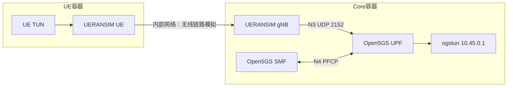

# WP11 / E7 隔离 5GC 实验记录（2026-10-10）

**版本说明：下文主体记录早期网络pilot-004（没有根因模型）。2026-10-10收到复核意见后的诊断原型、失败修复及60轮新实验另见[本轮修复与后续实验验收](复核问题修复与后续实验验收_20261010.md)。旧18轮与新18/60轮独立，旧N/A不当新结果。**

最新追加开发实验见[追加实施与验收](剩余实验追加实施与验收_20261010.md)：有限证据联合RCA三方法新90轮、270次异目录重算通过；主批joined/graph各57/60、健康误报0/5，8秒窗口补证9/9，三条主批unknown保留。实际MemoryGraph查询与有限PFCP建立／修改／N3字段关联已核验，joined与graph无额外准确率差异；不代表完整图RCA、全部PFCP语义或模型改进。详细材料与填写方式见[追加复核指南](追加实验复现与人工复核指南_20261010.md)。

此前诊断原型7已完成预检007（6轮）、pilot005（18轮）、full002（60轮）并独立审计，三批helper SHA一致。全量注入／完整输出／独立恢复60/60，方法／harness错误0；Top1=10/60、Top3=32/60。实际模型请求60、native读取240，输入399657／输出21025Token。诊断中位6.67秒、P95 10.72秒；正常探针开始至排行中位14.46秒、P95 20.04秒，不称MTTR。

逐条件表、50份Top1错误原文、失败迭代、真实附件6974文件离线复算及质量边界见[本轮验收第10节](复核问题修复与后续实验验收_20261010.md#10-e7逐条件结果与结论边界)。该原型为四对象R接入与有限候选模型原型，graph_enabled=false，该批PFCP完整IE／双侧会话映射未实现；自然语言／调查步骤未被专家批准。完整60轮执行不能解释成完整v8图RCA质量通过。

以下为旧网络工程pilot的历史正文。

本轮先验收健康网络、独立注入与恢复、真实日志采集和 v8 只读接入。**根因排名、正式调查方案质量和 60 轮扩展另行验收**；本轮不把日志接入通过记成定位成功。第二、第三阶段既有人工复核继续并行，原材料不修改。

## 实验来源与隔离

构建输入：`runtime/v8-next/wp11/environment-001/`；固定版本见 [upstream-lock.json](../../lab/e7/upstream-lock.json)。Open5GS 2.7.6 的实际 release commit 为 `d9d3abdd480be96fac3bc8a997e83446648763ca`，UERANSIM 3.2.7 为 `1d1e154f869260b5e98f6905827b1bd9b8663afc`；MongoDB 7.0.16 下载包保留实际 SHA。版本不同于前期仅供研究的 main 分支参考，旧 `opensource-references.json` 不改写。

采用两个独立容器：core 包含 Open5GS 各 NF、MongoDB 和 gNB，ue 包含独立 UERANSIM UE。Docker 内部网络 `10.208.7.0/24`；gNB 的无线模拟地址 `10.208.7.2`，UE 容器 `10.208.7.3`。NGAP/PFCP/GTP-U 在 core 的独立网络空间中使用上游默认回环地址。UE TUN 获取 `10.45.0.x`，业务探测从该 TUN 到 core 的 `ogstun=10.45.0.1`；目标与 UE 分处不同网络空间，避免在一个空间内走本地路由绕过 5GC。

容器使用 runc、仅增加 NET_ADMIN 和 TUN 设备，不使用 privileged、host network、端口发布或 GPU。内部网络禁止外部路由；注入只作用于本轮容器，不修改宿主机接口、已有容器或其防火墙规则。控制器创建／清理资源前核对所有权 label；回收本轮容器和网络，保留镜像及实验文件。

[Open5GS 官方构建与 TUN 指南](https://open5gs.org/open5gs/docs/guide/02-building-open5gs-from-sources/)、[UERANSIM 官方安装说明](https://github.com/aligungr/UERANSIM/wiki/Installation)提供构建依据。配置采用固定版本的 [gNB](https://github.com/aligungr/UERANSIM/blob/v3.2.7/config/open5gs-gnb.yaml)、[UE](https://github.com/aligungr/UERANSIM/blob/v3.2.7/config/open5gs-ue.yaml)和 Open5GS 上游模板；订阅为其公开测试样例，不连接实际运营网络。宿主机时钟由两个容器共享，日志时区设为 UTC；月日格式的事件不擅自推断年份或事件时间。

镜像固定为 `sha256:0298b2faf2810793b7d21ee61fd9f0189c35e22e3e3565b8dcfd615f78c04a3d`。APT 实际软件包清单已保存，重建时包仓库可能变化，因此 Dockerfile 不承诺逐字节重建出同一镜像 ID；新镜像必须重新登记、验收。CUDA 基础镜像来自本机缓存，本轮不使用其 GPU 功能。源仓库和许可证保留在构建输入，不将上游实现复制进项目 `src/`。

## 预先固定的 18 轮协议

每个条件独立重复三次。重复共享一套拓扑和测试订阅，不能作为 18 个独立故障家族或人群样本。

| 条件 | 注入 | 独立核验 |
|---|---|---|
| n3-ul-loss | core INPUT 静默丢弃 gNB→UPF 的 UDP/2152 | 业务失败、对应 DROP 计数增加、gNB 仍存活 |
| n3-dl-loss | core INPUT 静默丢弃 UPF→gNB 的 UDP/2152 | 业务失败、对应 DROP 计数增加、gNB 仍存活 |
| upf-paused | 控制器暂停 UPF 进程 | 实际进程状态 T、UE 业务失败 |
| upf-n3-block | core INPUT 阻断 UDP/2152 的通信 | 业务失败、DROP 计数增加、gNB 仍存活；此条件不是独立 N4/PFCP 注入 |
| gnb-gtp-mismatch | gNB 通告的 GTP 地址与实际监听地址不一致 | 实际配置、故障探测、重建 UE 会话 |
| ue-dnn-mismatch | UE 请求未订阅 DNN | 实际 UE 配置、UE 的明确 DNN 拒绝原因与 AMF 拒绝记录、业务探测失败 |

固定顺序：健康探测→正常日志基准位点→注入→外部核验→当前窗口日志／配置快照→只读 Agent→独立清理→健康探测。每次健康探测要求 5 个 ICMP 请求全部返回；初始化／恢复过程中暂未出现 TUN 的尝试全部保留，不能删去后只展示成功尝试。

注入失败和方法失败分开；清理失败停止后续轮次。网络恢复来自独立控制器和 UE 探测；重启 UE/gNB 是 harness 的清理动作，不是 Agent 的修复能力或 MTTR。

## 原失败与修订

[e7-pilot-001](../../runtime/v8-next/wp11/e7-pilot-001/invalid-injector-note.json)保留初次实际运行。OUTPUT 丢弃本地 UDP 会使 gNB 的 `sendto` 返回 EPERM，引发进程退出，混入第二种故障。该批已中止并清理，不计入有效 pilot。修订后使用 INPUT 静默丢包，增加 gNB 存活条件，另建 `e7-pilot-002`。002 的 DNN 核验仅匹配 PDU Reject，而实际返回 MM 状态；其原始结果为注入核验 15/18、恢复 18/18，不计完整 pilot 通过。修订为 UE 明确 DNN 原因和 AMF 的实际拒绝记录同时存在。

检查 002 非空日志的 Engine 回执还发现采集窗口缺少 `timezone_source`，原验收只检查终态／只读，错误地放过了工具失败。003 在首轮后中止；002/003 的旧 `integration_pass` 不能作最终接入通过证据。补上真实 UTC 采集时钟来源，要求没有 `tool_failed`、物理来源绑定条数与实际记录一致；[真实日志修复探针](../../runtime/v8-next/wp11/adapter-fix-probe-001/integration.json)成功入库 UPF/SMF 两条记录。最终批次为 `e7-pilot-004`，完整重跑六条件、没有拼接历史成功轮次。

构建时不支持 `docker build --runtime` 的失败、首次 Parser 正则分组错误的测试失败也保留在 `environment-001`；实际构建和后续测试另存新日志。

## 材料在哪里，怎么复核

最终网络批次在 `runtime/v8-next/wp11/e7-pilot-004/`：

- `protocol.json` 与 `code-hashes.json`：运行前固定的条件、分母和精确 helper 字节。
- `baseline-health.json`：健康 5GC 的全部探测；`private/baseline-core.json`、`baseline-ue.json` 是实际启动日志和正常配置。
- `private/round-NNN/health-before.json`、`inject.json`、`external-verification.json`、`truth.json`：逐轮注入真值及独立核验。不得给被测 Agent。
- `rounds/round-NNN/input/snapshot.json`：Agent 实际可见输入。只含正常调查配置、接口／监听状态和当前采集窗口的新日志，没有 condition、注入命令或期望答案。正常配置差异仍可见，不能为了隐藏 Gold 而遮蔽正常证据。
- `rounds/round-NNN/agent/`：真实 Engine/Ledger 运行、解析行号／字节区间、`integration.json`。未知行完整保留；当前 Parser 是日志头与原文定位适配，尚非已审定的全套 RCA 语义规则。
- `private/round-NNN/cleanup-core.json`、`cleanup-ue.json`、`health-after.json`：独立清理和恢复真值。
- `private/teardown.json`：本轮容器和网络的最终回收结果。

检查某轮时先核对健康状态；再看注入类型对应的实际 DROP 计数、进程状态或配置／拒绝日志；核对 Agent 可见快照只包含本轮新增日志；查看实际 Engine 是否保持只读、是否如实报告缺口；最后确认清理回执和健康恢复。参考和原文的人工判定尚未填入，不能沿用第二阶段的审核结论自动批准本轮。

Agent 在独立 Python 子进程中运行，禁止网络连接、控制命令、读取本轮真值及其他轮次材料，写入限制在自身结果目录；SQLite 同样限制路径。边界负控已测试。这是受信脚本的 Python audit 约束，尚不是针对恶意原生代码的 OS 安全沙箱。

## 结果解释与下一步

真实 N3 静默丢包时，默认级别的 UPF/SMF 日志可能没有新事件。当前 Agent 不将旧事件伪装成新观察、不填补不存在的记录；返回 needs_evidence 保留缺口。它验证接入与约束，**不产生根因排名，Top-1/Top-3 均为 N/A**。调查步骤质量、异常可观测时刻到定位的延迟尚未计算；不得用 `integration.json` 的本地处理耗时替代定位延迟。

后续依次推进：

- [ ] 为 N3 静默故障加入有物理来源的双侧包计数／抓包、会话与监听映射；缺失保持未知。
- [ ] 设计 RootCause 输出及证据引用，接到实际待测方法，独立评价调查步骤；当前 log_observation 探针不能冒充 v8-full 的根因实验。
- [ ] 处理 Open5GS 与 UERANSIM 的对象级 product/version：当前 Task 使用统一产品／版本，不能通过伪造版本让异构对象通过适用性门控。
- [ ] 根据实际材料审定可评分案例与错误／超时分母，冻结新的诊断批次，再运行 18 轮完整诊断 pilot。
- [ ] 完整 pilot 达到计划出门条件后扩展 12 条件 × 5 次；N4/PFCP 独立注入另先验收。
- [ ] 恢复执行效果另设独立执行器实验，不把 harness 清理算成 Agent 恢复成功。

## 实际验收结果

最终批次 [e7-pilot-004](../../runtime/v8-next/wp11/e7-pilot-004/summary.json)和[独立复算](../../runtime/v8-next/wp11/e7-pilot-audit-004.json)通过，完整 18 轮均为实际网络运行，synthetic=false / reviewed=false。

| 项目 | 实际结果 | 解释 |
|---|---|---|
| 注入／独立核验 | 18/18 | 六条件各三次，不含原失败批次 |
| 清理后的独立健康恢复 | 18/18 | 每次恢复的失败尝试也保留；非 Agent 修复效果 |
| 严格只读接入 | 18/18 | 工具错误 0，实际绑定数与实际记录一致 |
| Engine 终态 | 18/18 needs_evidence | 源的 corroborated=false 及实际证据缺口保持，不是诊断成功率 |
| 实际 UPF/SMF 来源绑定 | 12 条 | 由物理来源 SHA 复查；没有日志的轮次不造记录 |
| 新增日志 Parser | 700 行，其中 691 行头匹配、9 行未匹配 | 全部字节范围覆盖、未匹配原文保留；不是 691 次根因判断 |
| 健康基线日志 | 507 行，其中 483 行头匹配、24 行未匹配 | 启动 banner 等均保留 |
| 真值／来源复算 | 378 个原始文件固定 SHA | 再核对来源绑定、实际输入、每轮恢复和 helper 字节 |
| 本地 Agent 平均处理耗时 | 0.154 秒 | 不含完整网络生命周期，也不是根因定位延迟或 MTTR |
| 全量回归 | 918 passed / 71.34 秒 | 最终专项 12 passed / 7.98 秒，Ruff 通过 |
| 新模型调用／GPU | 0 / 未使用 | 本轮不产生模型根因对照结论 |
| 根因 Top-1 / Top-3、定位延迟 | N/A | 待实际根因接口及独立评分 |
| 资源回收 | 两个容器＋一个内部网络全部成功 | 镜像和证据保留 |

[机器验收](../../runtime/v8-next/wp11/wp11-acceptance-001.json)记录基础设施通过、完整 E7 未完成、人工批准未导入和正式 heldout 未消费。运行前全工作树快照为 `code-freeze-004`，1,376 文件、内容 SHA `ef5c600b578300aa8032e041cd08dcb2c077285289ee7a43be11c4b978876cee`；各轮运行的四个 helper 另在批内先冻结并核对。独立审计 helper 的最终版本在交付快照中保存。项目核心源码 SHA 仍为 `104df90661fc93e40375a73621e2b540a1d8e3e58e98d61c9c51fa7b46441486`。

当前不足是技术接入／评价接口，不能将其描述成只等人工复核。需要完成上文双侧真实遥测与根因方法接入，再运行完整诊断 pilot；60 轮扩展保持待办。第二／第三阶段原有人工材料继续并行。

复跑命令与构建说明见 [lab/e7/README.md](../../lab/e7/README.md)。
