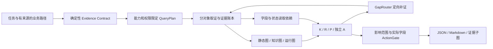

# v8 架构与接口

v8 新增独立契约 Agent，保留原 `AgentTask`、`VerifiedEvidence`、P3 手册检索、P4 日志工具、P5 AgentEngine 和旧 CLI。实际数据读取使用独立运行根，SQLite 复制使用 backup API；P3 的配置路径变化生成了新 generation，复用经 SHA 与配置语义校验的 1,061 个向量。

| 文件 | 责任 |
|---|---|
| `models.py` | 严格任务、路径、权限、契约、绑定、状态、动作与预算类型 |
| `compiler.py` | N4/PFCP、N3/GTP-U、手册操作、日志观察四模板；确定性能力、范围及查询编译 |
| `adapters.py` | 旧工具单对象子任务、结构化 observation、原件 SHA 与路径来源校验 |
| `evaluator.py` | K/R/P/A/C 全量参考规则、实际读取追踪、GapRouter |
| `dependency.py` | NetworkX 四类读取边、可达失效、局部波次、复用检查及全量回退 |
| `graph.py` | Memory/Neo4j 共用语义、有界图计划、参数化 Cypher、历史事实 |
| `builders.py` / `source_graph.py` | 手册块/命令/接口概念、来源拓扑候选、选定日志事件及任务业务域/工具回执构图 |
| `actions.py` | 检查 N4 配置、检查接口状态、复核对端映射；有界影响范围、路径外前置对象及门控 |
| `store.py` / `engine.py` | SQLite revision/批次/幂等回执/共享预算 + LangGraph checkpoint、中断和恢复 |
| `evaluation.py` / `graph_experiment.py` / `scenarios.py` | 独立全量对照、同种子图检索、冻结方法矩阵与结构留出 oracle |

任务 JSON 必须明确对象、授权范围、业务路径来源、版本和带时区的判定时间。结构化取证文件保存在运行根 `data/` 内；其 `path` 包含业务标识、对象顺序、域与映射版本，`observations` 包含对象、类别、实际字段、观察窗、配置版本和用途。完整示例、编译后的契约/计划和 JSON Schema 位于 `examples/v8/`。

K 检查产品、用途、来源、对象、版本及有效期；R 检查实际字段和观察窗，新鲜度默认 300 秒；零与 `false` 是字段值。P 同时取两侧，按业务标识、端点互指、方向归一、半开窗交叠和配置/映射版本逐项核对；中间对象的不同对端记录按配对需求分开绑定。行政边界由来源域映射决定。不同窗口不平均拼接，只按契约声明的交集规则比较。未知时区、身份、版本或单侧观测保持缺口。

权限 A 独立于 K/R/P；动作还核对范围内所有必需状态、状态批次/有效性/待重算标记、当前依据与实际谓词。`suggest_allowed` 只意味着“可提出只读建议”，任务和动作模型均禁止执行授权。门控读取整个传播范围，并支持截断关系、多个路径子区间和路径外前置对象；缺少前置对象契约时转人工。

状态保存原因、支持/反对证据、完整依据、语义版本、批次、有效性与 pending。读取依赖区分字段→状态、状态→状态、状态→动作、字段→动作。逻辑字段槽使用哈希避免标识分隔符碰撞，证据 revision 参与依据比较。每批快照固定，状态码未变但依据变化仍传播；时间推进也会失效。索引缺边回退全量；检测到环采用最多三次稳定检查并保持保守人工处理。独立全量评估不查询被测依赖索引。

三图共用 Neo4j 的 `V8Fact` 与 `V8Relation` 物理模式，逻辑层为 static/knowledge/runtime，namespace 隔离每个实验与任务。历史记录 ID 不覆盖；同 ID 异值写入拒绝。GraphQueryPlan 默认两跳、100 节点、200 边；种子、关系白名单、对象/域、版本、时刻、合成属性、契约 ID 共同约束结果。Cypher 查询结构由受控模板生成，对象和 frontier 值参数化，公共过滤层让两个后端返回同样的排除原因和来源指针。手册提及接口只生成概念关系，不据此证明物理连接。

LLM 只提供可选意图及实验决策头；必需契约、取证计划和 Gate 为确定性规则。`model_enabled=false` 默认能完成完整 Agent 流程；设为 `true` 会请求现有 baseline 服务，并记入共享模型预算。模型配置与权重属于外部依赖。

运行上限为工具 8、模型 8、补证 3 轮、有效执行时间 180 秒。必需补证只选择未尝试且匹配缺口的能力；没有可用能力会正常输出终态。真实工具通过子进程受剩余超时控制，模型 HTTP 使用剩余超时；账本先记预算预留后执行。SQLite 事务提交证据与回执，checkpoint 节点重入使用已提交回执；未提交的不确定回执转人工，避免重复取证。每 run 文件锁排除并发重入；运行根共享锁与快照排他锁保证暂停时可一致备份。恢复校验任务指纹及代码/锁定配置指纹，不能扩权。
