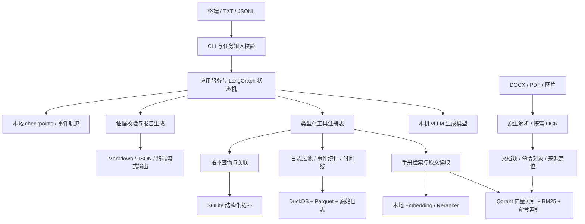
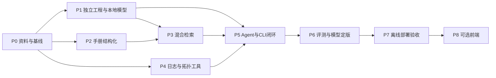

# UPF 本地运维 Agent：脱离 Dify 的迁移实施计划

> 编制日期：2026-09-25。资料根目录：`/home/huangxiaolin/dify`。
> 主文件名：`plan.md`；为兼容此前指定的名称，同步保留相同内容的 `plam.md`。后续以 `plan.md` 为准维护。
> 状态（2026-09-29）：M0/M1 已实测完成；P2 两轮用户复核合计 60 条结构样本及 30 张截图通过，M2 已完成；M3 本地混合检索、引用问答与开发对照已运行；M4 确定性日志/拓扑工具及 M5 有限 Agent/终端闭环的技术出口已通过。P6 的自动化开发对照与资源实测已完成，默认保留2507；真实日志时区/身份/拓扑、P6 人工业务评分与冻结测试、P7 离线部署验收仍待完成。本文的性能门槛和工期是设计预算，实测结果另行记录。

### 实施记录（2026-09-25）

独立工程位于 [`/home/huangxiaolin/upf-agent/`](/home/huangxiaolin/upf-agent/README.md)，不从 Dify 导入运行时代码。P0 已生成 7 份来源文件的哈希与结构清单、35 节点/32 边 DSL 拆解、旧日志函数及 32,539 行日志的旧输出基线、资料缺口说明和 120 个待人工标注的评测名额；关键快照保存在独立工程的 `evidence/p0/`。详见 [`P0_findings.md`](/home/huangxiaolin/upf-agent/docs/P0_findings.md) 和 [`protocol.md`](/home/huangxiaolin/upf-agent/eval/protocol.md)。M0 按本节 P0.1–P0.5 的定义完成；名额不是已审核真值集，实际人工标注与冻结留在 P6.1 前完成。

P1.1 工程/契约/CLI、P1.2 硬件和 BF16 探针、P1.3 基线独立服务的中文/JSON/工具往返实测均完成。P1.4 的 Qwen3.8-27B 已下载并校验 18 个权重分片，在独立 vLLM 的 16K、32K 配置下通过中文、JSON、工具往返和独立思考字段检查；32K 档另通过 20,029 tokens 长上下文末尾校验码测试。P1.5 的本地 embedding/reranker 真实权重 CPU smoke 通过；P1.6 锁定了独立环境、四组模型指纹及 Hugging Face etag/revision 对照。共享 GPU 曾被占用，验收抓住空闲窗口完成，两个自启服务随后关闭并释放显存。M1 已按第9节出口完成；默认主模型的业务质量选择仍待 P6。复现命令与逐项证据见独立工程的 README 和 `evidence/p1/` 快照。

## 1. 目标与已经确定的技术路线

建设一个独立 Python 项目，实现中文 UPF 手册问答、命令查询、日志分析、拓扑关联和有限轮次的 Agent 调查。生成模型、embedding、reranker、OCR、数据库和执行记录全部在本机；资料与推理请求不发送到外部服务。先交付 CLI、TXT/JSONL 批处理和 Markdown/JSON 报告，最后再考虑前端。

确定采用：

| 层次 | 选型 | 决策与作用 |
|---|---|---|
| 目标主生成模型 | **`Qwen/Qwen3.8-27B`，BF16** | 单 A100 部署，承担调查决策、参数抽取和有依据的回答；先通过本机兼容性与业务评测再启用为默认 |
| 首轮基线及回退模型 | **`Qwen/Qwen3-30B-A3B-Instruct-2507`，BF16** | 权重已在本地；先用它贯通整个系统，主模型升级不阻塞迁移 |
| Embedding | **`Qwen/Qwen3-Embedding-4B`，BF16，2560 维** | 本地已有权重；作为新检索方案默认模型 |
| Reranker | **`Qwen/Qwen3-Reranker-4B`，BF16** | 本地已有权重；对候选证据进行查询相关性重排 |
| 检索对照/低资源配置 | `BAAI/bge-m3` + `BAAI/bge-reranker-v2-m3` | 保留已有权重，用于消融实验、CPU/低资源降级；与 Qwen 向量索引分开构建 |
| 推理引擎 | **vLLM，本地 HTTP 接口** | 单卡生成、流式输出、结构化输出；应用层通过 HTTPX 访问 loopback，不绑定云端 SDK |
| Agent 编排 | **LangGraph `StateGraph` + Pydantic 数据契约** | 单主 Agent、确定性工具、证据检查、有限补查、断点恢复；无需托管服务 |
| 文档处理 | **python-docx/lxml；PDF 使用 Docling** | 优先利用原生结构；OCR 只处理图片和缺乏文本层的页面 |
| OCR | **PaddleOCR：`PP-OCRv5_server_det` + `PP-OCRv5_server_rec`** | 中文/英文截图按需识别；先CPU独立进程，确有吞吐需要再安排GPU |
| 向量/关键词检索 | **Qdrant local mode + bm25s + jieba 领域词典 + 精确命令索引** | 一期单进程持久化，应用层融合各路召回；多进程服务化时再换本地 Qdrant server |
| 日志处理 | **Python 解析器、版本化规则、DuckDB/Parquet、Drain3** | 流式解析、事件与时间线分析；Drain3 仅辅助发现未知模板 |
| 状态与元数据 | **SQLite + 本地文件** | 管理资料版本、拓扑表、任务、证据；独立 SQLite 文件保存 LangGraph checkpoints |
| 操作入口 | **Typer + Rich + TXT/JSONL** | 交互、批处理、报告导出；业务逻辑不写死在 CLI 中 |
| 工程工具 | **uv、pytest、Ruff、类型检查** | 独立环境、可复现依赖和工具回归测试 |

**交付标准：从独立目录启动，只挂载明确列出的源资料和模型，在禁止外部网络访问、无法访问 Dify 服务与数据卷的条件下完成测试。** 模型权重、Python wheels、解析器资源可以在准备阶段下载，也可以由另一台机器离线拷入；验收运行阶段必须不依赖互联网。

一期不实施：前端、Dify 可视化编排器复刻、多租户平台、自动修改真实网元、泛化多 Agent 系统、全量 GraphRAG、微调或强化学习。保留扩展接口，但不把这些项目加入当前关键路径。

## 2. 已有资料与业务事实

### 2.1 权威输入与用途

| 输入 | 本次确认的情况 | 迁移用途 |
|---|---|---|
| `upftest.yml` | DSL 0.3.0、advanced-chat；35 个节点、32 条边 | 提取路由、提示词、参数、规则和旧行为基线 |
| `提取自main.pdf` | 论文节选，原文第 42–53 页，共 12 页 | 理解方案与示例；不能代替可执行实现或完整评测集 |
| `5GC网管使用手册_V1.3_20220916(1).docx` | 约 14.5 MB | 网管、告警、配置和操作知识 |
| `UPF 5.0安装部署指导书(新网管版)(1).docx` | 约 17.5 MB | 安装部署、参数、操作步骤和截图 |
| `中国联通5G专网UPF产品使用手册(1).docx` | 约 1.15 MB | 产品与命令、接口配置知识 |
| `中国联通5G专网UPF紧急故障指引0429(1).docx` | 约 0.30 MB | 故障排查、健康检查知识 |
| `upfd_masked.log` | 6,347,974 字节，32,539 行 | 日志工具回归与真实样例测试 |
| `patent-theme-migration-smart-orchestrator/` | 包含既有资料审计，也包含拟议跨域方案 | 审计记录作为交叉检查；拟议方案不视为现有功能，不默认进入业务知识库 |
| `api/`、`web/`、`docker/` | Dify 平台源码和运行部署 | 仅作历史参考；新系统不导入其 Python 模块、不复用其运行数据库 |

知识库输入采用显式白名单，不能递归把整个 `dify/` 当成知识文档。论文属于设计与评测资料，专利草稿属于候选方案，均与产品操作手册分开；`docker/volumes/`、密钥、模型缓存和平台源码不进入检索。

DOCX 的 OOXML 结构盘点如下。媒体条目数不等于需要 OCR 的页面数，文本框也可能带有兼容分支；最终内容必须经过结构去重。

| 手册简称 | 原生表格数/行数 | 媒体条目 | 文本框 |
|---|---:|---:|---:|
| 产品使用手册 | 17 / 108 | 17 | 0 |
| 5GC 网管手册 | 83 / 561 | 313 | 6 |
| 紧急故障指引 | 0 / 0 | 1 | 52 |
| 安装部署指导 | 26 / 202 | 141 | 0 |
| 合计 | **126 / 871** | **472** | **58** |

媒体数统计 ZIP 内 `word/media/` 下的实际文件，排除3个目录条目，因此最终数量为472；不直接使用包含目录项的475条记录数。

尤其是紧急故障指引的 52 个文本框：只读取 `document.paragraphs` 会漏掉其中的命令/输出；对所有 XML 段落重复读取后代文本又会重复索引。文本框提取和去重属于一期必做项，而非可选优化。

### 2.2 原工作流的真实组成

节点统计：1 个开始、1 个问题分类、8 个 LLM、4 个知识检索、4 个代码、2 个迭代、2 个迭代起点、4 个赋值、1 个参数提取、2 个文档提取、6 个回答节点。

8 个 LLM 节点中，7 个配置为火山引擎的 `DeepSeekV3.1`，1 个配置为 `Qwen/Qwen3-32B`；另外的问题分类与参数提取节点也配置了 Qwen。因此当前 YAML 不是全本地模型工作流，云端节点必须整体替换。

| 原业务 | 已实现的处理 | 新系统保留与调整 |
|---|---|---|
| MML 查询 | 生成最多 3 个检索词、逐项检索、累积证据、生成回答 | 保留意图，改为原始命令精确召回 + 受限扩展查询 + 证据去重 |
| CLI/VPP 查询 | 同类查询扩展和迭代检索 | 增加产品、命令族和版本过滤；不同命令体系不混用 |
| 产品概念 | 知识检索与回答 | 走短路径，通常一次检索即可，不强制多轮 Agent |
| 健康/故障分析 | 提取时间/UPF、读取日志及拓扑、分类计数、检索与解释 | 改为事件级证据、时间线、发生/恢复关联与有限补查 |
| 网管查询 | 提取 user_id/interface_name/neid 并返回 JSON | 当前无独立 HTTP/工具调用节点；一期返回明确的“数据源未接入”，不伪装实时查询 |
| 其他 | 通用模型回答 | 缩小为项目范围内解释；与基于手册的确定回答分开标注 |

4 个知识检索节点配置了 BGE-M3、向量/关键词权重 0.7/0.3、top_k=4。配置中的 `weighted_score` 是检索结果加权方式，不能当作已经使用了独立交叉编码器重排序。DSL 中的 4 个知识库引用不包含完整文档、分段和向量索引；它们与四份 DOCX 并没有经过逐库完整性验证。

### 2.3 必须修正的问题

| ID | 当前问题及证据 | 迁移要求 |
|---|---|---|
| F01 | `upftest.yml:504` 起的 start 输入把日志设为全局必填 | 普通问答不需要日志；诊断任务才校验日志或粘贴输入 |
| F02 | `upftest.yml:939` 提示词允许把 N 接口编号当作可任意替换参数 | 删除该泛化；命令、接口语义必须有对应产品文档证据 |
| F03 | `upftest.yml:1491` 起的时间提取限定日期，温度 0.7 | 保留秒/小数秒/时区；确定性校验，缺失时追问或说明采用的范围 |
| F04 | 接收 PFCP 心跳请求被归为节点不可达 | 将“收到心跳”“上报告警”“告警解除”分成独立事件类型 |
| F05 | `Clear license not installed alarm` 被归为许可证告警 | 明确 `raised/cleared/observed/unknown` 状态 |
| F06 | FAR 切换规则要求十六进制或纯数字，脱敏标记不匹配 | 同时支持真实字段与脱敏占位符；未知值不作为实体关联依据 |
| F07 | 解析器丢弃无时间戳行；只保存时间和原文 | 支持多行记录、孤立行和解析错误隔离，保留字节偏移与行号 |
| F08 | 日期结束时间取 23:59:59 | 统一采用半开时间区间，整日使用 `[当日00:00, 次日00:00)` |
| F09 | 类别包含 GTP-U/PFCP 就查询拓扑，包含正常事件 | 按异常证据和用户调查目的选择拓扑查询，不能把协议出现当作故障 |
| F10 | 拓扑来自固定列 Markdown 表；N3/N4 整行子串匹配 | 直接读 XLSX/CSV，显式字段映射和接口枚举；避免 N3 匹配 N30 |
| F11 | `rag_mem` 与最终文本缺少统一证据标识、版本与时效 | 以结构化 Evidence 对象保存；检索证据按任务隔离并设数量上限 |

本次仅用原有纯 Python 规则复跑日志，不调用模型，得到：

- 32,539 行均被当前时间格式识别；未分类 25,979 行，占 79.84%。这表示规则覆盖有限，不等于 79.84% 的日志异常。
- 旧规则的“PFCP 节点不可达”共 37 条，其中 23 条实际为接收心跳请求，14 条匹配不可达上报。
- 旧规则的“许可证未安装告警”11 条实际匹配告警解除。
- 发现 3,238 条 FAR 切换格式样本，旧 FAR 规则没有命中；脱敏字段与正则不兼容是可定位的原因。
- 日志覆盖 2025-05-14 16:07:17.926985 至 2025-07-12 16:59:07.069077，发现 1 处相邻记录时间逆序。时间解析和乱序处理需真实样本回归。

上述统计是旧行为的对照，不是根因标签。修复后计数应有意改变，不能以“必须等于旧结果”作为正确性要求。

此外，旧代码将“没有日志记录”“窗口无数据”“起止时间颠倒”都压缩成空结果。新接口分别返回 `empty_input、no_data_in_window、invalid_time_range`，不能用“没有检测到故障”掩盖无效输入。

### 2.4 资料缺口与处理方式

1. **命令参考可能不全。** 论文出现的部分命令在四份 DOCX 原生文本中未检出，截图尚需 OCR 核对。先生成“命令—原文定位—缺口”清单；缺资料问题进入拒答测试，不能补造语法。
2. **未确认可用的真实拓扑文件。** 一期支持没有拓扑的日志诊断；用明确标注的合成 XLSX/CSV 验证解析和匹配，真实拓扑验收单独标记待补。
3. **没有完整实验真值集。** 从原始资料建立独立标注集，不把论文中的定性对比直接变成新系统分数。
4. **没有网管接口契约和可用性证据。** 仅预留只读数据源适配器；真实接入不阻塞手册和日志链路。
5. **现有 Dify 知识库分段未核对。** 优先从权威源文件重建；如后续需迁移额外知识，只做一次性可审计导出，独立系统不直接查询旧库。

## 3. 本机硬件与运行条件

### 3.1 2026-09-25 的只读检测快照

| 项目 | 结果 | 设计影响 |
|---|---|---|
| 主机/系统 | node01；Linux 5.19；Ubuntu 22.04 系内核 | 新项目单独环境，不改系统 Python |
| CPU | 2 × Xeon Silver 4310，24 物理核/48 线程，2 个 NUMA 节点 | 文档解析、关键词检索和日志计算可在 CPU 执行 |
| 内存 | 总量约 251 GiB，可用约 229 GiB | 足够本地索引与日志处理，但仍采用流式方案 |
| GPU | 2 × NVIDIA A100 80GB PCIe；各 81920 MiB | 单卡放生成模型，另一卡放检索模型 |
| GPU 互联 | `nvidia-smi topo -m` 显示 SYS，无 NVLink 连接 | 不默认双卡张量并行；避免跨 NUMA 通信成本 |
| 驱动 | 535.183.06 | CUDA/内核兼容必须验证；不直接升级共享主机驱动 |
| GPU 当前占用 | 两卡各约 2.3 GiB，存在其他用户任务 | 快照不代表可独占；启动前重新检查，不终止其他任务 |
| `/home` | 机械盘 ext4，约 15T，总剩余约 1.6T，已用 89% | 原始资料、权重与归档放这里；控制缓存和重复副本 |
| `/` | NVMe，剩余约 380G | 可评估放热索引/临时解析缓存；需设容量配额与清理策略 |
| Python/工具 | 系统 Python 3.10.6；uv、Docker、pdfinfo、pdftotext、LibreOffice 可用 | 能开展独立环境与文档处理 |
| 现有服务 | Dify Docker 服务仍运行；127.0.0.1:8000 有模型列表接口 | 新系统使用独立端口和数据目录，不改旧服务 |
| 本地请求环境 | 设置了 HTTP(S)/ALL_PROXY，未设置 NO_PROXY | 本地 HTTPX 客户端 `trust_env=False`；显式 loopback 防止请求误走代理 |

### 3.2 已有权重和环境

本次检查了权重文件大小，并对有 index.json 的目录确认所列 shard 均存在；尚未逐文件校验哈希，也未确认所有权重都能成功加载。

| 本地目录（均位于 `/home/huangxiaolin/models/`） | 权重文件大小 | 用途 |
|---|---:|---|
| `Qwen3-30B-A3B-Instruct-2507` | 56.87 GiB | 迁移基线和回退 |
| `Qwen3-32B` | 61.02 GiB | 必要时用于论文相关对照，不常驻 |
| `Qwen3-Embedding-4B` | 7.49 GiB | 默认 embedding |
| `Qwen3-Reranker-4B` | 7.49 GiB | 默认 reranker |
| `BGE-M3` | 2.12 GiB | 对照及低资源检索 |
| `bge-reranker-v2-m3` | 2.12 GiB | 对照及低资源重排 |

`127.0.0.1:8000/v1/models` 可直连并报告 `Qwen3-30B-A3B-Instruct-2507`、32768 上下文。对应进程使用 `/home/huangxiaolin/AITO/` 环境：vLLM 0.8.5.post1、Torch 2.6.0+cu124、Transformers 4.51.3。**这里只验证了元数据接口，不表示推理健康或 GPU 资源已经可用；新项目不依赖该环境。**

另有 `/home/huangxiaolin/dify_vllm` 和 `dify_vllm_uv310`：vLLM 0.19.1、Torch 2.10.0+cu128；Transformers 分别为 5.5.4、5.6.2。它们可供复现环境参考，不原地升级。

### 3.3 GPU、内存与磁盘预算

默认规划两卡可按需使用、与其他任务错峰；这只是资源配置假设，并非承诺长期独占。若实际只允许一张卡，启用下表降级模式。

| 资源 | 默认分配 | 初始控制 |
|---|---|---|
| GPU 0 | 单个生成模型，目标 Qwen3.8-27B；基线模型按需替换 | TP=1；BF16；先 16K 上下文、并发 1，验证后升至 32K/并发 2 |
| GPU 1 | Qwen embedding + reranker，按需 OCR | 两检索模型纯权重约 15 GiB；计入激活与批次后先预算 24–32 GiB |
| CPU | 文档结构解析、BM25、DuckDB、拓扑、编排 | 起步 8 个解析 worker 上限；按实际内存和 GPU 队列收敛 |
| RAM | 程序、索引、解析缓冲 | 起步设应用数据处理预算 32 GiB；禁止日志无限列表化 |
| 持久磁盘 | 已有权重、新增主模型、语料、索引、报告 | 额外预留 150–200 GiB，含新权重约 56 GB、下载暂存及环境 |
| NVMe 缓存 | 可选 `/var/tmp/upf-agent-<用户>/` | 最多约 50 GiB；能重建，重要数据仍在持久目录 |

显存估计只作可行性判断：Qwen3.8-27B 官方 BF16 文件约 55.6 GB，约 51.8 GiB；运行时还需要激活、工作区、CUDA graph、完整注意力 KV 和线性注意力状态。不能把文件大小当成总显存。

现有 Qwen3-30B-A3B 的普通 BF16 KV 粗算：`48层 × 2(K/V) × 4 KV头 × 128维 × 2字节 × token数`，单条 32K 序列约 3 GiB，仅用于说明上下文成本；MoE 的 3.3B 激活参数不代表只加载 3.3B 权重。vLLM 的实际预分配和峰值必须实测。

初始 `gpu_memory_utilization` 可从 0.85 评估，**它不是 GPU 配额隔离**；其他任务可能增长时不能据此保证安全共存。启动检查要结合其他进程占用、可用余量和实际峰值。资源不足时排队或切换配置，不自动杀进程。

单卡降级：生成保持单卡；检索先采用 BGE-M3 + bge-reranker-v2-m3 的 CPU 配置，或在独立低负载窗口预建索引；必要时启用本地已有 `Qwen/Qwen3-14B` 的独立评测配置。降级必须在输出元数据标明模型和检索配置，不静默替换。

## 4. 模型选择、运行兼容与升级门槛

### 4.1 为什么选择这组模型

截至调研日，官方已发布 Qwen3.8-27B。选择它作为目标主模型，依据是可本地部署的规模、中文/工具使用的适用方向、可控思考模式，以及单 A100 BF16 的显存预算；这些是选型依据，**尚不能证明它在本项目优于现有模型**。[官方模型卡](https://huggingface.co/Qwen/Qwen3.8-27B)

| 候选 | 取舍 |
|---|---|
| Qwen3.8-27B BF16 | 目标主模型；需要新下载和兼容测试，优先验证中文证据回答与工具参数 |
| Qwen3-30B-A3B-Instruct-2507 BF16 | 首个可交付版本的基线；本地已有权重，非思考模式，工程风险较低；吞吐是否更好须实测 |
| Qwen3-32B BF16 | 本地已有，适合有限对照；纯权重比上述两者大，不作为额外常驻模型 |
| Qwen3.5/3.6 的 27B、35B-A3B | 有部署价值，但不同时铺开测试多个相近型号；仅在 3.8 兼容或质量不通过时考虑 27B 替代 |
| 更大完整 MoE / 70B 以上 BF16 | 会挤占两卡和检索服务预算，不作为本机第一版路线；激活参数小不等于权重占用小 |
| 强压缩 FP8/NVFP4 配置 | 官方部分 recipe 针对更新 GPU；A100 首版选择 BF16，不直接照搬 Blackwell 的低精度配置 |

Qwen3-30B-A3B-Instruct-2507 为非思考模型，不能套用 Qwen3.8 的思考控制参数。[官方模型卡](https://huggingface.co/Qwen/Qwen3-30B-A3B-Instruct-2507)

Qwen3-Embedding-4B 支持指令化检索和最高 2560 维向量；本机已有 4B 权重，先采用完整维度，避免一开始引入压缩变量。查询使用固定任务指令，文档使用文档格式；二者不能误用同一前缀。[官方模型卡](https://huggingface.co/Qwen/Qwen3-Embedding-4B)

Qwen3-Reranker-4B 按官方查询—文档模板计算相关性；适配器使用对应 yes/no logits 评分路径，不把它当 embedding，也不让它自由生成解释后再解析分数。候选段落和批次有长度上限，模板和评分实现进入版本记录。[官方模型卡](https://huggingface.co/Qwen/Qwen3-Reranker-4B)

本地 reranker 目录带有 Sentence Transformers 5.4.0 的 `LogitScore` 模块配置。首版采用官方 `AutoModelForCausalLM` 评分实现，避免旧版 CrossEncoder 将它误加载为普通分类头；若使用 ST 5.4.0，必须验证其原始 logit 差与概率输出的关系：`p_yes = sigmoid(logit_yes - logit_no)`。禁止把原始分数与概率共用阈值，或重复做 Sigmoid。token ID 从实际 tokenizer 取得；左侧 padding、模板后缀和指令版本一并锁定。

OCR 明确选 PP-OCRv5 的 server 检测/识别组合，而不是运行时跟随 PaddleOCR 默认模型。使用显式本地路径，初版关闭方向分类、文档矫正等非必需模块；如样本需要旋转纠正，再把对应模型加入资产清单。已调研到更新 OCR 系列，但当前主要输入是原生 DOCX，优先把文本框、表格和截图定位处理正确，再以同一截图样本比较升级收益。[PaddleOCR 官方用法与模型配置](https://www.paddleocr.ai/main/en/version3.x/pipeline_usage/OCR.html)

### 4.2 环境和兼容验证决策

应用环境采用 Python 3.11 + uv。GPU 推理使用独立环境/独立进程，与文档解析、检索模型环境分开锁定，避免 OCR、vLLM 与 Transformers 互相升级依赖。

- 现有 vLLM 0.8.5.post1 仅供旧环境参考，不承担 Qwen3.8 目标部署。
- 新推理环境的**首轮兼容候选**为 vLLM 0.19.1、Torch 2.10.0+cu128、Transformers 5.8.0。这里复用的是已安装版本的经验，不是已经通过测试的组合；先解析依赖，再执行 P1 的 GPU/模型/工具调用测试。
- Qwen3.8 的官方 vLLM recipe 给出 Transformers ≥5.8.0 和 `qwen3_xml` 工具解析器等要求；A100 BF16 方案由本计划单独验证，不能套用 recipe 中其他硬件的性能数据。[官方 recipe](https://recipes.vllm.ai/Qwen/Qwen3.8-27B)
- 如果候选组合的依赖、架构或 GPU 内核不通过，先在隔离环境选择支持该架构的稳定版本重新验证；两天内仍不通过，则以已有 2507 模型继续业务迁移，将 3.8 升级独立排期。
- CUDA 12 的小版本兼容规则并不能保证所有新 PTX/JIT 内核都能在 535 驱动上工作。需要实际 BF16 运算、注意力/混合注意力和 MoE 加载测试；不能仅凭 `nvidia-smi` 显示的 CUDA 字样作结论。[NVIDIA 兼容说明](https://docs.nvidia.com/deploy/cuda-compatibility/minor-version-compatibility.html)
- 不把系统驱动升级作为默认步骤。如果测试明确需要改变共享驱动，记录失败证据、影响范围和替代路径，再单独安排主机维护；当前计划不执行这类变更。

P1 通过后写入 `uv.lock`、独立推理环境锁文件、模型 revision/hash 清单及启动参数。其他库的精确补丁版本在依赖解析和 smoke test 后锁定，不把未经组合验证的“最新版”写成已经确定可运行的事实。

### 4.3 推理行为

- 初版用结构化 `Action` schema 调用工具：工具名枚举、严格类型参数、可选 `need_user_input` 或 `finish` 状态。模型输出必须由 Pydantic 验证，解析失败最多修复一次。
- 后端优先支持原生工具调用；若模型 parser 与 chat template 不兼容，使用同一 Action schema 的受约束 JSON 模式，不退回任意文本执行。
- 参数抽取采用低温度/确定性配置；普通回答与诊断分别保存采样配置，调优只用开发集。
- Qwen3.8 日常路由/抽取先关闭思考；复杂诊断评测有限预算的 low 模式。验证长上下文工具调用、空答案、预算耗尽和思考内容混入正文等情况。
- 默认最终回答预算约 2K tokens；复杂诊断总 completion 预算可到 4K，包含推理消耗，达到上限必须返回可识别状态。
- 模型最大上下文从 16K 提升至 32K需要单独压测；手册证据通常控制在约 6–8K，工具摘要约 2–4K。不为整份日志启用超长上下文。

### 4.4 主模型切换门槛

先固定数据与检索，再比较 2507 和 3.8；不能同时换模型、分段和提示词后归因于模型升级。

主模型升为默认须同时满足：本机连续测试无 OOM/崩溃；工具参数测试达到第 11 节门槛；冻结测试集回答质量不低于基线；至少在证据完整性、命令准确性或复杂诊断之一有可解释收益；时延符合 CLI 预算。若结果无明显收益或代价过高，2507 保持默认，保留 3.8 实验配置。

## 5. 整体系统架构



### 5.1 各模块的职责

| 模块 | 职责 | 关键边界 |
|---|---|---|
| `cli` | 输入问题、选择文件、继续会话、显示进度 | 不包含检索和诊断业务实现 |
| `application` | 问答、导入、诊断、批处理用例 | 以后 FastAPI/前端复用这层 |
| `agent` | 判断任务、调查计划、工具选择、补查、结束 | 单主 Agent；显式状态和预算，模型无任意 shell 能力 |
| `models` | 本地生成/embedding/reranker/OCR 适配 | 模型路径、模板和配置独立；只能访问配置的本机端点 |
| `ingestion` | 文档结构、图片、元数据、版本化与增量更新 | 原文保存不改写，机器生成内容与原文区别记录 |
| `retrieval` | 精确/BM25/向量召回、融合、重排与上下文组装 | 产品/版本过滤一致；保留证据来源 |
| `logs` | 解析、分类、聚合、时序关联、模板发现 | 数值由代码计算，保留正常事件和未知事件 |
| `topology` | XLSX/CSV 导入、实体标识、接口与路径查询 | 缺失或脱敏不可关联时说明，不猜实际端口 |
| `evidence` | 引用解析、来源校验、命令支持关系 | 证据存在可自动检查；结论是否被支持还需评测/复核 |
| `storage` | 元数据、模型/索引版本、任务与持久化 | 应用 SQLite、checkpoint SQLite、DuckDB 职责分开 |
| `evaluation` | 基线、消融、回归、资源与延迟测量 | 人工真值为主，模型评分只能辅助 |

LangGraph 的状态管理与恢复能力可在本地进程中使用，本方案不依赖 LangSmith 或托管 Agent 服务。[官方文档](https://docs.langchain.com/oss/python/langgraph/overview)

### 5.2 Agent 范式和状态流转

采用“确定性主流程 + 有限自主调查”，不是固定复制 35 个节点，也不是开放式无上限 ReAct。

```text
validate_input → classify_task → resolve_entities_and_time
  ├─ 简单手册问答：retrieve → verify_evidence → answer
  ├─ 日志诊断：parse/index → summarize_events → plan_investigation
  │              → execute_tools → verify_evidence
  │                   ├─ 有明确缺口且有预算：replan → execute_tools
  │                   ├─ 缺少用户输入：await_input → resume
  │                   └─ 证据足够/预算耗尽：answer_with_limits
  └─ 未接入数据源：明确返回缺失项及可完成的部分
```

`AgentState` 至少保存：`run_id、task_type、question、attachments、product/version、entities、time_window、plan_steps、tool_results、evidence_ids、open_questions、budget、status`。会话摘要只保存任务事实和已确认参数，不能作为原始证据。

输入校验、数值统计、引用解析和工具权限检查是代码节点；调查规划、查询改写、证据解释是模型节点；“证据不足/预算用完/缺用户输入”是显式条件边。LangGraph 的 `recursion_limit` 只作最后保护，不能代替业务轮数和工具数计数。

初始限制：最多 3 轮调查、8 次工具调用、一次参数修复；重复的工具名+参数+数据版本命中缓存；工具失败最多重试一次且返回类型化错误。任务总超时默认 180 秒（不含首次文档导入/模型启动），到期输出已获证据和未完成项。后续根据开发集调节。

工具集合：

| 工具 | 输入 | 输出与限制 |
|---|---|---|
| `search_manual` | query、产品/版本、命令族、top_k | Evidence 列表，最多返回约定数量 |
| `read_manual_block` | source_id、block_id、邻接范围 | 可定位原文；不接受任意文件路径 |
| `analyze_log_window` | log_id、时间区间、设备 | 事件计数、状态、分桶趋势、代表样本 |
| `find_log_events` | 协议/实体/事件过滤、limit | 精确行号、片段与事件字段 |
| `read_log_context` | event_id、上下文行数 | 限长原文，避免把全日志送入模型 |
| `lookup_topology` | 设备、接口、时刻 | 端点、端口、来源行、有效性；缺失明确返回 |
| `compare_evidence` | evidence_ids、待核对字段 | 用代码比较计数、版本、时窗与标识；不虚构因果关系 |

模型可提出假设和下一步查询，但不能把自身猜测登记为“已证实事件”。报告区分“观测事实、候选原因、支持/反对证据、缺失信息、建议检查”。一期只给出建议，不执行网元变更。

### 5.3 从项目开始就固定的数据契约

P1.1 定义以下 schema；P2/P3/P4 按契约独立实现，P5 只负责接入，避免等到 Agent 阶段再统一数据格式。

| 对象 | 必须包含的字段/语义 |
|---|---|
| `TaskSpec` | 问题、任务类型、已登记附件、产品/版本、设备、时间范围与来源、交互/批处理模式 |
| `DocumentBlock` | 原始文本、规范化文本、章节、结构类型、父块、原文定位、提取方式与质量标记 |
| `CommandRecord` | 命令族、原始语法、参数块、前提条件、示例、版本和来源；未知字段不补造 |
| `Evidence` | evidence_id、source_id/hash、定位、证据类型、时间/版本适用性、生成它的工具版本 |
| `ToolResult` | status、结构化数据、evidence_ids、warnings、elapsed_ms；空结果与失败区别表达 |
| `TopologyEdge` | 两侧设备/端口、接口类型、快照/有效时间、表格来源；不确定映射单独标记 |
| `AnswerReport` | 状态、事实、候选解释、支持/反对证据、缺口、建议、模型与数据版本 |

工具只接受 source_id/evidence_id 和业务筛选参数。手册、日志、OCR 文本中的命令或指令均是待分析数据，不会改变工具白名单，也不会授权执行操作。

## 6. 手册知识工程与检索

### 6.1 文档处理流水线

1. 显式选择文件，计算 SHA-256，登记产品/版本、资料类型、语言及导入时间；产品版本未知时记录 unknown，不以文件修改时间推断。
2. DOCX 用 python-docx 1.2 系列/lxml 按真实 XML 顺序读取段落、表格、标题和图片关系；处理合并格、嵌套表格、列表、超链接和文本框。读取 `styles.xml` 的样式名称/outline level，不能硬编码 heading style ID；`AlternateContent` 的 Choice/Fallback 只取适用分支，每个文本节点只归属一次。先原生抽取，避免全量转图片再 OCR。
3. PDF 用 Docling 本地 standard pipeline 保存文本块、表格、页面和边界框；默认 `do_ocr=False`、`enable_remote_services=False`，预备所需布局/表格资产，有可靠文本层先用文本层。缺文本页再交给显式配置的 OCR 分支。论文作为设计资料单独保存。
4. 图片保留原文件和上下文标题；只有包含必要命令、参数或步骤的图片进入 OCR 处理队列。纯装饰图和重复截图不重复识别。
5. 命令、配置、参数表和步骤建立关联对象；每个派生块保留到原文的定位关系。
6. 生成结构检查报告：空文本、异常编码、缺标题、跨表头、OCR 未确认字段、重复内容、命令参考缺口。
7. 构建新一代索引后完成校验，再把 manifest 指向新版本；失败保留旧索引。

DOCX 不存在稳定的原生页码，引用以“文件+章节+段落/表格/单元格”为准。如为了核对而生成 PDF，应标记为渲染副本页码，保存其哈希，不能冒充原始 Word 固定页码。

网管手册同时包含 UDM/SMF/AMF/NRF/PCF 等内容，UPF 问题须做网元域过滤；目录、页眉页脚与正文分别标记，避免目录命中替代有效正文。紧急指引以“现象—信息收集—解决办法”作为父块，避免取到操作命令却遗漏其适用前提。Word 按序遍历接口与 Docling 离线资源配置分别参考[python-docx 文档](https://python-docx.readthedocs.io/en/latest/api/document.html)、[Docling 高级配置](https://docling-project.github.io/docling/usage/advanced_options/)。

### 6.1.1 OCR 的完成标准

先选取不少于 30 张有信息价值的截图，覆盖网管表格、命令行和参数界面。输出文字、置信分数、边框、图片hash与上下文章节；提取置信分数只是复核线索，不代表命令正确率。

人工核对命令中的大小写、冒号、等号、连字符、下划线、I/l/1、O/0及端口/IP等字符。无法确认的字段标记 `ocr_unverified`，不得成为确定性命令建议的唯一依据。OCR未通过只会使对应截图保留缺口，不能阻塞已正确解析的原生文本或日志链路。

### 6.2 切分与命令对象

- 普通说明初始按 400–800 tokens 的子块切分，所属章节作 parent；按语义边界截断，不机械切断句子。
- 一个命令的语法、参数说明、适用条件和示例以 `command_id` 关联；很长时拆成多个子块，查询时可补取父块和参数表。
- 表格按行组切分时带表头和表标题；合并单元格显式传播语义，保存原始行列坐标。
- 配置代码保留换行、缩进、大小写、标点与占位符；不做自动“拼写纠正”。
- 保留 `section_path、source_id、source_sha256、block_id、block_type、parent_id、product、version、interface、command_family、extraction_method`。
- 产品、版本未知的资料允许检索，但回答须保留适用性不确定；用户指定版本时禁止混入已知不兼容版本。

### 6.3 检索执行

1. 解析 query 中的命令名、参数、告警码、设备与版本。保留原始 query；最多产生 2 个附加查询，不改写精确标识。
2. 并行检索：精确命令索引、中文/技术词 BM25、Qwen embedding 向量。Dense 和 BM25 起步各取 20 个候选。
3. BM25 使用版本化 jieba 领域词典，同时抽取完整 MML/CLI token、IP、十六进制标识和参数名；不能直接用英语空格分词。
4. 按统一 `chunk_id` 去重，应用层 RRF 融合；初始 `k=60`，不是直接把不同量纲分数按 0.7/0.3 相加。
5. 精确命令命中优先保留，并将相关参数块纳入候选；错误产品/版本不得因分数高而进入答案。
6. Qwen reranker 重排约 20–40 个候选，保留 6–8 个证据块，再按预算补取所属章节上下文。
7. 回答前校验检索覆盖与冲突；无相应命令语法或参数证据时返回缺口，不能仅根据语义相近命令推导。

索引 manifest 保存 embedding ID/revision、维度、归一化方法、查询指令版本、解析/切分版本和语料哈希。BGE 1024 维与 Qwen 2560 维分属不同 collection，不混用。更换任一关键配置需要重建或明确的增量迁移。

Qdrant local mode 适用于一期串行 CLI；一个进程拥有索引，导入和问答互斥。后续多 CLI 并发/服务化，先切本地 Qdrant server，不让多个进程同时打开同一路径。[Qdrant 客户端说明](https://github.com/qdrant/qdrant-client)

## 7. 日志与拓扑处理

### 7.1 结构化事件

```text
LogEvent:
  event_id, source_id, source_sha256, line_start, line_end, byte_offset
  timestamp_original, timestamp_utc, timezone_status
  device_id, protocol, event_type, event_state, severity
  peer_ip, seid, teid, imsi, interface, port
  template_id, rule_id, parser_version, classification_basis
  raw_excerpt, parse_status, masked_fields
```

时区缺失时不能擅自假定生产设备使用服务器时区。导入参数可显式指定时区，记录来源；未知时区下限制跨数据源绝对时间关联。持续使用半开时间区间，输出明确的时间边界。

所有输入行都进入已解析事件、续行或异常隔离记录之一，不能静默丢弃。脱敏的 IMSI/SEID 等字段记录为 unknown/masked；同一个占位字符串不能被当成同一真实会话。

### 7.2 解析、分类、关联

1. 按块读取文件，记录 offset/行号；大日志无需全部载入并排序。
2. 对相邻续行建立同一事件；未归属行进入 quarantine，能回查原文。
3. 用预编译、版本化规则提取字段和事件语义；规则测试覆盖实际日志和明确标注的合成边界样例。
4. 把时间分区后的事件写入 Parquet；DuckDB 做筛选、分桶、计数和关联，SQL 由程序模板构造，不执行模型生成的任意 SQL。
5. 区分正常心跳、告警发生、解除、会话删除、切换、启动等。处理乱序、重复输入与截断日志，关联状态可为“不完整”。
6. 对异常事件按协议、真实设备/peer、时间窗口、会话标识等建立候选关联；字段不足则降低结论范围。
7. 代表样本选择包括首条、末条、峰值附近和不同实体样本；统计输出带 count、分母、范围和过滤条件。
8. 对未分类事件用 Drain3 发现模板，冻结模板快照用于回放；模板新颖不等于异常。规则新增须复核后版本化，不由模型自动改生产规则。

Drain3 训练阶段会更新模板，设置最大簇数时还会发生 LRU 淘汰。推理和评测必须使用冻结的匹配模式，保存 snapshot hash、掩码配置和版本；不能把模板被淘汰后重新出现当作新故障。[作者仓库](https://github.com/logpai/Drain3)

保留厂商原始日志级别 `severity_raw`，另设经规则解释的业务严重性；不把文本出现 FATAL/ERROR 直接等同于业务故障。GTP-U 两种各120条消息先按“消息条数”报告，是否代表120或240个独立故障必须有实体和时间去重依据。

### 7.3 拓扑

原生支持 XLSX/CSV；首轮必须定义字段映射配置，包含：`device_id、device_port、peer_device_id、peer_port、interface_type、vlan、purpose、valid_from/to、source_sheet/row`。

合并单元格只在明确分组范围内向下填充，跨表/跨设备不继承。设备别名经显式 alias 表归一化，接口类型按 token/枚举匹配，不能整行子串匹配。拓扑无版本时输出“适用时点未知”。

只得到 UPF 与交换机端口关联时，只能表述“相关链路/检查对象”；不能声称已验证端到端故障传播。跨 RAN/传输/核心网图谱是后续扩展，需真实数据再启动。

## 8. 持久化、离线运行与工程目录

### 8.1 建议独立目录

新项目建议创建在 `/home/huangxiaolin/upf-agent/`，而不是在 Dify 的 `api/` 或 `web/` 内开发。该独立目录已创建，当前实现进度见各阶段执行状态。

```text
upf-agent/
  pyproject.toml / uv.lock
  config/
    default.yaml / models.yaml / logging.yaml
    corpus.yaml / topology_columns.yaml / telecom_dictionary.txt
  src/upf_agent/
    cli/ application/ agent/ models/ ingestion/ retrieval/
    logs/ topology/ evidence/ storage/ evaluation/
  rules/                     # 已复核事件分类规则与schema
  prompts/                   # 路由、查询、诊断、回答及版本
  tests/
    unit/ integration/ offline/ fixtures/
  eval/
    dev.jsonl / test.jsonl / labels/ manifests/
  data/
    raw/ parsed/ quarantine/ indexes/ events/ metadata/
  runs/<run_id>/              # report.md/json、证据、工具轨迹、指标
  deploy/                    # 独立本地模型启动/健康检查配置
  assets-manifest.json        # 模型、解析器资源、字体等离线资产
  environment-lock/           # 独立推理/检索/OCR环境锁定记录
```

原始数据以显式复制并校验哈希，或采用受控只读资料目录；验收时只能挂载资料清单中的文件，不能依赖整个 Dify 目录树。模型路径可复用 `/home/huangxiaolin/models/`，复用权重不等于依赖 Dify。

### 8.2 离线资产与请求约束

- 模型资产不仅是 safetensors，还包括 config、tokenizer、chat template、词表、generation config、pooling/normalization 配置和必要代码；逐项记录 revision/hash。
- 解析器的布局/表格/OCR权重、字典、字体和 PDF 渲染依赖提前准备。缺资产立即报错，不自动联网补下载。
- 使用本地路径与 `local_files_only`；设置 `HF_HUB_OFFLINE=1`、`HF_HUB_DISABLE_TELEMETRY=1`，关闭 LangSmith tracing、Docling 远程服务及 vLLM 统计上报。
- 本地 HTTP 客户端禁用环境代理；生成端点默认 `127.0.0.1:18000`，避免占用已有 8000。Embedding/reranker 初版可在专用本地 worker 中直接调用，CLI 同步等候；该 worker 不持有 Qdrant 文件。
- 检索模型 worker 初版采用受应用管理的长驻子进程，以 JSONL stdin/stdout 传递 request_id、文本批次和结果，stderr 写运行日志；使用独立解释器加载 Torch，应用进程持有 Qdrant/SQLite。协议规定长度、批次、超时和异常，不需要为了CLI引入额外Web服务。
- 默认绑定 loopback，工具只访问任务登记的 source_id，不提供任意 URL 抓取和任意路径读取能力。
- 网络隔离验收采用隔离进程/容器的网络策略允许 loopback、阻止外联；不修改共享主机全局防火墙。仅设置 offline 环境变量不算网络隔离验收。
- 关闭遥测的具体配置在锁定版本上验证；vLLM 提供 `VLLM_NO_USAGE_STATS`/`DO_NOT_TRACK`。[官方说明](https://docs.vllm.ai/en/v0.18.0/usage/usage_stats/)

### 8.3 可恢复与可回滚

导入任务以 source_hash + parser_version + index_config 为幂等键。构建临时索引 generation，在文档元数据、BM25、向量和精确索引都完成校验后才原子发布 manifest；失败不覆盖旧索引。应用启动核对索引配置和模型配置一致性。

LangGraph checkpoint 保存任务状态和证据 ID，不重复存放整个日志。工具重放依赖只读操作和缓存键，避免恢复时重复导入或重复统计写入。每次报告保存模型/规则/语料/索引版本及输入哈希。

备份 SQLite 前使用一致性备份方式；Parquet 和索引按 generation 归档，保留上一可用版本。没有需要停掉旧 Dify 的技术依赖；最终验证通过之后是否退役旧部署另行安排。

## 9. 实施顺序与详细任务

任务粒度按能独立检查的交付物划分。人日为熟悉 Python/LLM 的一位开发者有效工作量，不含等待大模型下载、资料补充和共享 GPU 排队。



### P0：冻结资料、确认缺口和建立基线（2–3 人日）

| 子任务 | 前置 | 操作与交付物 | 完成效果/验收 |
|---|---|---|---|
| P0.1 资产登记 | 无 | 原始文件 manifest、哈希、硬件/服务快照、模型 shard 清单 | 每份输入可追溯；不把平台源码与拟议专利当业务资料 |
| P0.2 DSL 拆解 | P0.1 | 导出节点映射、prompt、规则、模型与知识库引用清单 | 35 节点有去向，云调用替换范围明确 |
| P0.3 旧工具基线 | P0.2 | 将纯 Python 日志函数隔离为 legacy reference，保存本日志聚合结果 | 能复现旧统计；已知错误单独标记，避免锁死错误行为 |
| P0.4 文档/拓扑缺口 | P0.1 | 命令—资料映射、图片/表格抽样、缺失拓扑和网管接口清单 | 区分“有文件”与“覆盖完整”；缺口不阻塞其他链路 |
| P0.5 评测协议 | P0.2–P0.4 | 120 题标注计划、开发/测试划分、工具边界用例清单 | 先规定对错和证据，再调模型；冻结测试集 |

阶段出口 M0：有可追溯资料清单、旧行为基线和明确缺口，不需要启动 Dify 才能阅读业务定义。

### P1：独立工程与本地推理底座（3–4 人日）

| 子任务 | 前置 | 操作与交付物 | 完成效果/验收 |
|---|---|---|---|
| P1.1 新项目骨架 | P0.1 | 独立 Python 项目、5.3节数据契约、配置schema、CLI doctor、环境隔离 | 不 import Dify；基础命令可执行 |
| P1.2 资源与环境探针 | P1.1 | 显存、代理、端口、BF16运算、驱动/内核检查 | 错误可诊断，不覆盖旧环境、不抢占其他任务 |
| P1.3 2507 基线服务 | P1.2 | 独立 loopback vLLM 配置，文本/JSON/工具往返 smoke | 本地问答与结构化动作能完成，记录峰值和延迟 |
| P1.4 目标模型兼容 | P1.2 | 下载/导入并校验3.8资产，16K→32K、工具/parser/思考测试 | 输出通过/不通过矩阵；失败按4.2回退，不卡住业务 |
| P1.5 检索模型加载 | P1.2 | embedding归一化、维度检查；reranker yes/no评分实现 | 相同输入稳定输出，能区分正负样本；缺资产离线报错 |
| P1.6 锁定运行配置 | P1.3/P1.5 | 环境锁、模型manifest、无代理客户端、健康检查 | 干净进程可复现；生成模型先用已通过者 |

阶段出口 M1：本机推理能力可被独立程序调用，尚不宣称有知识问答或诊断能力。

### P2：手册解析和结构化知识（4–5 人日）

| 子任务 | 前置 | 操作与交付物 | 完成效果/验收 |
|---|---|---|---|
| P2.1 DOCX 原生抽取 | P0.4/P1.1 | 章节、段落、表格、文本框、图片、有序块、样式映射、原文定位 | 四份DOCX均生成结构化结果；58文本框与兼容分支逐项解释去向 |
| P2.2 命令与表格处理 | P2.1 | command_id、语法/参数/示例关联、合并格处理 | 抽样语法和参数不丢字符；不编造Word页码 |
| P2.3 图片/OCR补充 | P2.1 | PP-OCRv5本地包、图片筛选、至少30张截图核对清单 | 重要截图可查；OCR未确认命令不会伪装权威文本 |
| P2.4 PDF扩展 | P2.1 | Docling适配器、页码/边框映射、离线资源manifest | 论文等PDF可解析且与产品语料隔离 |
| P2.5 增量与版本 | P2.2 | 幂等导入、去重、版本过滤、generation管理；P2.3/P2.4完成后增量纳入 | 原生文本可先发布；重复导入不重复计数，改变解析器会触发受控重建 |
| P2.6 结构抽验 | P2.5 | 至少60个关键块：命令/表格/步骤各20个 | 保存人工核对结果，修复影响命令含义的解析错误 |

阶段出口 M2：原生DOCX形成可定位、可抽验、可增量更新的本地文档库，OCR/PDF分支的完成或缺口状态明确。P3可先基于原生文本启动；最终P7交付须核对P2.3/P2.4产物及未确认截图清单。先验证解析正确性，不以回答流畅代替解析质量。

**2026-09-25 P2 执行状态：**P2.1–P2.5 的自动化部分已在独立工程 `/home/huangxiaolin/upf-agent/` 实现并验证。四份 DOCX 产出 9,713 个结构块、126 张表、109 条命令候选；原始 58 个文本框中 3 个为 `AlternateContent` Fallback 重复分支，实际保留 55 个。30 张截图已由本地 PP-OCRv5 server 识别，得到 1,712 条带坐标与置信度的文字行，全部保持未确认状态；论文 PDF 12 页经本地 Docling 得到 57 个带页码/边框的项目（含 2 张表），并与产品手册隔离。重复导入与辅助资料附着均验证幂等，详情见 [P2 验收记录](/home/huangxiaolin/upf-agent/docs/P2_acceptance.md)。P2.6 已产出命令、表格、步骤各 20 条的 60 条抽验包，全部通过原始 OOXML 逐字机器回查；人工复核仍为 0/60，截图 0/30。因此 M2 检查框暂不勾选，P3 可按本阶段出口先使用 DOCX 原生文本推进。

**2026-09-28 P2 质量修复：**当前 generation 为 `c05fe621e37ebdb1c663`。已排除原来误识别的 `cp:` 和 `ls:` 错误输出，候选命令 109→107；四份 DOCX 仍为 9713 块、126 表。步骤抽样不再混入目录、图注、标题和配置输出，新命令/表行/步骤各 20 条均完成原件逐字回查及助手语义核对，保留 6 处原手册/命令片段疑点；另对全部 144 个合并单元格完成原始 OOXML 属性与继承文本验证，见 [60 条核对记录](/home/huangxiaolin/upf-agent/evidence/p2/structure_audit.md)。用户的截图复核报告已逐图核查：122 条发现中 116 条纠错、1 条明确误报、5 条模糊/冲突项隔离，另隔离 2 条遮挡行；原图、原始 OCR、报告和历史抽样均保留。纠错副本有原文/坐标/哈希血缘，默认 OCR 搜索排除隔离行；30 图/1712 行仍标记未人工签署，不进入 P3 权威文本。详情见 [OCR 纠错记录](/home/huangxiaolin/upf-agent/evidence/p2/ocr_repair_validation.json)及 [纠错逐行文本](/home/huangxiaolin/upf-agent/evidence/p2/ocr_corrected_text.md)。助手核对为 60/60、30/30，人工业务签署仍为 0/60、0/30；M2 保留未勾选。

### P3：混合检索与有引用问答（3–4 人日）

| 子任务 | 前置 | 操作与交付物 | 完成效果/验收 |
|---|---|---|---|
| P3.1 多路索引 | M1/M2 | Qdrant、中文技术词BM25、精确命令索引 | 产品/版本过滤一致，collection维度可校验 |
| P3.2 融合与重排 | P3.1 | RRF、去重、reranker、父块扩展 | 输出排序和证据来源可检查，候选预算有界 |
| P3.3 问答与引用 | P3.2 | answer schema、来源查看、缺证据拒答 | CLI输入问题得到带真实来源的答案 |
| P3.4 对照实验 | P3.3/P0.5 | BGE基线、Qwen、加入BM25、加入reranker的逐项结果 | 可以解释改进来自哪一项，不盲换模型 |

阶段出口 M3：完全本地的手册问答可用，命令/参数能回查原文。

**2026-09-26 P3.1–P3.2 执行状态：**独立工程 `/home/huangxiaolin/upf-agent/` 已把四份原生 DOCX 手册的 1,065 个检索块写入本地 Qdrant（Qwen3-Embedding-4B，2,560 维），同时建成中文技术词 BM25（词表 4,442 项）和 109 条候选命令的精确索引。产品/版本过滤由三路共用；RRF 合并、最多 32 条 Qwen3-Reranker-4B 重排、最多 8 条证据和 5,000-token 父章节邻块上下文均已实现并实测。索引 generation、模型/词典/源指纹、来源定位和逐路排序可检查，重复构建可复用；`show cp-node` 与 N4/PFCP 查询已通过端到端检索，详见 [P3 检索验收记录](/home/huangxiaolin/upf-agent/docs/P3_retrieval_acceptance.md)。P3.1–P3.2 的检索 JSON 已成为后续引用问答的输入；P2.6 的人工复核仍待完成。

**2026-09-26 P3.3–P3.4 执行状态：**独立 CLI 已新增 `ask`（终端参数、TXT、stdin）、`source` 和 `ablate-retrieval`。问答由本地 Qwen3-30B-A3B-Instruct-2507 根据检索证据生成，模型选择原文片段编号，代码回填来源与原文并校验文件哈希，随后执行自动证据支持检查；未知版本返回适用性缺口，无证据拒答，引用失败最多纠正一次。结果和轨迹保存到 `runs/p3/`。五配置对照使用同一 1,065 块手册，比较 BGE dense、Qwen dense、加入 BM25、加入精确命令、加入 reranker；12 条开发探针已保存逐题排名及模型/语料指纹。该探针的相关性尚未经人工复核，**不能作为正式 Recall、业务准确率或模型胜负结论**，正式质量验收仍待 P0/P6 人工标注。重排在探针上提高目标集合覆盖但降低排序代理指标，当前不据此修改模型定版。详见 [P3 验收与对照记录](/home/huangxiaolin/upf-agent/docs/P3_retrieval_acceptance.md)。

**2026-09-28 P3 质量收口：**活动索引更新为 `c61e9796eead2610cfd4`，共 1061 块（797 段落、153 表格、107 命令、4 代码），Qdrant 2560 维及来源/范围校验通过，重建复用不增项；历史引用仍可按旧 generation 回查。12 条开发探针以不变的原件 block IDs 重绑，五配置对照重新运行，仍没有人工 Recall 或模型胜负结论。新增冻结的 16 条端到端开发回归，检查引用、关键命令/参数、状态、拒答、产品与未知版本；首轮 15/16 通过机器契约，无线题的无证据命令被拦截但返回 failed。首轮保留归档，两轮结果均保留归档：语义门控仍误判无线题，最终使用 `p3-answer-v3-source-term-gate`，先在完整的产品/版本原生手册检查显式技术标识；不存在时不调用模型直接说明缺资料。之后执行相关性门控、引用和生成后支持检查。策略可能拒绝仅中文/未登记别名的题，后续在人工依据下完善受控词典与误拒评测。开发修复后的逐题重跑见 [P3 问答回归](/home/huangxiaolin/upf-agent/evidence/p3/quality_regression.md)。本轮未消费 P0 的 120 个待审槽位或 heldout，机器契约通过不等于人工业务准确率；P6 正式质量验收仍待完成。 最终技术验证为 52 项测试与 Ruff 通过；第三轮 16 题真实推理满足机器契约，但助手语义复查发现 6 类归纳疑点，因此正式采用 `p3-answer-v4-source-extracts`，只发布选中的引用原文、归纳留在审计，缺结束符的脚本片段标为 partial。同一 16 题的确定性发布重放通过，不计为 16 次新推理；另通过当前代码的真实 TXT CLI 问答。答案完整性、证据相关性与示例现场适用性仍需 P6 评价。

**2026-09-28 P2 首轮用户复核回执（历史）：**当前 v3 文件 90 项已复核，60 条结构样本和 26 张截图通过；01/07/17/20 共 4 张截图不通过。已按原图修正 20 个 OCR 片段，并恢复 6 条 GRUB 配置行；本轮不通过结论保留，修正结果待用户确认。用户仅需查看 [4 图修正复核单](../upf-agent/evidence/p2/review_followup_v3_4_images.md)，无需重做其余 86 项。原始 OCR、用户文件与历史版本保留；7 条隔离行仍不纳入检索。独立 JSON 接收记录和 `verify-p2` 已同步“已复核”和“通过”数量；本轮全工程 203 项测试与 Ruff 通过，M2 暂不勾选。

**2026-09-28 P2 修正复核收口：**已读取用户提交的 4 图修正复核单，四项本轮均通过；截图 07 的残留 `PEDM` 已按原图修正为 `PFDM`，用户明确不影响本轮签署。两轮合计 60 条结构样本、30 张截图通过，M2 已完成。初次不通过、限定意见、两份用户文件和各版纠错产物保留；7 条隔离行继续隔离，OCR 不自动提升为权威命令或进入 P3 索引。`verify-p2` 返回人工验收通过。后续 P6/P7 与现场时区/身份/拓扑验收仍独立待办。

### P4：日志和拓扑工具（4–5 人日，可与 P2/P3 并行）

| 子任务 | 前置 | 操作与交付物 | 完成效果/验收 |
|---|---|---|---|
| P4.1 日志流式解析 | P0.3/P1.1 | 行号/offset、多行合并、时区、半开时间窗、quarantine | 所有输入行可解释去向，秒级边界测试通过 |
| P4.2 分类语义修复 | P4.1 | 心跳/告警/解除分离，脱敏字段规则，版本化schema | 本次定位错误都有专门用例；旧计数变化能解释 |
| P4.3 事件存储与查询 | P4.2 | Parquet、DuckDB、过滤/分桶/代表样本/原文上下文 | 无LLM也能正确输出统计和证据 |
| P4.4 未知模板 | P4.2 | Drain3训练/推理快照，未知模板清单 | 不自动把新模板判为异常，不使回放结果漂移 |
| P4.5 拓扑导入 | P0.4/P1.1 | XLSX/CSV字段映射、别名、有效期、来源定位 | 合成边界样例通过；真实拓扑另行验收 |
| P4.6 事件关联 | P4.3/P4.5 | 告警发生/解除配对、实体/时间关联、拓扑检查对象 | 无真实标识或无拓扑时输出证据缺口，不猜关联 |
| P4.7 容量测试 | P4.3 | 真实6.3MB日志与明确标注的放大数据集 | RSS/时间有记录，扩大输入不要求全部驻留内存 |

阶段出口 M4：确定性日志与拓扑工具独立可用，先于 Agent 验证统计正确性。

**2026-09-28 实施状态：P4.1–P4.7 的技术出口已通过。**实现位于独立工程 `upf-agent`，入口 `uv run upf-agent p4 --help`，不启动模型、不访问 Dify。真实日志 32539 行 / 6347974 字节全部入库，连续行号与字节范围回查无违例；修正心跳误判、许可证解除误判和脱敏 FAR 漏识别，并补充 svc2 的 N4 名称失败。版本化 Parquet/DuckDB 查询、原文回查、冻结 Drain3 162 模板、CSV/XLSX 别名/合并格/有效期、保守告警关联均通过回归。合成拓扑明确标注，不当作真实网络。

容量使用两个新进程：原日志峰值 RSS 约 138 MiB；170 倍合成放大至 1079155580 字节 / 5531630 行，入库 215.2896 秒、统计查询 2.6137 秒、峰值 RSS 约 241 MiB，计数严格按 170 倍增长，低于 4GiB 目标。未把合成数据计入业务准确率，也未对 1GiB 输入执行模型推理或模板训练。全工程 78 项测试与 Ruff 通过。

现场待补：源时区仍为 unknown，不执行绝对时间过滤；未提供真实设备标识与拓扑，278 条告警发生/解除消息没有足够身份，保留缺口而不强配。真实拓扑另行验收；P2 人工签署已完成，P6 正式评测仍待完成。详见 [P4 验收](../upf-agent/docs/P4_acceptance.md)、[回归证据](../upf-agent/evidence/p4/regression.json)、[容量报告](../upf-agent/evidence/p4/capacity.json)。P2 两轮复核已收口，接收记录见 [P2 验收](../upf-agent/docs/P2_acceptance.md)。P6 另需业务真值复核，见 `upf-agent/eval/p6/truth_review.md`。

### P5：Agent 调查与 CLI 完整闭环（4–5 人日）

| 子任务 | 前置 | 操作与交付物 | 完成效果/验收 |
|---|---|---|---|
| P5.1 状态与工具契约 | M1/M3/M4 | Pydantic schema、工具注册、类型化错误、budget | 任意未注册工具/错误参数不会执行 |
| P5.2 路由与短路径 | P5.1 | 手册问答、日志诊断、缺数据源路由 | 普通问答不要求日志，简单问题不过度调查 |
| P5.3 有限调查环 | P5.2 | 计划、执行、证据检查、补查/追问、终止条件 | 最多3轮/8调用，缺证据能结束并说明 |
| P5.4 恢复与会话 | P5.3 | SQLite checkpoint、任务隔离、缓存、resume | 中断后恢复不混用其他任务的日志证据 |
| P5.5 批处理与报告 | P5.3 | TXT、stdin、JSONL、report.md/json、工具轨迹 | 无前端完成全部操作，失败用退出码和结果状态表达 |
| P5.6 失败路径 | P5.4/P5.5 | 模型超时、空输出、损坏文件、预算耗尽测试 | 可解释降级，不无限重试，不伪造成功 |

阶段出口 M5：终端可完成“读问题→查资料/日志→补查→有证据报告→继续会话”的完整独立流程。

**2026-09-28 实施状态：P5.1–P5.6 的技术出口已通过。**独立工程新增 LangGraph 1.2.12 / SQLite checkpointer 3.1.1 状态图，接入 8 个只读工具，严格校验参数、来源 generation、设备、时间窗和已返回的证据标识。手册问答走 P3 原文发布；日志首查走确定性统计，复杂调查最多 3 轮 / 8 次工具尝试 / 8 次模型请求预算 / 180 秒活跃执行，工具重试一次和一次参数修复均受总预算约束。重复无新增信息时结束；缺输入保存检查点，通过显式 `resume` 补资料，不阻塞批处理。会话每个新问题有独立任务，恢复不混入其他日志证据，也不重置预算。

`investigate/diagnose/chat/resume/batch` 已支持终端、TXT、stdin、JSONL，输出报告、状态、manifest、事件、耗时及模型用量，恢复前版保留于 history。本地 Qwen3-30B-A3B-Instruct-2507 已通过真实 TXT 手册问答和日志调查暂停→新进程恢复→继续补查；日志调查 3 轮 7 调用、59.05 秒活跃执行，保留真实时区/身份/拓扑缺口，没有宣称根因已确定。全工程 **197 项测试、Ruff 与依赖兼容检查通过**；其中 100 个固定请求验证代码参数契约，不能作为模型参数准确率。真实 JSONL 的损坏行不影响后续任务。本次生成服务验收后已关闭并释放 GPU。M5 是技术闭环完成，不代替 M2 人工签署、P6 正式质量或 P7 离线隔离。详见 [P5 验收与使用](../upf-agent/docs/P5_acceptance.md)、[P5 实测证据](../upf-agent/evidence/p5/regression.json)。

### P6：质量、模型定版与性能优化（3–4 人日）

| 子任务 | 前置 | 操作与交付物 | 完成效果/验收 |
|---|---|---|---|
| P6.1 人工标注与开发集评测 | M5/P0.5 | 人工复核并冻结题目真值；开发集逐题评分、失败分类、版本记录 | 真值证据可追溯；区分资料缺失、解析、召回、重排、推理和工具错误 |
| P6.2 生成模型比较 | P6.1/P1.4 | 开发集上2507与3.8使用同证据和预算的A/B | 选出默认候选；3.8无法部署则记录跳过，不阻塞2507交付 |
| P6.3 Agent增益检查 | P6.1 | 开发集上单次RAG/固定工具流程/有限Agent对照 | 复杂任务有增益；简单任务额外调用受控 |
| P6.4 资源优化 | P6.2 | 16K/32K、并发1/2、batch、上下文预算 | 用本机p50/p95与峰值决定参数，不套用厂商吞吐 |
| P6.5 冻结配置并验收 | P6.1–P6.4 | 先锁定候选配置，再执行冻结测试集，保存评测报告 | 按4.4和11节判定发布；失败不以同一测试集反复调参 |

阶段出口 M6：默认模型与配置有开发集选择依据，并通过一次冻结测试集验收；任何测试后调参需另留独立验收集，记录原测试集已经转为开发资料。

**2026-09-29 P6 自动化开发实测收口，正式验收待完成：**独立工程已提供120道有来源的新版业务候选题（开发/保留各60），覆盖四份手册、日志与合成拓扑。新版替换44题、沿用76题；来源验证解析155个原生块、30个独立日志事件、5份合成CSV，实际来源分组不跨集。旧题库、历史曝光及改版记录均保留，新版完整业务集尚未评测。人工入口为 [业务真值复核单v3](../upf-agent/eval/p6/business_v3/truth_review.md)，不能用P2签署代替业务真值确认。

- **P6.1：**来源、标签导入、开发评测及答案评分工具已就绪；人工复核仍为0。开发草案失败按来源/模型/发布检查记录，不据机器契约报告业务正确率。
- **P6.2：**两模型逐文件复用相同证据和请求预算，旧草案42题基线机器契约35/42、目标25/42，章节命中31/40、23/40。默认保留 **Qwen3-30B-A3B-Instruct-2507，BF16，16K，服务并发1**；3.8继续候选。3.8短JSON节点关闭思考、普通Agent输出仍low；实际源码与失败样本按阶段归档，不宣称适配参数或完整代码相同。新版真实参数测试两模型均100/100首次及修复后通过，10族各10次重复、工具执行0；旧90/100首轮记录保留。
- **P6.3：**五类明确日志类型三路线对照已完成。固定工具与有限Agent均5/5命中原文；固定工具约0.24秒，有限Agent约19–113秒。单次路线只含统计摘要，此实验不证明复杂跨资料Agent业务增益；该项仍待真值与现场资料。
- **P6.4：**基线4档和目标关闭思考4档的16K/32K×并发1/2主矩阵完成，另保留目标low的16K两档失败对照，共400次计时请求，每提示预算20次（1200/5000字符，非token）。目标low并发1的40次全截断，并发2的40次中34次截断；停止32K low扩测，关闭思考的主矩阵160次均正常非空结束。这只是生成组件优化，不改变普通Agent策略。单题20次热完整RAG的p95为基线16.58秒、目标15.98秒；当前CLI经校验后一次发布，**未满足或证明普通问答首输出p95≤10秒**。服务容量、短提示、前缀缓存与采样范围均单独披露；32K短提示结果不能证明长输入更优。
- **P6.5：**正式执行前校验实际服务、模型、来源与配置；冻结绑定真值/代码/索引/日志/拓扑/开发评分指纹，一次性保留集预占与失败防重跑已实现。尚未签署、冻结或执行保留集，**M6保持未勾选**。

全工程 **243项测试、Ruff、90文件格式检查与81包依赖兼容检查通过**。历史P1–P5证据及P2两轮用户原件复核保留。本次自启服务已关闭，两卡显存均归零，未停用户原有8000端口服务。下一步顺序：120题真值复核→开发60题执行与实际答案评分→修复并复核检索/语义/资源与复杂任务门槛→冻结→一次保留60题及答案评分→判定M6。详见 [P6实测报告](../upf-agent/evidence/p6/results.md)、[P6评测与人工操作](../upf-agent/docs/P6_evaluation.md)、[验收状态](../upf-agent/evidence/p6/acceptance.json)。


**2026-09-29 P6 旧版复核接收与来源修正：**实际收到的是 `eval/p6/truth_review.md` 旧版，116题通过、4题不通过；复核人仍写“AI辅助复核（待人工签名）”，真实署名待明确。已对原件确认command-009至012的“相关说明”拼接问题并修正：命令格式保留p[177]，示例独立保留p[183]；原P2数据、用户原文件及旧P3索引均未覆盖。新索引 `daa6f8e85f8a664b0a55` 仍有1,061块，107个命令块与原始OOXML和各自定位逐块一致；本轮248项测试通过。

当前候选题库为 `eval/p6/business_v4/`，保持v3题目、分组、60/60划分，仅更新原生命令来源与4题真值。旧版与新版一致的72题原通过结论保留供实际署名确认，另需 [48题内容复核](../upf-agent/eval/p6/business_v4/pending_48_review.md)：44道新版业务题及4道修正题，原件路径与章节在 [48题来源定位](../upf-agent/eval/p6/business_v4/pending_48_sources.md)。正式真值尚未导入、开发模型未运行、保留集未消费，M6仍未通过。之前的开发对照和性能实测属于旧索引历史，不据此宣称新索引已满足业务门槛。接收、源码修正、原文逐块检查及版本迁移证据保存在 `evidence/p6/review_followup/059da33fbaf3d338/`。


**2026-09-29 P6 v4补充48题接收：**用户已更新 `pending_48_review.md`，48题全部勾选通过，修正意见均为无；与原72题合并后，120题内容结论均通过，内容待复核为0。问题、来源和预期事实未变；原提交和合并副本保存在 `evidence/p6/review_followup/v4_48_5a8e673eab81836e/`，原始手册与日志未修改。120题实际署名仍待补（目前均为“AI辅助复核（待人工签名）”）；只需提供实际复核人姓名与实际复核日期，可统一补入新署名副本，不需重复逐题内容复核。严格导入已确认拒绝占位署名，尚未创建正式真值、未运行开发集或保留集，M6保持未通过。详见 [补充复核接收回执](../upf-agent/evidence/p6/review_followup/v4_48_5a8e673eab81836e/接收与待办.md)。


**2026-09-29 P6真值正式导入：**按用户明确指定填写复核人“张三”，日期沿用已提交表中的2026-09-28；署名来源记录保留，不声明实名核验。120题已严格导入 `eval/p6/business_v4/reviewed_suite.jsonl`，155原生块、30独立日志事件、5合成拓扑来源校验通过。此前署名待补项已收口；用户原文件与合并前版未覆盖。当前准备运行基线开发60题，实际模型答案仍须独立评分；真值签署不等同模型答案通过，保留集尚未消费、M6尚未通过。

### P7：独立离线部署与交付（2–3 人日）

| 子任务 | 前置 | 操作与交付物 | 完成效果/验收 |
|---|---|---|---|
| P7.1 干净环境重建 | P6.5 | 离线wheel/权重/解析资源包与安装说明 | 不依赖旧AITO/Dify虚拟环境 |
| P7.2 网络隔离验证 | P7.1 | 允许loopback、阻断外联的测试记录 | 核心问答/诊断成功；缺资源立即报错 |
| P7.3 Dify隔离验证 | P7.1 | 不挂载Dify运行卷，不可访问其API的独立运行 | 迁移结果在Dify不可达时仍工作，无需停共享服务 |
| P7.4 备份与恢复 | P7.1 | 数据manifest、SQLite备份、索引generation恢复演练 | 指定历史版本可恢复，报告引用仍有效 |
| P7.5 操作手册 | P7.2–P7.4 | CLI说明、故障定位、资源配置、已知限制、验收报告 | 其他人按文档能够复现并定位问题 |

阶段出口 M7：用户可以离线用终端和 TXT 使用系统，模型、知识库与执行链均不依赖 Dify。

### P8：前端和扩展（一期完成后再排期）

通过 M7 后再将 application 层暴露为 FastAPI，添加任务/会话/引用/日志时间线接口与前端。需要并发时切换 Qdrant local→本地server，并评估SQLite→PostgreSQL，而不是重写业务层。真实网管连接、跨域Agent、GraphRAG、微调各自需要数据与效果证明，单独立项。

## 10. CLI 目标与输出格式

以下为完整系统的目标接口约定。当前 `ask/source/ablate-retrieval` 是 P3 手册接口，`p4` 提供确定性日志/拓扑工具，`investigate/diagnose/chat/resume/batch` 为 P5 已实现入口，具体选项以独立工程 README 和 `--help` 为准。这里的 `doctor --offline`、统一 `ingest` 与 `evaluate` 仍是后续目标接口，不代表已经实现：

```bash
# 检查离线资产、GPU、模型端点、索引版本和代理设置
uv run upf-agent doctor --offline

# 导入白名单中的手册，不扫描整个Dify目录
uv run upf-agent ingest --manifest config/corpus.yaml

# 问答和TXT输入
uv run upf-agent ask "如何配置UPF的N3接口？"
uv run upf-agent ask --file examples/question.txt --output runs/example
uv run upf-agent investigate --file examples/p5_manual.txt --product 5GC网管 --version V1.3
uv run upf-agent chat --session demo

# 日志分析；不提供topology也能工作
uv run upf-agent diagnose --log data/raw/upfd_masked.log \
  --question-file examples/diagnosis.txt --output runs/diagnosis

# 参数明确时不要求LLM再次猜测；时间区间为[start,end)
uv run upf-agent diagnose --log data/raw/upfd_masked.log \
  --start "2025-05-14T00:00:00+08:00" \
  --end "2025-05-15T00:00:00+08:00" \
  --log-timezone Asia/Shanghai --output runs/window

# 继续任务、批量评测、查看引用
uv run upf-agent resume RUN_ID --answer "补充已确认设备身份" --device-id "已确认设备ID"
uv run upf-agent batch --input eval/dev.jsonl --output runs/batch
uv run upf-agent source show SOURCE_ID --block BLOCK_ID
uv run upf-agent evaluate --suite eval/test.jsonl --config config/default.yaml
```

`--log-timezone Asia/Shanghai` 在示例中是调用者显式提供的假设，不是对当前生产日志时区的判定。

每个运行目录至少保存：

- `report.md`：结论、观测事实、候选原因、证据引用、缺失项、建议检查。
- `report.json`：结构化同等内容，供后续前端使用。
- `events.jsonl`：工具名、参数摘要、输入输出证据ID、耗时、错误；不把模型隐藏推理作为系统证据。
- `manifest.json`：输入哈希、模型/索引/规则/prompt版本、资源profile、是否降级。
- `metrics.json`：模型调用数、token用量（本地统计）、各阶段时间、峰值资源。

状态枚举建议：`completed、partial、need_input、missing_source、failed`。CLI 的退出码区分运行失败与可解释的资料不足；批处理逐条记录状态，单条失败不吞掉后续任务。

## 11. 验收和评测

### 11.1 数据集

首轮建立 120 条人工可复核任务：40 条命令/参数、20 条产品知识、20 条手册排障、20 条日志证据问题、10 条拓扑任务、10 条缺资料/冲突/范围外任务。拓扑样例缺真实数据时标明 synthetic，真实与合成分开报告。

按命令族、源章节、事件时段/模板分组划分开发集 60 条、冻结测试集 60 条，避免同一答案的近义问法跨集合泄漏。每题保存来源定位、预期事实/命令字段、允许的不确定项、禁止出现的结论。稀有事件单独分层，不能靠多数普通问题掩盖误判。

另建确定性边界测试，覆盖：跨日与小数秒、时区、乱序、重复、无时间戳、多行、脱敏字段、正常心跳、告警解除、截断窗口、N3/N30、合并单元格、未知拓扑、OCR字符误识别、缺版本、模型非法参数、超时和恢复。

工具调用另建至少100个固定请求测试参数类型、null、时间范围、枚举、缺字段、Unicode及多轮调用；一次修复后的98%指这组测试中的至少98个，不能从十几个业务问题推断。相同模板的参数变体归为一个场景族，报告各族通过率。这个契约测试集不替代120题业务质量评测。

### 11.2 目标门槛（不是现有成绩）

| 维度 | 验收目标/判定方式 |
|---|---|
| 独立性 | 运行目录、Python imports、服务访问均无Dify依赖；隔离验收完成核心链路 |
| 离线性 | 阻断外部网络时问答和诊断通过；外部模型请求为0，缺失资源不触发下载 |
| 文档保真 | 抽样60个关键块无导致命令/参数含义变化的缺字、错列或误合并；缺失显式标记 |
| 召回 | 对有知识依据的问题，Recall@20目标≥90%；“相关证据至少一条命中”的Hit@20另报，不能混作Recall |
| 重排 | nDCG@8相对无reranker不退化，并报告各命令族结果；若退化检查模板/分段，不能仅相信模型榜单 |
| 命令回答 | 有依据的命令题，关键语法与参数正确率目标≥95%；冻结集不允许凭空增加关键操作参数 |
| 引用 | source/block/line能解析的比例100%；人工抽验的结论支持率目标≥95%，不能只检查“有引用” |
| 缺资料处理 | 无依据任务正确说明缺口/追问的比例目标≥90%；不得输出模拟实时网管结果 |
| 日志完整性 | 输入非空行全部可追溯到事件/续行/quarantine；真实日志与边界测试有计数对账 |
| 日志语义 | 已定位的心跳/告警解除/脱敏匹配错误全部修复；不能以未分类率降到0作为目标 |
| 工具调用 | 独立工具调用用例，首轮schema/参数正确率目标≥95%，一次修复后≥98%；非法动作实际执行次数0 |
| Agent | 预算、超时、重复调用限制测试100%通过；多轮任务可恢复，任务间证据不串用 |
| 质量提升 | 同资料同模型条件下，改进RAG/工具对照给出逐题差异；不能将论文分数当旧系统实测 |

Recall、nDCG等指标必须基于人工定义的相关块集合/相关度等级。命令准确率和证据支持率须注明分母、样本数和失败案例；120题是初版验证规模，不足以推断生产环境总体准确率。

### 11.3 性能与容量预算

初始体验目标：热模型、并发1时普通问答首输出p95≤10秒、完整回答p95≤60秒；6.3MB日志的确定性解析/统计目标≤10秒，完整诊断p95≤180秒。均需明确问题长度、输出token上限、检索top_k、模型和硬件占用，首次下载/模型加载/文档建库单独计时。

另做1GiB级合成扩容测试，记录吞吐、峰值RSS、临时文件大小，目标日志处理RSS≤4GiB且无全量原文进入模型。放大数据只证明容量处理，不证明真实故障诊断质量。对于单一真实日志样本，不承诺跨产品、跨时间段泛化能力。

每个配置预热后重复运行至少20次代表问题，报告p50/p95及峰值显存。显存紧张优先降并发、context和batch，再考虑更小模型；不把压缩量化作为首个排错手段。

## 12. 工期、风险与推进原则

### 12.1 工期

| 阶段 | 人日 |
|---|---:|
| P0 资料/基线 | 2–3 |
| P1 本地推理/工程 | 3–4 |
| P2 文档结构 | 4–5 |
| P3 检索问答 | 3–4 |
| P4 日志拓扑 | 4–5 |
| P5 Agent/CLI | 4–5 |
| P6 评测定版 | 3–4 |
| P7 离线交付 | 2–3 |
| **总计** | **25–33 人日，约5–7周** |

总工期不含前端、真实网管接入、共享资源长时间排队和完整命令资料补齐。前2–3周优先形成“本地手册问答+日志工具”的可验证纵向切片；后续完善Agent、评测和离线重建。P2与P4在人员允许时并行，但不能把并行当作减少总人日。

### 12.2 风险与对应动作

| 风险 | 发现信号 | 对应动作 |
|---|---|---|
| 最新模型不能在当前驱动稳定运行 | 内核/PTX失败、OOM或parser不兼容 | 两天兼容窗口后回退2507，保留失败报告；不阻塞检索/日志开发 |
| 手册缺完整命令参考 | 检索无原文、论文命令找不到 | 补资料清单+缺依据回答；不靠模型常识补语法 |
| OCR破坏命令参数 | O/0、I/1、标点/端口错识别 | 保留原图及定位，关键字符人工抽验，未确认降权并标记 |
| 分类统计被当成根因 | 仅事件同时出现就输出确定原因 | 报告区分事实/假设，增加反证与时间范围，缺信息时补查 |
| 图谱/多Agent扩张范围 | 缺真实拓扑仍实现复杂平台 | 一期只实现结构化拓扑工具和单主Agent，扩展独立排期 |
| 检索模型升级导致索引错配 | dimension/prompt/hash不一致 | manifest检查失败即停止该索引使用，重建后发布 |
| 共享GPU资源波动 | 空闲显存下降、延迟激增 | 启动前检查、排队、单卡降级；不操作其他用户进程 |
| 本地请求误走代理/遥测 | 本地502、外部连接 | trust_env=False、离线资产、禁遥测、网络隔离验收 |
| 测试集被调参污染 | 同一失败题反复改变规则直到“通过” | 开发集调参、冻结集只验收；需要继续调参时另留新测试集 |

### 12.3 当前未决但不阻塞的事项

- 两卡是否能长期分配给本项目：默认错峰两卡模式，同时交付单卡配置；实施前在资源profile中明确。
- 真实拓扑表、网管API与补充命令参考是否可用：作为各自能力的验收条件，不阻塞现有资料范围内的系统。
- Qwen3.8在本机的最终速度和效果：P1/P6给出实测；当前确定的是目标选型与回退规则，而不是虚构已验证成绩。
- OCR模型已确定为PP-OCRv5 server检测/识别组合；具体资源hash及Paddle兼容版本在P2.3锁定，不影响DOCX原生抽取、日志工具与首轮问答。

实施从 P0 开始，先把数据与旧行为固定，再建立独立工具链，最后让 Agent 调用已经验证的工具。每个阶段以交付物和验收结果推进，不以“页面能聊天”作为完成标准。

## 13. 资料和外部技术依据

本地事实主要来自：`upftest.yml`、四份DOCX、论文节选、`upfd_masked.log`；已有 `patent-theme-migration-smart-orchestrator/source-inventory.md`、`fact-ledger.md`、`code-evidence-map.md`用于交叉检查。硬件来自 `lscpu/free/df/lsblk/nvidia-smi`，环境版本来自本地包metadata和只读服务列表接口。

外部调研使用官方资料，访问日期2026-09-25；后续实现需按锁定版本重新核对API，不能把持续更新网页当作环境锁文件。

- [Qwen 官方模型系列与发布时间](https://github.com/QwenLM/Qwen3.8)
- [Qwen3.8-27B 模型卡](https://huggingface.co/Qwen/Qwen3.8-27B)
- [Qwen3.8-27B vLLM recipe](https://recipes.vllm.ai/Qwen/Qwen3.8-27B)
- [Qwen3-30B-A3B-Instruct-2507](https://huggingface.co/Qwen/Qwen3-30B-A3B-Instruct-2507)
- [Qwen3-Embedding-4B](https://huggingface.co/Qwen/Qwen3-Embedding-4B)
- [Qwen3-Reranker-4B](https://huggingface.co/Qwen/Qwen3-Reranker-4B)
- [NVIDIA CUDA 小版本兼容](https://docs.nvidia.com/deploy/cuda-compatibility/minor-version-compatibility.html)
- [LangGraph 概述](https://docs.langchain.com/oss/python/langgraph/overview)
- [Qdrant Python 客户端](https://github.com/qdrant/qdrant-client)
- [Qdrant 混合检索](https://qdrant.tech/documentation/search/hybrid-queries/)
- [python-docx 文档](https://python-docx.readthedocs.io/)
- [Docling 官方仓库](https://github.com/docling-project/docling)
- [Drain3 官方仓库](https://github.com/logpai/Drain3)
- [PaddleOCR 本地模型配置](https://www.paddleocr.ai/main/en/version3.x/pipeline_usage/OCR.html)
- [Docling 离线与远程服务配置](https://docling-project.github.io/docling/usage/advanced_options/)
- [LangGraph 本地持久化](https://docs.langchain.com/oss/python/langgraph/persistence)
- [BM25S 作者仓库](https://github.com/xhluca/bm25s)
- [DuckDB Parquet 查询](https://duckdb.org/docs/stable/data/parquet/overview)

## 14. 可执行检查表与最终交付包

本节是执行时的总检查表，任务细节以第9节的子任务表为准。状态随实际验收更新；未通过的任务不提前勾选。

- [x] 只读检查工作流、论文节选、四份DOCX、样例日志及本机硬件/已有模型。
- [x] 确定完全本地、CLI优先、单主Agent与确定性工具的迁移路线。
- [x] 明确目标模型、已有基线、框架、数据处理组件和回退条件。
- [x] **M0**：保存可执行资产清单、legacy工具基线、缺资料清单、人工标注协议及 120 个待审槽位；人工真值集仍属 P6.1。
- [x] **M1**：独立项目和模型底座通过基线/目标模型兼容测试，环境/资产/配置锁定；默认模型的业务质量比较留待 P6。
- [x] **M2**：60 条结构样本和 30 张截图通过两轮用户复核，4 项原不通过已修正并确认；PFDM 残留已修复。原件疑点与 7 条隔离行保留，不将截图补猜为完整配置。
- [x] **M3**：混合检索、重排、精确命令引用问答及消融测试可运行；已通过本机功能验证，正式质量结论仍待人工标注。
- [x] **M4**：日志完整性、语义修复、时间窗、原文回查、合成拓扑及超过 1GiB 容量回归通过；真实时区/设备/拓扑的现场验收待补。
- [x] **M5**：有限 Agent、TXT/stdin/JSONL、交互式 CLI、SQLite 恢复、任务隔离和结构化报告已通过 197 项测试及真实模型闭环验证；业务质量另由 M6 验收。
- [ ] **M6**：冻结测试集、模型对照和本机性能测试完成，默认配置定版。
- [ ] **M7**：离线重建、外网隔离、Dify隔离、备份恢复全部通过。

M7交付包至少包含：独立源码与锁文件、明确的模型/离线资源manifest、资料导入清单、重建索引脚本、规则与提示词版本、CLI操作说明、测试集及人工依据、评测/容量/隔离验收报告、示例问答与诊断报告、已知限制和回退操作。

“迁移完成”按M7判断；“效果优于旧方案”必须有控制变量的评测结果支持。缺真实拓扑或网管接口时，只交付可验证的对应工具/适配器边界，在验收报告中明确这两项现场能力尚未接入。
