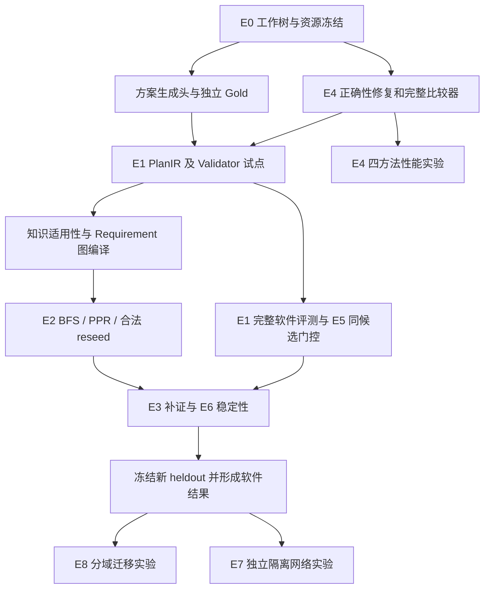

# UPF-Agent v8：完整升级计划与逐步完成记录

最后更新：2026-10-13（Asia/Shanghai）。本文件完整纳入[可行性评估与实验推进计划](docs/v8-next/升级方案V2可行性评估与实验推进计划_20261008.md)的第 1–11 节，包括代码差距、工作包、实验协议、Gold、统计、排期和验收门槛。

**使用方式：每完成一步，把对应的 `- [ ]` 改为 `- [x]`，写上完成日期，并在文末追加实际变更、验证结果与证据。未完成或部分完成的步骤保持未勾选，注明剩余项。后续进度统一在本文件维护。**

**当前修复完成（2026-10-13）：任务覆盖、漏项拒绝发布及最终输出预算保护已完成工程修复，1140回归与Ruff通过；N001／N003两例×四方法8/8实际输出均通过任务覆盖／完整校验和未审草稿匹配，独立原文／费用／实际语法及隔离复现一致。10模型／46工具，完整输入112,562／输出19,970Token，共同头超时0。P5两份原生规划均因阶段余量不足而提前结束／降级，这项限制保留，不算原生闭环成功。任务清单来自公开问题，仍需专家确认，覆盖通过不证明领域质量领先；图新增独立K来源0。原60例及旧结果不改，heldout未读／未消费，正式VPR=null。见[任务覆盖与预算修复](docs/v8/E1任务覆盖与分阶段预算修复验收_20261013.md)。以下记录保留其历史版本和计数口径。**

**最新推进（2026-10-13）：本轮专家意见工程修订、48/48四方法真实复测、独立原文／请求／隔离复现及289条意见响应已完成。新增只读手册引用、具体身份与正常来源SHA、日志／未知出口、冻结捕获消费语义、手册集合语义、显式原文引用表与公开动作参数目录；1121回归、12正控／144负控及Ruff通过。Direct／P5／no-graph／full机械通过12／5／12／12，完整未审草稿匹配均0，日志核对仍普遍遗漏，图新增独立K来源0，不能证明质量提升。78模型／286工具尝试，7个P5超时响应的用量未知；失败前序及费用全部保留。12份修订参考未批准，新原文尚无语义裁决；原60例与历史结果不改，heldout未读／未消费，正式VPR=null。下一步是修订版实际复审、正式数据及协议冻结、正式validation及其原文双评，再准备／冻结／单次运行heldout。见[本轮修订验收](docs/v8/E1专家意见修订与四方法复测验收_20261013.md)。此前“最新推进”和真实审核0表示各历史阶段当时状态，不能用来否定已接收的60項正式专家意见。**

**最新推进（2026-10-11区分度审计后）：12份validation的来源、固定版本知识、参考编制草稿及24行双评空表已导出，另有12份未审工作说明；真实审核及新Gold仍为0。新增可选候选计划头，允许1–8步自主选择，保留证据与只读限制；原正式默认头保留。旧dev三例×四方法真实试跑12/12完成／可解析，11/12完整Validator及未审参考匹配通过，P5手册案例重复ID失败保留。20次实际模型／52次工具，103,604输入／15,889输出token；full对no-graph机械通过率无收益且多3次工具。完整1062项回归及Ruff通过；heldout读取／消费0，正式VPR=null，领域动作与权限、独立Gold和真实双评仍待完成。见[本轮推进验收](docs/v8/E1证据编制与候选计划接口推进验收_20261011.md)。以下“续跑”与旧SHA记录保留为此前批次。**

**最新推进（2026-10-11续跑）：输入已扩到60份＝24旧dev＋12 validation＋24 heldout候选。新增采集34次，33次符合预登记效果／清理恢复，另1次MTU失败假设保留；留出有18份故障输入和6份低MTU正常边界控制，尚未发送给模型。12例×四方法的未审工程校准已完成48/48，72次模型／120次工具尝试；48份原文完整Validator重放及72份实际请求核验通过，机械通过率差异0，参考匹配／VPR禁用；新案例独立Gold缺36份、实际新hash批准及真实双评0，data_ready=false。实际来源、失败前序和进度保存于 `runtime/v8-next/e1-experiments-20261011/`。本轮全量1055项回归与Ruff通过，实测和边界见[续跑验收](docs/v8/E1输入扩量与四方法校准实验验收_20261011.md)。此前正式入口及477文件冻结见[上轮验收](docs/v8/E1独立案例入口与新校准候选实施验收_20261011.md)；正式E1和领域质量总项保持待办。**

### E1 独立案例顺序实施（2026-10-11）

- [x] F1：建立 `eval/v8/e1/`、file-backed loader 和 Schema，迁移24个原开发案例及未审参考；不把它们重命名为正式 split。
- [x] F2：预登记三个新故障条件并实际采集正常输入／私有真值、独立核验和恢复回执；3/3通过，新候选同一来源组件，不声称独立样本或新拓扑泛化。
- [x] F3：真实来源 adapter 与可追溯归一化002，保留001；task／来源／权限／时间／Gold hash／物理评审原件核验。
- [x] F4：正式入口 init／audit／freeze／run／finalize 已实现；固定四方法、完整失败分母、配对分组统计、真实部署核验；validation 运行及原文双评完成后开启 heldout，按输入 hash 单次消费。
- [x] F5：关键负控及全量回归、Ruff、原材料和历史冻结保全、本轮另版冻结与只读交付核验；实测记录见 `runtime/v8-next/e1-independent-20261010/acceptance.json`。
- [ ] F6：输入24／12／24的规模、实际来源投影及部署权重回执已补齐；新案例独立Gold缺36份、60份当前hash双评批准0，完整正式协议仍待真实审核。重复采集按来源／结构组件计相关性，不称60个独立来源。
- [ ] F7：未审工程校准48份实际输出与成本复算已完成；正式validation／新heldout、原文真实双评／仲裁和正式质量—成本统计仍待独立Gold与真实审核，WP06／WP09质量总项不关闭。

当前代码有必要的来源与外部 ID 兼容修改；历史698d…只代表此前冻结版本，当前SHA见本轮机器回执。以下O项保留此前阶段记录；本轮实际新增以F项与文末2026-10-11续跑记录为准。

### 当前未完成事项的顺序推进（2026-10-10）

- [x] O1：清查独立案例与评审来源，登记P6两套240条元数据、其中60条未执行新候选；不消费heldout，不将P6标签转换为E1批准。
- [x] O2：实现真实材料接收核验，检查canonical hash、物理review_source、身份重复与来源完整性；24例参考清单和48行空白双评表已交付，实际双评0，data_ready=false。
- [x] O3：统一导出E1–E7逐样本CSV及artifact索引，133,789行／16,317原文件；两个稳定批全部13文件字节一致，保留失败、unknown、负收益及不同版本／计数单位。
- [x] O4：开发配对质量与成本复算完成，13组比较／41行质量—成本／240行E4成本，两批5文件一致；同来源／结构相关性单列，图消融零收益及工具成本增加保留，不作为正式总体统计。
- [x] O5：14项新增关键测试、全量1029项回归（74.26秒）及Ruff通过；原3922冻结文件匹配、业务源698d…不变，本轮工具／文档／plan及产物另版冻结，并由只读核验器复核；实测回执见`runtime/v8-next/ordered-completion-20261010/acceptance.json`。
- [ ] O6：独立E1正常材料、任务／证据／PlanIR Gold及真实新hash双评／仲裁。现有24例仍同结构族全部dev，候选格式迁移与人工事实未完成。
- [ ] O7：按实际来源／结构组件分组，完成validation修订并冻结正式协议、模型、prompt、registry、evaluator、批准Gold与新heldout；现有协议仍是草案。
- [ ] O8：正式执行入口已由F4交付；独立资料／真实Gold和双评到位后仍需实际E1／新heldout、原文语义终审和正式配对质量—成本统计，再关闭WP06／WP09等质量总项。

本轮交付入口：`runtime/v8-next/ordered-completion-20261010/`。六段证据链及各实验限定表述见[此前核验](docs/v8/E1-E7完成度与收益证据核验_20261010.md)和[本轮验收](docs/v8/未完成事项顺序推进与验收_20261010.md)。以下记录保留为此前历史。

### 剩余实验追加推进（2026-10-10）

- [x] 对照原计划界定边界：E7 Agent 保持只读；实际变更／MTTR 是另行授权执行实验的指标，本轮不将 harness 清理冒充修复。
- [x] 正式 E1 启动条件实际核验：24例／1结构族／全部dev／hash绑定双评批准0，来源全部匹配；不将开发案例改名成正式留出集。证据：`runtime/v8-next/remaining-experiments-20261010/formal-e1-readiness-001/summary.json`。
- [x] 导出正式E1协议待审草案及实际CaseGold／GoldReview Schema：002与原计划四方法／实际METHODS对齐，主次比较、预算、60/150候选划分、分组／冻结／统计条件齐备；规模未选、实际Gold/仲裁为空，未消费heldout。入口：`formal-e1-protocol-draft-002/README.md`，初稿001保留。
- [x] 实现三方法同输入有限 RCA 对照，实际 MemoryGraph 查询及来源路径回执；PFCP序列号、有限IE与双侧F-SEID事务关联；22项新增关键负控通过。
- [x] 预登记新实验条件、分母和限制，代码按SHA冻结；规则设计使用旧60轮开发观测，不声称新故障族泛化。证据：`runtime/v8-next/remaining-experiments-20261010/protocol-001.json`。
- [x] 旧60轮原始观测的三方法配对重放：flat 25/60、joined与graph各59/60；旧模型10/60保留，1个缺证未知未补造；这是参与规则设计的开发集，不是盲测。
- [x] 新12故障条件＋健康控制各1次 pilot完成并独立复算：注入/输出/恢复13/13，故障flat 5/12、joined与graph各12/12；健康1/1正确、误报0。PFCP建链配对2条、解码错误/截断0，冻结方法不变。
- [x] 同一冻结版本13条件×5次主扩量与独立审计完成：65/65注入/输出/恢复，故障flat 25/60、joined/graph各57/60；未知49/51/53计未命中，健康误报0/5。来源核验、截断/解码错误0。
- [x] 事后8秒窗口N4补证完成并独立审计：三条件pilot3/3、同版扩量9/9，规则未变；额外5秒采集成本单列，主批三条unknown保持未命中，不替换结果、不称为heldout。证据：`window-protocol-002.json`、两批audit与`window-sensitivity-analysis-001.json`。
- [x] 主批原始来源、图回执和有限会话映射独立复算：full核验10条PFCP/N3字段关联、5条RAN地址错配保留；本地2149文件附件异目录两次核验，234次方法重算一致，78条／席空白审查记录交付。补证附件终态另记录。
- [x] 合并交付：90条／席空白审查记录与完整normal副本，450行结果两次导出字节一致；另版附件002的2426文件在异目录两次核验，四批90轮／270次方法重算和会话结果一致，模型／外部网络／原项目访问／子进程调用0。
- [x] 最终全量1015项回归（73.79秒）、Ruff和边界负控通过；旧1665冻结文件、HEAD／暂存与三个既有服务身份不变；四批容器／网络归零。另版代码／文档／plan冻结及核验完成，见`engineering-acceptance-002.json`、`delivery-freeze-001/`和`delivery-verification-001.json`。
- [ ] 正式 E1／新heldout：独立案例来源、Gold、按hash真实双评、分组与评价协议冻结到位后启动；当前缺失的数据和人工事实不由自动控制代填。

**此前已验收状态（2026-10-10）：复核发现的工程缺陷已修复；新S2及E2–E6完整开发矩阵、E8官方QA小样本、E7原型7预检6轮／诊断pilot18轮／全量60轮均完成并独立审计。E7注入／输出／恢复60/60，Top1=10/60、Top3=32/60，质量错误保留。978项全量回归及Ruff通过，业务源码698d…。三份新附件异目录复算通过，816行新开发表两次导出一致；728条／席补充评审索引已交付。正式Gold、真实双评／仲裁和新heldout保持待办；不由工程通过关闭领域质量。详见[本轮修复与实验验收](docs/v8/复核问题修复与后续实验验收_20261010.md)。**

修复前历史记录：第二阶段工程修复和完整复测（2026-10-09）。`closure-full-004` 24 例 × 四方法 = 96 次，全部可解析、通过 Validator 和未审参考匹配，评分/成本复算一致；539 项回归与 Ruff 通过。额外实际取证覆盖核验已通过，96 次均满足 180 秒及 8/8 调用预算。P5 原生规划失败 1 例及措辞待复核项保留；共享模板保证不能当自由规划优势。已收到你本人完成的单人审核汇总，覆盖 24 个参考和 96 份原文；20 个 R07/R09 问题已修订，原 96 份另批重评分通过。修订版确认和第二位独立评审仍待完成，WP06 / S2.8 / S2.10 总项保持未勾选。详见[失败根因修复与全量验收](docs/v8/第二阶段失败根因修复与全量验收_20261008.md)。

修复前第三阶段历史记录：可自动执行的 E2/E3/E4/E5/E6 开发工程矩阵与只读复算全部完成（2026-10-10）。E2：96 次实际 P3、480 方法运行及另 168 混合／敏感性运行、5 Ledger 控制；E3：最终共同工具接口 128 次，目标 12/12、全任务 10/32；E4：此前 64,000 批并再次复算；E5：600 实际门控＋120 全拒绝判定；E6：540 次完整重复／扰动与实际请求审计。最终 893 项回归和 Ruff 通过。独立 Gold／语义复核及双评仍待完成，WP09 正式总项保持未勾选；E4 四 worker 吞吐为可选后续、未运行。详见[完整工程验收](docs/v8/第三阶段完整实验实施与验收_20261010.md)与[人工审查指导](docs/v8/第三阶段人工审查清单与操作指南_20261009.md)。

此前交付记录：WP10 工程交付完成（2026-10-10）。本地 synthetic-only 包、真实 E2 独立附件、历史代码／失败集、118 行开发结果表均交付；新目录／独立环境完整复算通过，另执行 72 个图控制、3 次 Engine/Ledger、96 次无模型 E3、720 批 E4 和 720 次 E5 判定。新增模型调用 0，全量 906 项及最终专项 13 项通过，Ruff 通过。没有对外发布或导入人工批准，正式质量总项保持待办。详见[WP10 验收](docs/v8/WP10复现包与独立复算实施验收_20261010.md)。

此前网络pilot记录：WP11/E7 的隔离网络和 18 轮工程 pilot 完成（2026-10-10）。实际注入／清理恢复／严格只读接入均 18/18，独立复算通过；918 项回归与 Ruff 通过。真实静默故障缺少日志及异构对象版本问题已记录，RootCause 接口、完整诊断评价和 60 轮扩展仍待推进，并非只等待人工。详见 [E7 报告](docs/v8/e7-lab-report.md)。

## 逐步完成清单

修订后当前人工入口：[新版本材料与确认指南](docs/v8/修订后人工复核材料与确认指南_20261010.md)，来源、原文和待判定均按新hash登记。

此前人工复核统一入口：[第二与第三阶段人工复核总清单与操作指南](docs/v8/第二与第三阶段人工复核总清单与操作指南_20261010.md)。列明修订参考确认、已有意见登记、双评、E2/E3/E5/E6 的来源与逐项方法；实际填写使用 `runtime/v8-next/20261010-001/`，不覆盖冻结材料。

### 第二、第三阶段复核结果接收与修复

本轮早期进度（历史，后续结果见最新状态）：核心修复冻结为 `698d1761d39f7795b2e9d7ec779e89d9ceccfab7a4e29b7139031d194b6f443a`；950 项全量回归及 Ruff 通过。新 E2 完整检索、E3 无模型 96 次、E4 720 批及 E5 120 候选矩阵已运行；模型预检、完整生成和重复实验的进度及失败保存在 `runtime/v8-next/review-remediation-20261010/`。以下子项按实际完成勾选，正式批准不由机械结果代替。

- [x] R0：接收用户交付的448份逐项意见、667行问题清单；核对788来源hash和66工作区文件；新接收目录保存版本核验，原复核包不改（2026-10-10）。
- [x] R0.1：完整只读复现S2的96份Validator结果与E5的120份A4结果；确认80份映射步骤引用不完整，指出E5两个辅助复核漏检；补查ETSI N3/N4角色依据（2026-10-10）。
- [ ] R1：修复生成Schema的双侧引用限制、Validator覆盖及缺侧条件性调查口径，补关键正负控，新批次生成/评分/复核。
  - [x] 已有映射必须引用双方 P 并依赖双方身份；缺侧/冲突仅允许明确 `basis=collect_then_verify`、完整 `pending` 和停止出口；伪造、重复引用及假缺口反例通过（2026-10-10）。
  - [x] HEAD-10 / Validator-2 / Capabilities-2、异构对象版本适用性及来源窗口复核实现；32 项修复专项、950 项全量回归通过（2026-10-10）。
  - [x] 四方法三批 20 次预检及 `review-closure-full-001` 24×4 完整运行／独立复算；96 次 Validator 通过、94 次匹配未审参考，P5 两例缺 K 未获取配置调查保留（2026-10-10）。
  - [ ] 新原文自然语言／修订参考按新 hash 人工批准，不能将机械通过计为正式 VPR。
- [ ] R2：修订6个N3开发案例的对端角色、对象适用性及参考，并给pilot-13–16生成无歧义手册任务新版本；原件和旧hash留存。
  - [x] 新输入采用 UPF/RAN 与 UPF/SMF 对象角色及各自产品/版本，合成对端知识显式标识；4 个手册任务移除双侧要求；转人工参考保留可进行的调查；旧输入不改（2026-10-10）。
  - [x] 新版24参考、96原文及80扰动对机械复核材料导出至 `revised-review-package-001/public/`；两席真实评审模板保持空白，另提供详细操作指南（2026-10-10）。
  - [ ] 新hash的领域参考和调查措辞批准，见R5；不自动继承旧版本意见。
- [ ] R3：修订E2的48条R/P查询文字与结构化需求，细分K片段等价集合，独立审定新Gold并另批复测。
  - [x] R/P 查询明确对象/字段/双侧要求；K 的相关文段仅用于章节发现，补逐片段 locator/hash，禁止将文段视为已审完整操作等价集合（2026-10-10）。
  - [x] `review-e2-full-001`：96 次实际新 P3 检索、480 方法运行、1440 个 top-K 评价；旧缓存未复用（2026-10-10）。
  - [x] 另168次混合/敏感性、5个真实 Ledger 控制及来源／逐方法复算完成；新实际 E2 私有附件异目录独立复算，2552 文件核验，新增模型调用和网络／原项目访问均为0（2026-10-10）。
  - [ ] 新章节发现范围／操作等价集合的独立 Gold 批准。
- [ ] R4：派生复核工具补binding窗口与物理来源的一致性检查；处理E5允许候选语义问题和评审标签泄漏，新包再核验。
  - [x] 独立来源复核比较 binding 与物理 `observed/valid`，并单独评估绑定时刻；两个旧漏检负例已检出，原意见不改（2026-10-10）。
  - [x] `review-e5-full-001`：120 候选、600 次实际门控及120次全拒绝对照复算通过，最终40允许/40阻断/40转人工；新包使用中性来源路径、组织者索引与评审材料分开（2026-10-10）。
  - [ ] 新候选的领域语义与真实双评/批准。
- [ ] R5：登记实际逐项确认、E3目标/全任务与预算解释、E6语义及真实独立双评/仲裁；缺失的汇总表和人工确认来源如实补齐，正式VPR保持待办。
- [ ] R6：修复复测后另版更新开发表与WP10复现包，不覆盖历史包；按实际批准关闭S2/S3质量项。
  - [x] 新合成附件27668固定文件，在新目录／既有独立Python锁定环境复算成功；同SHA包首轮路径不合规失败留存，修正启动路径后再执行E3 96、E4 720、E5 720，无新模型与原项目访问（2026-10-10）。
  - [x] 新真实E2附件2552文件两次核验与独立复算通过。
  - [x] E7原型7完整60轮独立审计、真实E7/E8附件6974文件异目录复算及816行新开发表两次导出一致；728条／席空白人工索引与7127来源文件SHA交付（2026-10-10）。
  - [ ] 实际Gold／双评／heldout批准后关闭正式质量项，不由附件通过代替。

接收证据：[机器汇总](runtime/v8-next/review-intake-20261010-001/intake-summary.json)、[详细修复安排](docs/v8/复核结果接收核验与修复安排_20261010.md)。R0/R0.1勾选表示接收与复现完成，不表示88份“修订”意见已转成人工失败标签，也不表示阶段批准。

### 第一阶段：工程底座（WP00 / WP01）

- [x] WP00：工作树冻结、调用计数和 CPU 合成入口（2026-10-08）。完整 P5 公平对照仍属 WP05 / E0 后续验收。
- [x] S1.1：冻结改造前代码、环境、暂存/非暂存差异和原始资料指纹（2026-10-08）。
- [x] S1.2：建立反例回归，确认改造前 7 项失败（2026-10-08）。
- [x] S1.3：F1 当前认证批次与原计算批次分开（2026-10-08）。
- [x] S1.4：F2 Full / Local / Gate / fallback 统一评估时间和上下文（2026-10-08）。
- [x] S1.5：F3 初始实际读集审计、损坏索引隔离和 Full fallback（2026-10-08）。
- [x] S1.6：调用事件、Ledger 原子提交及 MeasuredBackend 回归（2026-10-08）。
- [x] S1.7：180 批更新、30 类边界和四模板合成运行验收（2026-10-08）。
- [x] S1.8：393 项回归及 Ruff 通过，交付实施与验收报告（2026-10-08）。
- [x] S1.9：冻结第一阶段交付快照（2026-10-08；形成于本计划文件新增前）。
- [x] WP01：F1–F3 修复、完整比较器及当前规则读集审计通过（2026-10-08）。

验收证据：[第一阶段报告](docs/v8/第一阶段实施与验收_20261008.md)、[机器汇总](docs/v8/phase1-acceptance-20261008.json)。合成工程验收不代表方案质量或真实性能优势；新 heldout 未消费。

### 第二阶段：知识映射与方案评价试点

- [x] WP02：知识适用性 registry、普通适配及图回写。
  - [x] S2.1：定义文段 hash / 版本 / locator、purpose、对象范围、映射依据和复核状态 schema。
  - [x] S2.2：普通检索和图回写共用映射；审定正例、未知、错版、错对象及来源变化回归通过。
- [x] WP03：PlanIR、action registry、共同方案生成头与保真 Translator。
  - [x] S2.3：定义 PlanIR / action registry / Gold schema，准备合法、多解、缺步骤和缺证样例。
  - [x] S2.4：共同方案头与模型观测；P5 / v8 各至少两例真实生成 trace，保留 Gate 前原文。
  - [x] S2.5：保真转换回执保存原文 hash、步骤 span、未知字段与解析错误，不补造信息。
- [x] WP04：独立 Validator、Gold schema 和分层指标。
  - [x] S2.6：DAG、参数、证据、版本/时刻、三值前置条件和权限校验；关键违规检出、合法控制保留。
- [x] WP05：完整 P5 / v8 runners、公用证据工具、共同模型预算和调用观测。
  - [x] S2.7：P5 自主工具规划；v8 no-graph 真正跳过图调用及费用；统一来源、权限和预算。
- [ ] WP06（部分完成）：试点输入、指标和匿名导出已交付；独立评审及正式统计待完成。
  - [ ] S2.8（部分完成）：24 个合成开发案例和独立参考草稿已准备；专家校准待完成。
    - [x] 24 个开发输入及参考分支在模型输出前冻结，全部 synthetic=true / reviewed=false（2026-10-08）。
    - [x] 登记前 10 例为校准候选，导出复核表和基于 hash 的双评导入协议（2026-10-08）。
    - [x] 收到用户本人审核汇总：24 个参考／96 份方案均已审，20 个故障参考存在 R07/R09 缺双侧映射问题（2026-10-09，单人审核；原始汇总独立留档）。
    - [x] 在新包修订 20 个参考共 34 个分支：补 VERIFY_PEER_MAPPING、准确对端参数和两端身份依赖；4 个手册参考不变（2026-10-09）。
    - [ ] 用户确认修订后参考；处理 13–16 旧任务文字的手册范围歧义，按新 hash 记录批准。
    - [ ] 完成 10 例独立双评、分歧仲裁和修订参考批准。
  - [x] S2.9：逐 case 指标和匿名评审材料；空输出、解析失败、超时保留；分母可核对。
  - [ ] S2.10（部分完成）：24 例 × 4 方法试点及工程复盘完成；专家仲裁与扩样待完成。
    - [x] 完成 96 次真实模型方法运行，保存逐 case 原文与所有失败（2026-10-08）。
    - [x] 汇总失败类型并完成工程复盘；96 份结果与调用成本复算一致（2026-10-08）。
    - [x] 以新实验 ID 修订并核验步骤依赖、证据引用、解析失败和必需出口；完整 96 次复测通过，保留历史失败，不覆盖原文（2026-10-09）。
      - [x] 共同方案头第二版：显式依赖字段、保真输入引用对象；IR / Translator / Validator / 参考评分规则不变，466 项回归通过（2026-10-08）。
      - [x] `quality-pilot-001`：原案例 1 / 5 / 13 / 15 / 23 × 4 方法，共 20 次失败选取开发复核（2026-10-08）。
      - [x] 与原批次同案例配对复算、核对原文与引用、保留退步及未解决失败（2026-10-08）。
      - [x] `quality-pilot-002`：第三版显式权限/效果字段，案例 23 × 4 方法完成；出现 3 次字段层级解析失败，不能算质量通过（2026-10-08）。
      - [x] 第四版接入本地服务 JSON Schema：限定字段层级、有限动作参数/权限/效果、当前可见引用；P5 原生规划保留旧接口，468 项测试通过（2026-10-08）。
      - [x] `quality-pilot-003`：案例 15 / 23 × 4 方法，8 次真实结构化输出均可解析；独立评分与成本复算一致，原文不补写（2026-10-08）。
      - [x] 核验当前两例的字段层级、权限/效果、已有来源引用及 SHA 格式约束；完整 24 例未重跑，不能宣称全量解析问题消除（2026-10-08）。
      - [x] 解决未获取适用 K 时仍生成配置检查、未知 purpose、跨对象引用和必需补证动作遗漏；合法/非法控制及完整 96 次复测通过（2026-10-09）。
        - [x] 逐例核对拒绝与原文，确认未知目的 K、跨对象 K、P5 未查手册、8 步挤掉出口及 Schema 重复输入的根因（2026-10-08）。
        - [x] 实施共享生成前许可，物理来源与撤销映射回查、同对象 K/R 与双侧 P 引用、身份依赖；24 种输入条件及伪造/撤销负控有回归（2026-10-08）。
        - [x] 修正固定 ID 抢先锁定动作的解码顺序，以及无缺口 N4 案例补 MTU 的反例；保留两个中止批次，补证只允许当前实际缺口（2026-10-08）。
        - [x] 第七版 12 次预检完成并复算，保留 3 次未知知识场景重复身份失败；第八版模板流程修订后 4 次真实预检全部通过并复算（2026-10-08）。
        - [x] 模板流程覆盖与双侧身份依赖、24 个合法/72 个非法实际解码控制核验；K/R/P 仍按方法真实取证限定，不能把结构覆盖解释为自由规划能力（2026-10-08）。
        - [x] 第九版首批 25 次中发现空设备范围导致 R/P 假缺失，保留中止批次；修复单设备查询范围及普通/图知识时间投影，实际取证覆盖与正常状态回归通过（2026-10-09）。
        - [x] 24 种输入 × 有图/无图 48 次实际取证专项通过，错误 scope_denied 为 0；真实缺口仍保留、拒读字段未泄漏，模型调用 0（2026-10-09）。
        - [x] 第九版生成头 / 第二版公共工具适配完整 96 次另批验证、取证覆盖及评分/成本复算通过；2,794 个新文件 SHA 核验，原参考逐字节不变（2026-10-09）。
      - [x] 完成当前结构化生成协议的实际成本与共有 180 秒 / 8 模型 / 8 工具预算核算，96 次均满足；保留分布及 P5 原生失败，不归因纯 Schema、图或速度优势（2026-10-09）。
    - [ ] 完成专家仲裁，依据质量和标注速度决定 60 或 150 例正式规模。
    - [x] 提供真实双评记录的导出/导入入口，拒绝 hash 错配及重复评审，分歧另存仲裁，5 项入口回归通过；不替专家填写空表（2026-10-08）。
    - [x] 交付[人工复核清单与操作指南](docs/v8/第二阶段人工复核清单与操作指南_20261009.md)，逐项说明材料位置、参考／原文检查、判定、填写、仲裁及提交；另建 48 份参考／192 份原文 Markdown 记录和 96 份原文分行阅览，全部待评，不修改旧批次（2026-10-09）。
    - [x] 按收到的审核结论另批重评分原 96 份输出：96/96 Validator／修订参考匹配通过，80 份故障方案双侧动作与两端身份核验通过；240 个缺动作／错对端／缺依赖参考负控全部拒绝，成本复算一致（2026-10-09，`reference-revision-002`，模型调用 0）。
    - [x] 修正后续手册案例生成文字，补 34 项参考回归；全量 681 项及 Ruff 通过，原 2,794 文件 SHA 保持不变（2026-10-09）。
    - [ ] 接入实际方案原文双评与仲裁结果，关联批准参考及人工判定完成统计结案；当前只有用户单人汇总，参考批准／双评和正式 VPR 仍未完成。

验收证据：[第二阶段报告](docs/v8/第二阶段实施与试点_20261008.md)、[机器汇总](docs/v8/phase2-acceptance-20261008.json)。24 例是最初计划提出的规模，实际构建为合成开发输入，并非用户已有真实故障或专家 Gold。

### 第三阶段及后续：对照、扩量与正式结果

- [x] 第三阶段可自动执行的完整开发实验矩阵、终态复算和工程交付完成（2026-10-10，E2/E3/E4/E5/E6；正式人工验收另列）。

- [x] WP07：旧版E4四模式单worker验收完成；修订版单worker720、四worker720、压力576及四worker全量64000完成并独立复算，四worker只报告吞吐（2026-10-10）。
  - [x] Full / Local-no-cutoff / Local-cutoff / Local-audited-cutoff 开关和成本可分离（2026-10-09）。Full 不构造 DependencyIndex；所有 Local 保留初始实际读集认证和索引完整性保护，L3 额外核验逐次实际读集。
  - [x] 四模式分别完成 180 批小矩阵；语义及批次/上下文一致（2026-10-09，`e4-small-001`，720/720）。
  - [x] 三种 Local 各 30 类边界场景、共 90 次完整认证比较，以及 18 个独立安全控制通过（2026-10-09，`e4-audit-001`）；预算中断后相同输入恢复问题已有修复及回归。
  - [x] 修复 XL 逐动作重复上下文计算；按新 ID 重跑小矩阵和边界控制，`e4-small-002` 720/720、`e4-audit-002` 90/90 及 18/18 通过（2026-10-09）。
  - [x] `e4-stress-002`：S/M/L/XL 的 10%/50%/100% 稠密与根节点高扇出，576/576 方法批次一致；保留负收益与旧中断批次（2026-10-09）。
  - [x] `e4-stable-fanout-001`：144/144 方法批次一致，验证输出不变时真实截断；XL L1 重算 501 状态，L2/L3 各 1（2026-10-09）。
  - [x] 558 项全量回归（36.64 秒）、Ruff 通过；用第二阶段冻结源码复算原 96 份评分／成本并核验原批 SHA，不改人工材料（2026-10-09）。
  - [x] 从 `e4-code-freeze-002` 启动 `e4-full-single-001` 单 worker 全量任务，独立日志／状态／逐批进度持续保存；成功后自动记录对应扩量步骤，当前不算全量通过（2026-10-09）。
  - [x] 正确性通过后扩至每方法 16,000 批，共 64,000 方法批次；增加稠密及高扇出变更。（自动完成记录：2026-10-09T09:18:03.744559+00:00，`e4-full-single-001`；16,000/方法、64,000 总批次完整一致，另批稠密/高扇出通过。）
  - [x] 构建、审计、重算、fallback、冷热和 worker 成本分开报告，保留负收益（2026-10-09，`e4-full-review-001`：64,000 条 CSV 复算一致；S-10/S-50/M-50 均有负收益；4-worker 吞吐明确为未运行，不混入延迟）。
- [x] WP08（工程验收）：Requirement 图编译、受约束排名与合法 reseed（2026-10-09）。正式 E2 查询质量仍属 WP09 待办。
  - [x] 对象/字段/目的/版本/时间编译、可核验路径和合法 Graph K 回写；来源／映射复查，三个实际引擎探针均 completed 且关闭 K 缺口（2026-10-09）。
  - [x] 同图 / seed / 过滤 / 扫描预算对照；纯 Python PPR 固定容差及收敛失败行为，发现＋回写复核合计 ≤100 节点／200 邻接，排名及快照 setup 单列（2026-10-09）。
  - [x] `wp08-pilot-004` 24 类 synthetic 控制 × 3 方法 = 72/72 符合预期；`wp08-engine-probes-002` 3/3 实际关闭；647 项全量回归及 Ruff 通过（2026-10-09）。详见[验收报告](docs/v8/第三阶段WP08需求图检索实施与验收_20261009.md)。
- [ ] WP09：E2 / E3 / E5 / E6 对照与统计。
  - [ ] E2：24 条查询 pilot，再扩至 96 条审定查询；BFS / PPR / reseed 同预算比较。
    - [x] 准备查询编译与受约束检索工程入口；完成 24 类未审合成控制的 72 次运行（2026-10-09，属于 WP08，不替代 24 条独立审定查询）。
    - [x] 实际 P3 完成 96 次 embedding/BM25/exact/rerank 检索；冻结缓存，96 查询×5 方法＝480 次、top-K 5/10/20 共 1,440 条观测及只读复算通过（2026-10-09，`e2-full-003`、`e2-full-audit-001`）。
    - [x] K12/R6/P6 混合 24 查询补充 pilot 共 120 次，alpha 0.70/0.95 另 48 次；三类真实手册单文段 Ledger 关闭、源篡改拒绝和多文段 conflict 控制通过（2026-10-09，`e2-mixed-pilot-and-sensitivity-003`；开发后登记，不作为独立正式 Gold pilot）。
    - [ ] 独立审定查询 Gold 并按批准协议开展正式评价；当前开发标签未审，R/P 仅检索线索，不声称图回写改善。
  - [ ] E3：32 条独立开发场景 × 4 方法 = 128 次；验证可补、不可补、假关闭和停止。
    - [x] 实现独立分轮证据后端：冻结完整发布版、显式替代旧观察槽、固定权限和时刻、Ledger 原子回执，以及每批 Full/Local 完整认证比较（2026-10-09）。
    - [x] 首轮 96 次工程试验保留；定位服务恢复后“工具/对象”去重漏掉新 P 需求，实验调度细化为“工具/对象/需求”；36 项专项回归通过（2026-10-09）。
    - [x] 原生 P5 真实模型两例预检完成，成功与残留缺口均留档；新增上下文向 P5 提供同一公开发布目录，不暴露未来内容或参考（2026-10-09）。
    - [x] `e3-four-methods-002` 已运行 128 次并保留；完整性复核发现原生 P5 的 4 个 unavailable 案例错误码非法、各有 1 个未提交回执，工程验收未通过，不把原 summary.pass=true 当最终结论（2026-10-09）。
    - [x] 修复实验 P5 错误包为原生 tool_failed、保留可用性原因；实际尝试／提交／未提交分别计数，未提交不计正确停止。只读审计新增 pending 检查，原批 `e3-four-methods-audit-002` 明确 pass=false（2026-10-09）。
    - [x] `e3-four-methods-003` 修订冻结版本完整 32×4 通过：241 输入／956 方法副本／670 证据版本核验，798 次 Full/Local 比较、实际 49 模型调用；未提交／假关闭／超预算均 0，775 项回归与 Ruff 通过（2026-10-09）。
    - [x] 统一 K/R/P 公共工具接口、显式评价时刻／300 秒 freshness，分轮服务接入实际 Engine／LangGraph，32 场景控制通过；首批公共接口 128 次已留档（2026-10-09，`e3-public-four-methods-001`）。
    - [x] 修正 E3 原生 P5 沿用的 1 次方案头预留，让其实际获得共同 8 次模型请求上限；新冻结版本完整 128 次复跑和来源／Ledger／认证复算通过（2026-10-09，`e3-public-four-methods-002`、审计 `002`；目标关闭 12/12，全任务闭合 10/32）。
    - [ ] 独立审查开发参考并补充更广来源／任务的正式统计；八类合成 fixture 相关，不作为独立事故总体。
  - [ ] E5：120 个同源候选，允许 / 禁止 / 未知各 40；逐层门控，错误拒绝与可用性同时报告。
    - [x] E5 首批工程控制：冻结允许／禁止／未知各 40 个同源候选，A0–A4 累计诊断策略及全部拒绝对照，720 次判定；A4 保留 40／拦截 40／转人工 40，734 项回归与 Ruff 通过（2026-10-09，`e5-pilot-001`）。
    - [x] 保存评价前标签、原文／物理来源／输入 SHA、逐候选决策与完整诊断成本；副本相关性、R 证据范围及离线诊断投影口径明确（2026-10-09）。
    - [x] 完整 K/R/P、双侧映射、权限、DAG、有限未知出口控制；120 候选×5 层＝600 次实际组件执行及 120 次全拒绝对照，来源／逐层执行只读复算通过（2026-10-09，`e5-full-002`、`e5-full-audit-001`）。默认完整 Validator 与旧冻结版本保持一致。
    - [ ] 批准参考／人工判定联动后的正式质量统计；开发控制不是现网零风险证据。
  - [ ] E6：20 例 × 3 方法 × 5 次 = 300 次重复；经审查的四类扰动另 240 次，全部结果留档。
    - [x] 四类扰动机械事实等价／来源重绑定及全链采样回归；温度 0.2，5 个显式 seed；P5 规划器与方案头均记录采样参数（2026-10-09）。
    - [x] 完整 540 次及原文、成本、Decision Flip、pass@1／全五次成功的只读复算完成（2026-10-10，`e6-full-002`、`e6-full-audit-001`）；旧 27 次完整／2 次中断独立保留。
    - [ ] 扰动语义、修订参考的独立人工审定；未消费正式 heldout。
- [ ] 正式 E1：分组划分、独立 Gold 和评价协议冻结，validation 失败修订完成。
- [ ] 正式 heldout：冻结代码 / 模型 / prompt / registry / evaluator 后消费新留出集；盲评、仲裁与统计完成。
- [x] WP10（工程交付）：软件结果、失败集和本地 synthetic-only 分发候选包，另一目录完整复算通过（2026-10-10）；正式质量依 WP09，未对外发布。
  - [x] 冻结合成原文、完整分母、负收益与失败前序，按原 SHA 收录第二阶段及 E3/E4/E5/E6 历史代码（2026-10-10）。
  - [x] 合成包与实际手册 E2 本地附件分离；E2 原缓存支持异目录解析，仍逐文件核对原 SHA；排除旧虚拟环境链接（2026-10-10）。
  - [x] 打包、文件篡改、路径越界、符号链接、缓存迁移和离线保护专项测试通过；全量 906 项回归通过（2026-10-10）。
  - [x] 独立 Python 3.11.15、固定依赖离线安装、异目录完整复算和五类 CPU 重执行通过；最终包 `synthetic-bundle-005`、复算 `independent-synthetic-replay-003`；E5 命名空间与标准库只读硬件查询问题另批修订，原失败保存（2026-10-10）。
  - [x] 118 行开发结果表两处导出字节一致，负收益及全拒绝损失保留；复现命令、限制和[机器验收](runtime/v8-next/wp10/wp10-acceptance-001.json)齐备（2026-10-10）。
  - [ ] 正式论文质量结论、代码／材料分发许可与对外发布；不把开发控制解释为正式专家质量。
- [ ] WP11 / E7（部分完成）：网络基础设施、原型7修订版60轮模型实验及新90轮有限证据联合对照完成，来源与异目录复算通过；调查步骤质量与正式批准待人工审查。
  - [x] 健康 Open5GS 2.7.6 / UERANSIM 3.2.7、公开测试订阅、独立内部网络与 harness / 真值就绪；不使用 host network、privileged、端口发布或 GPU（2026-10-10）。
  - [x] 6 条件 × 3 次 = 18 轮**网络工程 pilot**，注入及独立核验 18/18、清理恢复 18/18、严格只读接入 18/18；`e7-pilot-004` 和独立审计通过（2026-10-10）。
    - [x] 原失败 001/002/003 保留：OUTPUT 丢包触发 gNB 崩溃、DNN 实际返回 MM 状态、采集窗口缺 timezone_source 与接入验收过宽；分别修订，最终完整另批重跑。
    - [x] 700 行当前窗口日志完整保留，691 行头匹配；物理入库 12 条 UPF/SMF R，工具错误 0；18 次终态均 needs_evidence，不计根因诊断成功。
    - [x] 378 个原始文件 SHA、真实来源绑定与恢复回执复算；918 项全量／12 项专项及 Ruff 通过；本轮容器与内部网络回收（2026-10-10）。
  - [x] 双侧正常抓包、GTP扩展头／内层ICMP与对象级产品版本接入，四对象R读取与有限RootCause候选／来源引用接口完成；原型7预检007及18轮诊断pilot005独立审计通过，Top1=6/18、Top3=9/18，真实成本保留（2026-10-10）。
  - [ ] 独立审定调查步骤与自然语言依据；真实双评／分歧仲裁，正式质量尚未结案。
  - 能力边界：原模型批为graph_enabled=false的四对象R接入＋有限候选原型；新增adapter验证有限MemoryGraph查询及PFCP建立／修改／N3字段关联。全部IE、多UE并发、应用侧规则安装及原生完整图RCA尚未验收；joined与graph无额外准确率收益，不由flat对照推断纯图优势。
  - [x] 原型7完整诊断pilot通过后扩至12×5=60轮full002：注入／完整输出／独立恢复各60/60，方法及harness错误0；Top1=10/60、Top3=32/60，实际60次模型／240次native读取与费用独立复算；仍为有限候选原型（2026-10-10）。
  - [x] 有限证据联合flat/joined/graph同输入对照、健康控制与事后窗口敏感性完成；新90轮独立审计、270次离线重算通过，未修改原模型输出或填补原unknown；详见[追加验收](docs/v8/剩余实验追加实施与验收_20261010.md)（2026-10-10）。
  - 验收材料：[E7 实际网络报告](docs/v8/e7-lab-report.md)、[机器验收](runtime/v8-next/wp11/wp11-acceptance-001.json)、[复跑入口](lab/e7/README.md)。
- [x] E8：OpsEval官方固定版本中文5G单选24题读取、adapter、真实zero-shot运行与独立复算／版本报告完成；15/24、失败0，官方全量排行榜未复现，独立于UPF VPR（2026-10-10）；见[e8-domain-transfer.md](docs/v8/e8-domain-transfer.md)。

### 计划维护

- [x] PM.1：建立统一总计划和逐步执行记录（2026-10-08）。
- [x] PM.2：纳入完整详细计划，改为逐项复选框，保留既有验收记录（2026-10-08）。
- [x] PM.3：补充人工复核完整操作指南及可填写工作区，保留原材料和待评状态（2026-10-09）。
- [x] PM.4：交付第二／第三阶段统一人工复核总清单与独立填写工作区（2026-10-10）；48 份新参考 digest 空表、192 行第二阶段原文登记、656 行第三阶段审查表，全部判定未填，未导入人工批准。
- [x] PM.5：记录 WP10 复现包、独立复算、CPU 重新执行、失败修订与结果表验收；人工项与正式 heldout 状态保持独立（2026-10-10）。
- [x] PM.6：记录 WP11/E7 实际网络工程 pilot、三批失败及修订、918 项回归、独立复算与根因评价缺口（2026-10-10）。
- [ ] 持续维护：每完成一个步骤，打勾、注明日期并追加执行记录；失败保留，新实验使用新 ID。

## 完整可行性评估与实验推进计划

以下完整保留原详细计划的实质内容；相对链接已按项目根目录调整。拟议接口、工期和未来实验规模仍是计划，不作为完成证据。

评估日期：2026-10-08（Asia/Shanghai）。本计划对照本机现有代码制定，实验规模、工期、接口及新增文件均为拟实施项；已经运行的核验单独列在下文。

实施进度（2026-10-08）：第一阶段工程底座已落实 WP00/WP01 的冻结、调用计数、CPU-only 入口及 F1/F2/F3 修复，最终回归 393 项通过，180 批更新与 30 类边界变更完整一致。详见[第一阶段实施与验收](docs/v8/第一阶段实施与验收_20261008.md)。下文原审计结果保留为改造前记录；完整 P5 对照及 PlanIR/Gold 试点继续推进后续工作包。

**结论：V2 的研究路线可行，现有 v8 应作为工程底座继续使用。需要调整执行顺序：先补基线公平性、局部更新边界和真正的方案生成，再做 PlanIR 试点；完成正确性验收后扩大样本，最后再决定是否引入 PPR 和隔离 5GC。按一名主要研发、两名领域评审可持续参与估计，第一轮完整的软件实验约需 8–10 周，隔离网络另预留 2–4 周。**

其中最有价值的主实验是 E1，最适合立即开展的是 E4 的正确性审计。PPR 属于可选算法对照，真实故障实验受测试床和独立真值限制，不能作为第一轮交付的必经依赖。

## 1. 本次评估的基线与实际核验

### 1.1 使用的是本地工作树快照

| 项目 | 本次基线 |
|---|---|
| 工作目录 | `/home/huangxiaolin/upf-agent-v8` |
| 阅读方案 | 仓库根目录的 `UPF-Agent-Graph_v8_%E5%AE%9E%E9%AA%8C%E8%AF%84%E6%B5%8B%E4%B8%8E%E5%B7%A5%E7%A8%8B%E8%A1%A5%E5%BC%BA%E6%96%B9%E6%A1%88_v2.md`，共 1,087 行 |
| 方案 SHA256 | `18827c4917b5f40b22c2aca2940a498a78d539a10a702ce4a4e3e73728c9aa6f` |
| 本地 Git HEAD | `e234bf774c5714748ab739af43cffeca87a36565` |
| 本地 origin | `https://github.com/jijigood/upf-agent.git` |
| 与方案的区别 | 方案引用 `upf-agent-graph` 的 `421d8f…`；本机 v8 源码主要位于未提交工作树，不能仅以本地 HEAD 标识实验版本 |
| 实际应用环境 | `.venv-v8`；确认导入 `/home/huangxiaolin/upf-agent-v8/src/upf_agent/__init__.py` |
| 当前运行根 | `runtime/v8/`；新实验应另建运行根，避免覆盖历史批次 |

因此，E0 要冻结 **HEAD + tracked diff + untracked 文件清单及内容 SHA + lockfile + 配置**。只记录 `git rev-parse HEAD` 会遗漏当前 v8 实现。后续创建分支或 PR 之前，先保存现有 staged/unstaged/untracked 状态，避免混入已有 P7 工作。

### 1.2 本次确实执行了什么

| 核验 | 实际结果 | 证据与适用边界 |
|---|---|---|
| 全部现有测试 | **371 passed，24.71 秒，退出码 0** | [测试记录](docs/v8-next/baseline-tests-20261008.json)；包括现有可用的 Neo4j 同语义测试；没有新增模型方案质量评测 |
| 小规模 Full/Local 对比 | **48/48** 个批次通过现有语义比较 | `S/M/L × 1/5 fields × 2 seeds × 4 batches`；未作为性能实验；48 个批次均存在至少一个旧动作 batch 标签 |
| 更新边界探针 | 复现批次标签、评估时刻、构建期漏读边三个问题 | [探针输出](docs/v8-next/feasibility-probes-20261008.json)及[复跑脚本](docs/v8-next/feasibility_probes.py)；全部输入在临时目录生成，无模型调用，无真实网络写入 |
| 图 K 绑定目的标签 | 按 `_graph` 现有字段构造的绑定被判为 `unknown_knowledge_purpose` | 是字段投影探针，**没有运行完整图取证链**；结合源码确认工程缺口 |
| 历史 16,000 批产物 | 16 份 CSV 共 16,000 行，其中保存的一致性标志均为真；9 份验收输入文件 hash 匹配 | [历史产物核对](docs/v8-next/historical-artifact-check-20261008.json)；这是历史记录重聚合，**没有重新执行完整矩阵或新盲测** |
| 本机资源/依赖 | baseline `/models` 返回 200；target 端点连接失败；当前 v8 环境无 SciPy，`nx.pagerank` 实调用失败 | [资源检查](docs/v8-next/resource-check-20261008.json)；端点就绪不代表已测推理吞吐 |

硬件检查时有两张 A100 80GB、48 个逻辑 CPU、约 230.6 GiB 可用内存和 1,245.9 GiB 剩余磁盘；第二张 GPU 的当时利用率为 100%。这些是瞬时读数，不能据此假定两张 GPU 均可独占使用。第一轮冻结已就绪的 baseline 模型即可，target 模型迁移单独成批，避免把模型变化混入机制贡献。

旧交付资料在本机存在，比 V2 所审查的公开仓库证据更完整；但仍须区分“本次回归”“历史产物核对”“重新运行实验”三个等级。

## 2. 对照代码后的可行性判断

| 实验 | 现有可复用能力 | 真正缺口 | 可行性及先后 |
|---|---|---|---|
| E0 基线与公平性 | Ledger、P5 backend、冻结脚本、运行隔离 | 工作树冻结、统一真实计数、完整 P5 对照、可公开最小环境 | 高；所有实验前置 |
| E1 多步骤方案 | Contract、Binding、K/R/P、动作模板、报告 | **方案生成头**、PlanIR、保真转换器、Gold、独立 Validator | 高但开发与标注工作最多；论文主线 |
| E2 图检索 | Memory/Neo4j、白名单、适用性排除、同 P3 seed 小实验 | Requirement 编译、知识适用性标注、查询 Gold、合法 reseed、PPR 依赖与预算 | 中高；先修证据回写，再比较算法 |
| E3 定向补证 | `route_gaps`、`compile_gap_plan`、轮数与工具预算 | 动态补证场景、无源/不可补真值、统一计数 | 高；依赖 E0 与适配器能力 |
| E4 局部更新 | 字段/状态/动作依赖、early cutoff、全量参考函数 | 初始读集完整性、统一时刻、动作批次、四方法开关、完整比较器 | 高；**正确性问题前置，性能随后** |
| E5 门控 | `gate`、影响范围、实际字段谓词、只读限定 | 独立合法/非法候选集、步骤级前置条件、可用性统计 | 高；与 E1 共用评价底座 |
| E6 鲁棒性 | 基础 fixtures、预算/恢复/来源变更测试 | 保语义扰动、分组新留出、采样参数可控 | 中高；等模型/提示/协议稳定后开展 |
| E7 隔离网络 | 可复用日志/证据模型；当前没有测试床 runner | 部署、实际日志映射、故障注入与清理、独立真值/功能测试 | 条件性可行；独立后期里程碑 |
| E8 外部基准 | 检索和模型接口 | 分域 adapter、数据版本、公开集合适配 | 中；补充迁移实验，不阻塞 UPF 主线 |

### 2.1 应立即前置的代码问题

**F1：无变化或局部变化后，未进入 affected 队列的动作保留旧 batch 标签。**

`dependency.py:199` 给全部状态写入新 batch，而 `dependency.py:261` 仅给队列内复用动作更新 batch。无变化探针中，全部状态为 `batch-1`，全部动作仍为 `batch-0`。现有 `semantic_results()` 在 `dependency.py:292` 排除了动作 `batch_id`，所以旧比较器仍给出相等。当前 `execute_authorized=False`，不能把这个问题描述为已经执行了危险动作。

修复目标：语义复用和批次认证分开保存，例如 `computed_batch` 与 `validated_batch`；所有发布动作都指向当前快照的认证批次。完整比较器检查认证批次、上下文与证据 revision，不能简单地把所有元信息都从比较中排除。

**F2：状态与 Gate 使用不同的 evaluation time，Full/Local 共用错误也可能看起来一致。**

`LocalEvaluator.update(..., now=...)` 和 `full_evaluate(..., now=...)` 支持变更时刻；`actions.py:180/211` 仍按 `task.as_of` 重新选证据，`full_actions()` 也不接收统一时刻。探针使一份冲突观测在 5 秒后过期，10 秒时 R 已恢复 `satisfied`；旧时刻 Gate 仍返回 `human_review`，统一时刻 Gate 则允许只读建议。

修复目标：显式 `EvaluationContext(as_of, batch_id, permission_digest, contract_digest, policy_version)`，传入 full/local/state/gate/PlanValidator；初始化、fallback 和补证后的 Gate 均使用同一个时刻。应同时验证“应阻断而阻断”和“应允许而允许”。

**F3：初始依赖索引的自认证不能证明真实读取完整。**

`DependencyIndex.expected_edges` 来自它自己构造的图；`LocalEvaluator.__init__()` 的初始 Full 结果没有逐 reader 验证实际读集。更新时 `check_reads()` 只覆盖被调度的 reader。本次模拟构建阶段漏掉 UPF-A 的 R 读取组共 12 条边后，自审计通过、重算 0 个状态，但 `n4_enabled=False` 的新 revision 在 Full 中要求补证，Local 仍建议允许。

这是**明确注入构建缺陷后的反例**，没有发现正常构图器当前自然漏掉这些边。它说明 V2 要求的“构建期漏边发现”尚不成立。修复目标：在初始建索引与上下文变更时，独立采集每个需求和动作的真实读集；将必要声明读集与实际读集做双向核对，并针对分支未覆盖的读集保留保守依赖。发现缺边后 Full fallback，并隔离/修复损坏索引后再恢复 local。

**F4：知识绑定缺 purpose 的问题同时存在于普通手册适配和图回写。**

`compiler.py:61` 给 K 需求设置 `purpose=task.template`；`evaluator.py:136` 在目的标签未知时保持 Unknown。`engine.py:_graph`、`adapters.py:collect` 当前创建的文档 K 绑定均未填 `purposes`；`builders.py:manual_graph` 也没有可直接使用的审定 purpose 映射。普通手册检索同样可能无法关闭 K 缺口。

修复目标：增加按文档 hash/版本/定位符登记的适用性标注，保存人工或可信规则映射的来源、版本与复核状态；普通检索和图检索读取同一份映射。**不能仅因为用户问 N4，就自动给所有命中文段填 N4 purpose。**

**F5：当前 E1 缺少真正的方案生成过程。**

`engine.py:_compile` 的模型调用只生成可选意图说明，`_report` 写入状态表和动作 ID。`OrchestrationData` 没有自然语言多步骤方案；`scenarios.py:propose` 只返回 `suggested_action_ids`。因此，在旧输出上新增 Translator 无法凭空得到待评价的方案。

修复目标：除了 V2 已列的四个 plan 模块，再新增 `plan_generator.py`/统一方案头；它把各方法取得的事实、证据和缺口转成带原始中文文本的多步骤建议。生成消耗纳入同一预算，输出必须保留未经 Gate 修饰的原文。

**F6：旧 B1 对照不是完整自由取证的 P5 Agent；P5 原生报告也不具备完整多步骤处置输出。**

`FrozenLegacyBackend.model()` 在 `scenarios.py:304` 提示“取证已完成、actions=[]、done=true”；`agent_engine.py:519` 的原生报告以事实/候选/缺口为主，recommendations 为通用复核建议。旧 B1 适合称为“P5 编排 + 冻结证据适配器”，不适合承担“v8 超过完整 P5”结论。

修复目标：新增完整 P5 runner，保留其工具规划行为，在共同权限和证据源上实际调用；另给 P5/v8 使用同一个冻结方案头。原生 P5 报告作为辅助结果保存，主对照准确命名为 `P5+CommonPlanHead` 与 `v8+CommonPlanHead`。

**F7：真实资料目前只能支持有限的可解子集，不能直接凑 150 个真实故障 Gold。**

普通日志适配在 `adapters.py:collect` 保留 `observed=None` 和未知运行版本；工具只能提供 `event_type/interface/state`，不等于获得 `n4_enabled/mtu` 等现场字段。真实资料缺少身份、观测窗或双侧映射时，正例不足是数据事实。优先把这些样本用于正确补证/转人工评测；可解 D2 需要额外可信现场记录与专家核验。

**F8：PPR 和采样稳定性存在具体依赖/接口工作。**

当前 `.venv-v8` 安装了 NetworkX 3.6.1，但没有 SciPy，实际 `nx.pagerank` 抛出 `ModuleNotFoundError`。可锁定可选 SciPy 依赖，或在小图上实现经过参考实现核对的幂迭代。`LocalChatClient.chat()` 又固定 `temperature=0`、默认 `max_tokens=256`，只返回 message、丢弃 response 的 token usage；不能直接得到 E6 温度消融和可信 token 成本。新增兼容客户端/观测包装器，保持旧 `chat()` 行为可复现。

以上问题的定位入口：[引擎](src/upf_agent/v8/engine.py)、[依赖更新](src/upf_agent/v8/dependency.py)、[门控](src/upf_agent/v8/actions.py)、[适配器](src/upf_agent/v8/adapters.py)、[旧消融](src/upf_agent/v8/scenarios.py)、[模型客户端](src/upf_agent/models.py)。本次仅评估并增加文档/审计产物，尚未修改这些产品代码。

## 3. 推荐实施依赖与范围



依赖图表示门槛；资料整理、专家标注和测试床准备可以由对应人员并行推进。第一轮优先保证 CPU synthetic-only 可以复算，然后增加本机真实手册/日志，不以 Neo4j 或 GPU 作为确定性验证的必要依赖。

## 4. 工程工作包：可直接拆成提交

| ID | 工作包及文件 | 输入 → 输出 | 验收 | 估计研发人日 |
|---|---|---|---|---:|
| WP00 | `experiment_manifest.py`、`experiment_metrics.py`、独立 runner | 工作树/配置/调用事件 → SHA manifest、真实 trace | 未提交 v8 代码可追溯；失败/重试/复用计数可核对 | 2–3 |
| WP01 | `dependency.py`、`actions.py`、完整 snapshot comparator | 同一上下文/新快照 → 当前批状态与动作 | F1–F3 反例被修复或安全 fallback；旧回归通过 | 3–5 |
| WP02 | `knowledge_applicability.py`、适配器、图构建器 | 审定文段元数据 → 有依据的 purposes/作用对象 | F4 修复；未知仍 Unknown；不按任务编造映射 | 1–2 |
| WP03 | `plan_ir.py`、`plan_generator.py`、`plan_translator.py` | 各方法事实/原始文本 → raw + PlanIR + 转写回执 | P5/v8 都有实际方案；转写不补步骤/证据 | 3–4 |
| WP04 | `plan_validator.py`、`plan_metrics.py`、Gold schemas | 原文/IR/证据快照/Gold → 分层判定与分母 | 关键违规检出、合法计划保留、多解/缺证可评价 | 4–6 |
| WP05 | `p5_plan_runner.py`、`v8_plan_runner.py`、统一模型观测器 | 共同工具与预算 → 方法 trace | 完整 P5 可自主选工具；共同方案头预算计入总额 | 2–3 |
| WP06 | `eval/v8_plan/`、评审及统计导出 | 冻结案例 → 盲评材料/一致性/CI/失败表 | 输出逐 case 可复算；调参与 heldout 分离 | 2–3，另计标注 |
| WP07 | E4 四模式及 `scripts/v8_next_local_matrix.py` | 变更序列 → 语义/批次/开销矩阵 | Full/Local/Local-cutoff/Local-audited 可分离 | 2–3 |
| WP08 | `graph_query_compiler.py`、`graph_ranking.py` | 单条 Requirement/合法 seeds → 受约束检索 | 同图/同 seed/同扫描预算；Graph K 真实回写 | 3–4 |
| WP09 | E2/E3/E5/E6 runners 与统计报告 | 冻结对照与扰动 → 成本/效果/稳健性 | 错受、可用性、失败及负收益均完整保存 | 4–6 |
| WP10 | synthetic-only bundle 与论文结果包 | 已冻结实验 → 复现命令/表图/限制 | 另一目录可重聚合；公开包无需私有资料 | 2–3 |
| WP11 | `lab/` 独立注入、观测与清理 | 隔离测试床 → D3 trace/真值/功能检查 | 注入、归零、健康检查稳定；Agent 保持只读 | 8–15，另计部署协调 |

WP00–WP10 粗估 **28–42 个研发人日**，另含专家标注与失败修订时间；这是工作量估计，不是承诺工期。WP11 单独排期。每个提交应保持老批次可回放，新增功能有版本或开关；改变语义后使用新实验 ID。

### 4.1 PlanIR 与验证器的实现约束

1. 使用 action registry，将 `action_type`、参数 schema、前置条件、对象范围和读/建议权限统一登记。第一版只建 N4/N3/身份/日志/配置检查/补证/转人工词表，不开发完整 PDDL 编译器。
2. 引用至少能定位到 `evidence_id + revision + source_sha256 + locator`。模型写出的 `source_verified=true` 不作为验证依据；Verifier 从冻结来源重新核对。Contract/KRP 是输入，不是独立 Gold 的替代物。
3. `scope_fingerprint/evaluation_as_of/batch` 来自 runner 和证据快照，校验模型传回的值，禁止模型自定可信上下文。
4. DAG 检查包括唯一 step ID、引用存在性、无环、必要步骤的先后可达关系、多对象和参数匹配。Gold 可以是多个合法分支；不能把所有合法分支的步骤并集都要求同时完成。
5. 前置条件采用有限谓词和三值结果 `true/false/unknown`，禁止执行模型传入的任意表达式。只读检查可以合法地收集尚缺的信息，不应要求所有检查前已经获得其检查结果。
6. `expected_observations` 是未来检查预期，**不是已经获得的证据**；不能直接置为真后宣布目标完成。具有未知观测的计划使用条件分支、停止/补证/转人工出口。
7. 验证 `permission_kind/effect_kind/claimed_executed/non_executable`：当前不会产生网络写执行授权；描述需要人工审批的变更与声称已执行变更必须区分。
8. 同时输出 `raw_plan_validity`、`published_plan_validity`、拒绝/改写/保留数。Gate 拦掉错误计划不等于原始生成质量提高。
9. 保真 Translator 保存原文 hash、步骤对应原文 span、解析错误和未知字段；不补缺失的步骤、版本、命令或证据。统一冻结的转换器用于所有方法，成本与方案生成成本分开记录。
10. 机器格式/程序可行性和诊断目标达成分层输出；`VPR` 必须受 Gold 与独立复核约束，单纯 Validator 自判通过只记 `validator_pass_rate`。

建议接口如下，均为待实现接口：

```python
generate_plan(method_context, task, budget, model) -> RawPlanOutput
translate_plan(raw_output, frozen_registry) -> TranslationReceipt
validate_plan(plan, raw_output, evidence_snapshot, evaluation_context) -> PlanValidationReport
score_case(validation, independent_gold, expert_review) -> CaseMetrics
```

## 5. Gold 与评审推进计划

### 5.1 三档规模，先确保独立性

| 阶段 | 数量及划分 | 用途 |
|---|---|---|
| 试点 | 24 个开发案例；其中 10 个双评校准 | Schema、原文转写、规则和 rubric 验证；不形成性能优越结论 |
| 资源受限第一轮 | 60 个案例：24 dev / 12 validation / 24 heldout | 有质量的小规模软件结果；置信区间会较宽 |
| 推荐完整第一轮 | 150 个案例：60 dev / 30 validation / 60 heldout | 接近 V2 的主实验设计；需足够独立案例组 |

24 个试点建议按“8 个 N4、4 个 N3、4 个知识/配置、4 个版本/时间/权限缺证、4 个双侧/多对象”组织，每类包含适量可解与应补证/转人工样本。10 个校准样本是这 24 个的子集。

150 个目标配额沿用 V2：N4 30、N3 25、知识/配置 25、错版/时效/权限/冲突 30、多对象/边界 25、对抗/不可支持 15。**样本类别与可解性是两条标签轴**：错误版本场景也可能有合法替代来源，可补与不可补必须独立标注。只有形成足够独立组后才扩量，语义改写不能充当新增独立故障。

### 5.2 每个 Gold 必填

`case_id、source_group、structure_family、source_level、synthetic、reviewed、可解性、对象/版本/时间/权限范围、可见证据清单、required/optional/forbidden actions、多解及等价类、依赖 DAG、必要字段/关键参数、停止条件、独立根因真值等级、评审版本、来源 hash`。

多解 Gold 可使用 `any_of` 包含若干 `all_of` 条件集；动作等价只在目标对象、版本、参数和观察能力一致时成立。必要步骤与边计数对每个匹配的合法分支计算，不将无效分支挑选为最佳得分来掩盖关键违规。

`source_level` 分 D1 合成、D2 历史资料、D3 注入、D4 外部；根因标签另分 `unknown/expert_verified/experimental_injection`。D2 没有独立根因时只评价方案适用性/诊断候选，不计算 RCA accuracy。

### 5.3 分割与冻结

同一事故、同一注入条件族、同一 fixture 生成家族及其词面变体不得跨 split。共享手册作为所有方法可检索的背景语料可以存在，但同源事故的答案或专门适用性标签不能泄漏。先按来源事故组与结构家族检查关联，再分组分割，禁止仅按题目随机划分。

Gold 在看待评模型输出之前确定。dev 用于实现，validation 用于阈值与失败修订；heldout 在代码/模型/prompt/registry/evaluator 冻结后一次正式消费。已有 P6/v8 heldout 只做已知输入回归，不重新命名为新盲测。

### 5.4 专家工作量与角色

假设每例事实审查和 Gold 独立标注每位专家 15–25 分钟，150 例双评约 **75–125 专家小时**。第一轮 validation+heldout 的 90 例 × 4 方法 = 360 份方案，假设每份每位专家复核 6–10 分钟，双评另需 **72–120 小时**，再预留仲裁和返工。实际耗时用试点测量后重估。

两位评审先看隐去方法身份的原始方案、冻结事实和 Gold，再看机器结果；第三位只仲裁分歧。没有两位独立评审时，如实报告单人审核/未复核，不标为专家双盲 Gold。LLM judge 可以预筛，不能顶替独立真值。

## 6. 各实验的执行协议

### E0：冻结、计数与最小可复现环境

对照完整 P5 与当前 v8 的环境、来源与权限；保留当前 371 项回归记录，代码变更后运行相应回归。建立 synthetic-only root factory，在临时目录生成 K/R/P，不依赖同机原项目或企业原件。

统一事件记录 `attempted/committed/reused/error`，分别统计模型、工具、各类检索、源读取与缓存；记录 token usage 的来源，取不到写 `null`。`LocalChatClient` 的响应包装应保留 token usage/request ID，同时保证旧调用返回的 message 语义兼容。现有 B0/B2/B3/B4 的“声明访问数”保留为历史字段，不能纳入工具节省率。

**出门条件**：工作树和数据可冻结；完整 P5 可运行；四方法共同权限/预算有 trace；CPU-only 小包可复跑；计数事件可从原始 trace 重聚合。产物：`e0-baseline-report.md`、`environment.json`、`source_manifest.json`、`method_manifest.json`。

### E1：多步骤方案主实验

主矩阵固定四方法：`DirectLLM+CommonPlanHead`、`P5+CommonPlanHead`、`v8-no-graph+CommonPlanHead`、`v8-full+CommonPlanHead`。P5 native report 与 `GraphContextOnly` 只做辅助组。工具型方法获得同样的来源/API/授权对象；DirectLLM 使用冻结检索上下文，单列其上下文准备成本与信息可见范围。

当前引擎还没有 no-graph 开关，应新增版本化实验开关，真正跳过 `_graph` 及其调用费用，不能用空图代替后仍收费。P5 若需要读取合成结构化观测，应使用保持来源/字段/权限的公共工具适配器，让它自主选择工具；不得直接喂入 v8 已算好的状态或 Gold 必需步骤。

先在 24 个试点跑四方法，共 **96 次方法运行**。格式轴第一版只比较普通文本/JSON与 schema 提示；grammar 解码等后端支持后再扩展。线上“无 Validator”的方法也必须接受同一个离线评价器，不能因其没部署验证器就少检查硬约束。

推荐初始共同上限：工具 8、模型请求 8、补证轮次 3、总时间 180 秒；在总模型预算内预留 1 次最终方案生成。转换器若额外调用模型，单独报告评价开销，不能暗中给某一规划方法增加生成预算。最终输出 token 上限先试 1,024，依据 pilot 截断率统一冻结；不沿用只适合动作 ID 的 256/384 token。

Primary 比较预先指定 `P5+Head vs v8-full+Head` 的 VPR/HCVR；`v8-no-graph vs full` 等列为 secondary。同时报告 MSR、DAG 依赖满足率、EGRR、CDR、原始/发布方案保留率和成本。对无独立根因的样本不报 Top-K。

**出门条件**：原文、IR、转写错误、验证、盲评均保存；所有预植入关键违规类别在对应测试集合被检出，合法同源控制计划仍保留；多解与缺证都能评分；未取得专家 Gold 前只报告 validator 单测，不报告实际 VPR 优势。产物：`e1-pilot/`、`e1-plan-evaluation.md`、逐 case CSV、盲评包。

### E4：正确性审计与条件性性能

先处理 F1–F3，开发 **至少 30 条** 更新序列，覆盖不变值/revision、关键值变而状态码不变、无关字段、版本、时效、P 映射、删除/反证/source SHA、权限/scope/as_of、跨 batch、构建期漏边、分支读取、环、预算中断、恢复后更新、密集更新。输入变化和规则切换必须版本化。

Full 对比不能调用被测 DependencyIndex；允许共用底层确定性规则，但须增加独立 Gold 反例，以发现 Full/Local 同源错误。比较两层结果：领域可观察语义，以及 batch/as_of/source/revision/permission/context 的认证一致性。保留现有“忽略展示版本”的比较作为辅助项。

四组：L0 Full，L1 Local-no-cutoff，L2 Local-cutoff，L3 Local-audited-cutoff。L1 对所有受影响 reader 继续传播，禁止语义不变后截断；L2/L3 分离审计开销，初始索引构建与每批验证时间分别保存。

小矩阵先用 S/M × 1/5/10 fields × 3 seeds × 10 batches = **180 批/方法**。正确性通过后跑 V2 原矩阵 **16,000 批/方法**，四组共 **64,000 个方法批次**；同一变更序列复用输入。另加 10%/50%/100% 稠密变更及少量高扇出变更，小规模先定位负收益，再扩到 XL。

性能轮次在单 worker 上交替或随机方法顺序，冷热分开；四 worker 吞吐另列，不能混入单请求延迟。报告构建成本、fingerprint/审计/重算成本、重算 reader、fallback、P50/P95、CPU/RSS及 `T_full/T_local`。条件不同的开销不相除。

**出门条件**：冻结矩阵语义一致，所有发布动作认证批次正确；漏边/环/预算触发时不会保留未经确认的允许建议。发现任一非预期差异先修复，再用新 ID 复跑；性能不优则如实保留负收益范围。产物：`e4-correctness-audit.md`、`e4-performance.md`、变更序列和失败快照。

### E2：图证据检索

先修 F4，逐 Requirement 编译对象、字段、目的、关系、版本、时间和预算，返回可核验的候选路径。未知来源/版本可作为补证线索单列，不能作为已满足证据采信。

先做 **24 条** 查询 pilot，再扩大到 **96 条** Gold 查询（K48/R24/P24；按资料实际可支持能力调整并冻结）。每条定义相关且适用的证据/等价证据集合、必需字段、合法关系、无证据或种子不可用条件。标注专家先看来源与需求，后看方法结果。图中存在 R/P 节点不代表引擎已经支持其回写；相关接口未实现时只评检索，不声称完成 R/P 方案改善。

核心组：G0 Hybrid P3，G1 Fixed-Hop + 统一末端过滤，G2 Contract BFS，G3 同约束候选图 PPR，G4 Contract BFS + legal reseed。Requirement 个性化的 PPR 作为 G3 的单独次级消融，避免 V2 原 G3/G4 的定义重叠。Beam/ToG 暂不纳入第一轮。

统一 seed 缓存、图快照、关系过滤、源扫描预算与返回上限；PPR 在相同预先过滤候选图上排序。起始仍限制 2 跳、100 节点/200 边；3+ 跳样本先用于报告不可达，不在某一方法中偷偷提高跳数。若拓展跳数，所有方法另开相同预算批次。

top-K 预注册为 5/10/20；PPR 试点可搜索 `alpha={0.70,0.85,0.95}`，仅 dev/validation 调参，冻结迭代上限/容差/不收敛行为后再测 heldout。当前 `nx.pagerank` 依赖缺失先解决，不能直接把现有 NetworkX 依赖视为 PPR 可用。

Valid P/R 同时报告；等价证据多份重复不重复增加 Required Coverage。另报 Invalid Acceptance、seed validity、Correct No-Evidence、扫描量、过滤损失和完整 retrieval latency。Neo4j 官方 HybridCypher 因种子底座不同单列。

**出门条件**：有多于四问的审定 Gold；合法文段能凭映射进入 K；错版/无佐证关系不被采信；同预算得到可解释质量—成本结果。PPR 无收益则保留 BFS 默认。产物：`e2-graph-retrieval.md`、查询 Gold、seed/排除/路径 trace。

### E3：类型化补证

构建 **32 条独立开发场景**，覆盖 V2 的八类缺口，每类含可补与不可补条件。需要分轮次返回不同合法证据的确定性 backend；否则反复读取同一 fixture 无法测闭环收益。默认不解决身份/时区等来源本来未知的事实。

四组 T0 不补证、T1 完整刷新、T2 完整 P5 工具选择、T3 类型化补证；E2 稳定后新增 T4 合法 reseed。32×4 = **128 次方法运行**，后续以正式留出中对应子集验证，不能在这些开发场景上宣布泛化。

核心指标是可补 Gap Closure、不可补 False Closure、正确停止、每实际调用新增的有效字段及冗余查询。必要负证据查询/确认查询不自动记为冗余。

**出门条件**：每个关闭缺口有新适用 Binding 支撑；未知仍保持未知；共享权限/工具预算；超时、无源和不可补均有完整终态。产物：`e3-gap-closure.md`。

### E5：安全与可用性

建立 **120 个候选建议**试点，建议 40 个应允许、40 个应禁止、40 个信息未知/应转人工；它们来自若干独立任务族，报告候选数与任务族数，不能称为 120 个独立故障。

同候选集依次运行 A0 原始建议、A1 schema/白名单、A2 KRP/provenance、A3 scope/context/batch、A4 多步骤 Validator；只离线判定，不执行候选。另一条 E1 end-to-end 结果中各方法可以产生不同候选，两个实验不能混为 Gate 因果贡献。

共同报告 URR、VAAR、正确转人工率、方案 VPR/CDR、错误拒绝和 Raw/Published Unsafe Plan。保留“全部拒绝”退化对照：它可能 URR 很低，但 VAAR 必须失败。

**出门条件**：关键违规注入被拦、合法控制建议被保留，所有执行授权保持 false；0 错误同时给出样本数与上界，不写现网零风险。产物：`e5-gate-safety-availability.md`。

### E6：扰动与多次运行

从冻结评审集选 **20 个案例**，对 P5+Head、v8-no-graph、v8-full 各独立生成 5 次，共 **300 次运行**；前提是客户端能显式记录并控制 temperature/seed。温度为 0 时不保证不同 seed 带来实际随机性，应说明后端是否支持 seed，缺失写 N/A。

另对同 20 个案例生成 4 种经审查的语义保持扰动（表述、顺序、拓扑列表顺序、无关噪声），三方法一次运行，共 **240 次**。版本替换、缺字段、故障家族变化会改变 Gold，属于 OOD/新任务，应另标并重新审核，不能冒充语义保持扰动。

报告 pass@1、所有五次均成功的经验 pass^5、最差组 VPR、关键违规次数和 Decision Flip。若 v8 经验证的证据与状态是确定的，明确哪些随机变化来自最终方案头。

**出门条件**：扰动不改变参考事实；重试输出均保留；不以挑选最优结果替代单次成功率；heldout 修订后使用新的正式批次。产物：`e6-robustness.md`。

### E7：隔离 5GC，单独验收

先部署一套健康 Open5GS/UERANSIM，固定版本、拓扑、UE/订阅与业务测试；独立 harness 控制注入与清理。优先做 N3 丢包、UPF 通信中断、配置错配三类，覆盖 **6 个注入条件 × 3 次 = 18 轮 pilot**；再扩到 12×5=60 轮。N4/PFCP 只有在独立注入器稳定且实际观测能够核验后增加。

每轮顺序：健康检查→注入→外部核验注入成功→固定 Agent 可见快照→诊断→根因/步骤评价→独立清理→健康恢复。Gold 注入对象/命令/期望答案不得进入 Agent 可见字段；配置等正常调查材料照常可读，不能人为遮掉可见证据。

第一次只评价定位与调查步骤；网络修复效果另做由独立执行器实施的实验。故障清除和恢复真值不由被测 Agent 自报。注入失败记 harness error，诊断超时记 method failure，两种分母分开；清理失败暂停下一轮以免污染。

现有外部框架官方说明采用 Kubernetes 上的 Open5GS/UERANSIM、Ansible 注入和成本轨迹，可借用生命周期及 runner 结构；当前仓库没有因此自动具备该测试床。[5G Agent Benchmarking Framework](https://github.com/ATNoG/5g-agent-benchmarking-framework)

**出门条件**：18 轮 pilot 的注入和清理均可核验、Parser 与实际日志匹配、Agent 只读、独立真值不泄漏。报告 Top-1/Top-3、可观测异常后定位延迟、真实成本；有外部执行实验时再报功能目标和副作用。产物：`e7-lab-report.md`，不将诊断延迟称为 MTTR。

### E8：分域迁移，可裁剪

先选一个资料与 adapter 最容易准备的外部集合，少量样本验证数据读取与官方基线，再登记可下载子集/版本。OpsEval 用于知识 QA，RCAEval 用于有根因标签的微服务定位，标准文本用于条款检索；各域独立指标和结果，不与 UPF VPR 合成总准确率。

第一轮软件主结果不依赖 E8，工期或标注不足时可以延期。产物：`e8-domain-transfer.md`。

## 7. 指标、统计与结果解释

| 主指标 | 分母与规则 | 必须配套 |
|---|---|---|
| VPR | 所有可解任务；空输出/解析失败/超时计失败；Gold 目标与硬约束均满足 | validator pass、CDR、N、CI、raw/published 区分 |
| HCVR | 应生成方案的全部任务；统计确定发现的硬约束违规 | 未可评分数、解析失败率；不把未知语义悄悄记安全 |
| MSR/DAG | 匹配的合法 Gold 分支的必需步骤/依赖关系 | 禁止动作与关键参数检查 |
| EGRR | 有关键建议的方案；每条关键建议都可核验 | 无建议比例、拒绝率 |
| CDR | 不可解/需补证任务 | 错误确定处置率、可解任务 VPR |
| URR/VAAR | 分别以应禁止/应允许候选为分母 | Unknown 候选单列、任务族数、CI |
| Graph P/R | 相关且适用证据的返回/Gold 集合 | required fields、错受、无证据正确率、seed validity |
| Full/Local Equality | 所有冻结更新批次，包括 fallback/失败 | 领域语义与批次上下文分别比较 |
| Latency/Cost | 所有运行保留成功/失败状态；超时按实际截止记录 | 总端到端与各阶段、冷热/预处理、P50/P95 |
| Root Cause Top-K | 独立核验根因的案例 | unknown 真值数、fault-family 聚类 |

空分母写 N/A，数值缺失写 null，保留分子/分母。门控后只剩少量好计划时，不能只报保留集 VPR；主指标对全部应输出任务计算。

二分类比例给 Wilson 95% CI；同任务方法比较采用配对检验并报告不一致对计数。连续成本做任务/来源族级 paired bootstrap，同一案例的多次生成不能当作多个独立任务。主检验固定 P5 vs v8；多重次级比较作调整或明确探索性分析。

60 个 heldout 在成功率约 50% 时，单方法 Wilson 区间半宽约 12 个百分点；小样本无法保证检出细小提升。用 pilot 的不一致对和来源族结构重新估计样本量，不预设“必须提升 10%”。重复 5 次主要测稳定性，不代替增加独立任务。

0/N 错误的一侧 95% 上界为 `1-0.05**(1/N)`：例如独立近似下 0/100 仍约 2.95%，0/300 约 0.99%。实际候选相关时按家族解释，不能直接套独立机会数。E5 的 120 候选是工程试点，不是低风险率统计证明。

## 8. 排期、资源预算与第一批动作

### 8.1 建议 8–10 周软件推进表

| 时段 | 研发任务 | 数据/评审任务 | 出门条件与交付 |
|---|---|---|---|
| 第 1 周 | WP00；修 F1/F2；初始读集审计原型 | 建立 action registry；准备 24 例事实材料 | E0 冻结可用，三类更新反例有回归用例 |
| 第 2 周 | F3/F4；PlanIR/生成头/保真转换 | 24 例 Gold 双评，10 例校准 | P5/v8 均有原始方案，未知元数据不被填造 |
| 第 3 周 | Validator、完整 P5 runner、24 例×4 方法 | 校准 raw text→IR 与 rubric，仲裁 | `e1-pilot`；决定 60 或 150 例正式规模 |
| 第 4 周 | E1/E5 validation；E4 四模式小矩阵 | 完整数据分组、增量边界 Gold | 关键违规/合法控制均验证，E4 正确性出门 |
| 第 5 周 | E4 完整性能；Requirement 图编译 | 图 24 例 pilot、扩至 96 查询 | 正确性与性能分表；知识适用性回写有据 |
| 第 6 周 | E2 BFS/PPR/reseed；E3 动态补证 | 图 Gold 复核；无源/可补标签 | 报过滤召回代价、假关闭与净收益 |
| 第 7 周 | E6 重复/扰动；汇总 validation 失败 | 正式 heldout Gold 完成、评审匿名化 | 模型/prompt/代码/evaluator 全冻结 |
| 第 8 周 | 正式 heldout 一次消费、统计/复现 | 双评与仲裁 | 软件主结果、失败集、质量—成本图 |
| 第 9–10 周缓冲 | 失败修订、外部最小复现、必要的新批次 | 仲裁积压、数据补充 | 只用新批次核验修订，不覆盖旧结果 |

若只有一名研发且两名评审不能持续参与，优先交付 **E0 + E4 正确性 + E1 24例 pilot**，预计 3–4 周；完整规模按实际标注速度顺延。E7 在软件输出协议稳定后另排 2–4 周，不将测试床搭建挤入第一周。

### 8.2 前 10 个工作日的具体动作

| 日 | 动作 | 当日可检查产物 |
|---|---|---|
| D1 | 冻结工作树/来源/环境，建立新 root 与真实计数协议 | E0 manifest；确认 P5/full-v8 方法边界 |
| D2 | 修无变化与部分变化动作批次认证 | F1 反例变为通过；完整比较器包含上下文 |
| D3 | 统一 state/local/full/gate 的 evaluation time | F2 过期冲突、未来观测及 freshness 回归 |
| D4 | 初始实际读集审计；损坏索引隔离与 fallback | F3 构建期漏边不能错误复用建议 |
| D5 | 知识 applicability registry 与两条适配链 | 无 purpose 保持 Unknown；审定文段可满足 K |
| D6 | 定稿 PlanIR/action registry/Gold schema | 合法/缺步骤/缺证/错误执行声明样例 |
| D7 | 共同方案头与原文保留；固定模型/预算 | P5/v8 各至少 2 例真实生成 trace |
| D8 | 保真 Translator、DAG/参数/证据 Validator | 多解、环路、错版本、越权反例回执 |
| D9 | 接入独立指标及盲评导出 | 分母可手算；解析失败不丢失 |
| D10 | 运行 24 例试点或已完成标注子集；统一复盘 | `e1-pilot-report`，阻塞项与下一批工作包 |

专家标注从 D1 并行开始。D10 未完成复核的案例不冒充完整 Gold；协议模块可以先在 D1 合成样本上完成可复算验证。

### 8.3 运行量及算力估算方式

150 例×4 方法的全套留档是 **600 次**；其中 dev240、validation120、heldout240。E6 两组另约540次，E3 四组128次，扩展格式轴另计，**同一任务在多个实验里的复用不能重复声称为独立案例数**。

每轮实际时间先在 24 例 pilot 测量。若平均每任务方法运行 60 秒，600 次串行约 10 小时；若 120 秒约 20 小时，均不含额外评价/专家工作。180 秒为硬上限，600 次的运行时上限预算约 30 小时，排队、初始化和离线评价另计。这些是预算算式，不是已测吞吐。

当前模型 `max_num_seqs=1`，GPU 检索又可能占用第二张卡；第一轮以单模型队列、冻结 seed/cache 优先，CPU E4 与标注可独立进行。所有资源结果保存运行时观测值，不能用显卡总容量推算空闲可用容量。

## 9. 产物与复现入口

拟新增运行目录：

```text
runtime/v8-next/                       # 新任务账本/检查点，不覆盖 runtime/v8
eval/v8_plan/{dev,validation,heldout,adjudication}/
eval/v8_graph/gold_requirements/
eval/v8_incremental/mutations/
experiments/v8-next/<experiment_id>/
  protocol.yaml
  environment.json
  worktree_manifest.json
  source_manifest.json
  method_manifest.json
  raw_outputs.jsonl                    # Gate 前原文
  plan_ir.jsonl
  translation_receipts.jsonl
  validation.jsonl
  published_outputs.jsonl              # Gate 后结果
  traces.jsonl
  metrics_by_case.csv
  summary.json
  failures.jsonl
  sha256_manifest.json
```

每个 case trace 包括方法版本、数据等级、reviewed、run_id、code snapshot、模型/参数、源 hash、各阶段计时、预算/重试事件、原文/IR/validator/Gold/review版本、终态和失败原因。完整证据与案例答案只放在对应权限的包中；公开复现包使用明确标记的 synthetic 输入。

本次审计已经可以复跑，以下命令是**现成命令**：

```bash
cd /home/huangxiaolin/upf-agent-v8
.venv-v8/bin/python docs/v8-next/feasibility_probes.py > /tmp/upf-v8-feasibility-probes.json
```

结果包含预期反例，因此不能把 JSON 中出现 `false` 视为脚本运行失败。源代码 hash 必须与本次记录比较；后续修复后探针结果应改变，不能拿旧反例记录当新验收。

已存在的矩阵脚本可在正确性修复后以新输出目录运行；以下为**届时执行示例，不是本次已执行记录**：

```bash
.venv-v8/bin/python scripts/v8_local_matrix.py \
  --root runtime/v8-next-e4 \
  --output experiments/v8-next/e4-full-local-new-batch \
  --workers 1
```

这份旧脚本只比较 Full 与现有 Local；四模式和完整比较器需要 WP07 新脚本。不能把示例命令当作已经支持四模式的新实验入口。不要为准备评测再次运行 `v8_prepare.py` 覆盖旧 root；它当前依赖原项目路径和既有向量环境。

## 10. 各阶段的继续/停止条件

| 门槛 | 满足时继续 | 未满足时的工作 |
|---|---|---|
| G0 可复现 | 工作树/来源/计数可追溯 | 修冻结与 runner，不进入方法成本对比 |
| G1 更新正确 | F1–F3 和 30 条边界序列通过 | 固定反例、修复或强制 Full；暂停局部效率结论 |
| G2 方案可评价 | 原文保真、独立 Gold、多解/缺证可评分 | 缩到24例完善协议，不扩量 |
| G3 安全且可用 | 关键违规拒绝、合法控制保留 | 找误放/误拒来源，继续离线修订，不输出效果优势 |
| G4 图对照公平 | 同 seed/图/过滤/预算，purpose 证据合法 | 修适配与编译，PPR 不设默认 |
| G5 正式结果可复算 | 新 heldout、失败全保留、盲评/统计完成 | 如实报告限制；变更后登记新批次 |
| G6 测试床独立真值 | 健康/注入/清理可核验、观测适配稳定 | 留在文本/离线评估；不宣称真实恢复效果 |

第一轮最小可信结论应是：“在冻结来源与作用范围条件下，v8 产生的方案在哪些步骤、证据和权限约束上通过/失败；局部更新在哪些变更条件下与 Full 等价且节约净开销。”是否优于 P5、PPR 是否提升有效召回、是否帮助真实定位，都以相应实验结果决定。

## 11. 外部方法核验与使用边界

本次只核验直接影响实施的几个入口，不将原方案全部文献视为已完成系统检索：

- TelcoAgent-Bench 的步骤完整性/稳定性设计适合借鉴；其多语言电信蓝图不等于本项目 UPF Gold。[论文](https://arxiv.org/abs/2604.06209)
- TeleCom-Bench 确实包含 solution generation 等流程任务；arXiv 页面目前 Comments 标注 `Accepted by KDD 2026`，正式写作时应更新 V2 的“仅预印本”状态描述。数据获取仍以公开仓库实际内容为准。[论文](https://arxiv.org/abs/2605.18025)、[官方仓库](https://github.com/ZTE-AICloud/TeleCom-Bench)
- HippoRAG 的 PPR 是关联检索方法参考，本项目先做同约束候选图的算法消融，不复制完整框架，也不预设收益。[论文](https://arxiv.org/abs/2405.14831)
- Salsa 的 revision、依赖追踪与输出不变时 backdating 可用于理解 early cutoff；本项目需要补初始读集和证据上下文的具体审计。[官方算法说明](https://github.com/salsa-rs/salsa/blob/master/book/src/reference/algorithm.md)
- NetworkX 的 PageRank 提供个性化权重和收敛参数；使用与本地锁定版本一致的参考接口，同时解决本次实际发现的 SciPy 依赖缺失。[NetworkX 3.6.1 文档](https://networkx.org/documentation/networkx-3.6.1/reference/algorithms/generated/networkx.algorithms.link_analysis.pagerank_alg.pagerank.html)
- 外部 5G 框架可以参考实验生命周期；将其 Agent 或 MCP 写权限直接交给本项目不是本计划的实施内容。[官方仓库](https://github.com/ATNoG/5g-agent-benchmarking-framework)

当前最先应落地的批次为 **WP00/01/02/03/04 的24例试点**：冻结及修复可验证边界，生成真正的多步骤方案，完成独立 Gold 和评价器，再用数据决定扩样和图算法投入。

---

## 已完成步骤与执行记录

下表为对第一阶段的补记，验收日期均为 2026-10-08。顺序表示工程步骤，不将同日多次开发验收累计成独立案例。

| 步骤 ID | 已完成事项 | 实际验证与证据 | 限制/后续 |
|---|---|---|---|
| S1.1 | 冻结改造前工作区、环境及原始资料指纹 | 1,301 文件；HEAD、暂存/非暂存补丁、index；[快照指针](runtime/v8-next/phase1/baseline-pointer.json) | 原有暂存修改保留；后续实验仍需新快照 |
| S1.2 | 建立可检出原问题的回归反例 | 改造前 7 项失败；[失败日志](runtime/v8-next/phase1/pre-fix-regression.log) | 失败证据保留 |
| S1.3 | F1：当前认证批次与原计算批次分开 | 无变化/局部变化动作均认证当前批；[工程回归](tests/test_v8_phase1_updates.py) | `computed_batch_id` 允许不同 |
| S1.4 | F2：Full/Local/Gate/fallback 共用 EvaluationContext | 时效、错上下文和快照缓存回归通过；[上下文实现](src/upf_agent/v8/evaluation_context.py) | 新领域规则需补分支回归 |
| S1.5 | F3：独立初始实际读取审计与损坏索引 fallback | 注入漏读边可提前发现；[依赖实现](src/upf_agent/v8/dependency.py) | 当前规则/声明/观测分支覆盖，不是任意代码依赖完整性证明 |
| S1.6 | 调用事件记录、Ledger 原子提交、MeasuredBackend | attempted/committed/reused/error/blocked、失败/复用/幂等回归；[指标回归](tests/test_v8_phase1_metrics_manifest.py) | 包装器单测通过，未运行完整 P5；无 usage 写 null |
| S1.7 | 独立合成入口与完整比较器验收 | [最终汇总](runtime/v8-next/phase1/acceptance-final-003/summary.json)：180/180 更新、30/30 边界一致；旧动作批次 0；四模板完成 | synthetic=true/reviewed=false；12 次工具调度、0 模型调用、0 真实网络写入 |
| S1.8 | 完整回归、静态检查和第一阶段交付 | [393 项回归日志](runtime/v8-next/phase1/full-regression-delivery.log)；[Ruff](runtime/v8-next/phase1/lint-final.log)；[报告](docs/v8/第一阶段实施与验收_20261008.md) | 无真实场景性能或方案质量结论；新 heldout 未消费 |
| S1.9 | 冻结阶段交付工作树 | 1,297 个 Git 清单文件，快照 hash 全核验；[交付快照指针](runtime/v8-next/phase1/delivery-freeze-pointer.json) | 快照形成于本总计划新增前；不能称已包含 plan.md |
| PM.1 | 建立统一总计划、状态表和逐步记录规范 | 本文件；README/详细计划/阶段报告增加入口；本地链接与 Git 忽略规则核验 | 后续每完成一步持续追加 |
| PM.2 | 按用户要求，将详细评估与实验推进计划完整纳入 plan.md，并改用复选框追踪 | 原计划第 1–11 节全部纳入，保留协议/规模/排期/门槛/来源；相对链接调整；已完成步骤打勾 | 后续在本文件逐项打勾并追加证据 |

后续执行记录沿用以下格式，填写实际值：

```text
日期：YYYY-MM-DD（Asia/Shanghai）
步骤 ID / 状态：S2.x / 进行中、部分完成或已完成
变更：实际新增/修改的模块、行为或数据
验证：实际命令、退出码、通过/失败数与适用范围
证据：报告、日志、快照、实验 ID 和逐 case 输出路径
限制/待办：未执行的检查、未就绪的输入及失败原因
下一步：具体步骤 ID 与所需输入
```

## 当前交接与复跑入口

下一步：**S2.8 / S2.10 的专家剩余项**。前 10 例独立双评校准、全部 24 例参考批准/仲裁及原文复核。工程分支、取证覆盖和预算核算已经完成；原生 P5 失败及措辞问题仍列入复核。保持原 24 个合成开发输入，G2 / G5 未满足时不扩为正式 60/150 例，也不消费新 heldout。

运行环境使用 `.venv-v8`。每批输出目录必须新建，不覆盖历史 `runtime/v8/` 或既有验收目录：

```bash
cd /home/huangxiaolin/upf-agent-v8
.venv-v8/bin/upf-agent v8 experiment phase1 \
  --output runtime/v8-next/phase1/acceptance-user-001
.venv-v8/bin/upf-agent v8 experiment freeze \
  --output runtime/v8-next/phase1/freeze-user-001
.venv-v8/bin/upf-agent v8 experiment phase2 \
  --output runtime/v8-next/phase2/pilot-user-001
```

以上命令是已实现的第一、二阶段入口；四模式/PPR/测试床 runner 以各后续工作包的实际交付为准。

### 第二阶段启动：2026-10-08

已冻结改造前工作区至 `runtime/v8-next/phase2/baseline-001`。按 S2.1–S2.10 推进工程和试点；独立专家复核状态单独记录。

### 2026-10-08：S2.1 / S2.2 / S2.3 / S2.5 / S2.6

- 变更：知识适用性 schema/registry，普通检索和图回写共用映射；PlanIR/动作词表、Gold schema、保真 JSON Translator、独立 Validator 已实现。知识依据按哈希/定位符/文本指纹/对象/版本匹配，未知保持 Unknown。
- 验证：新增工程回归 52 项通过，包含普通适配链、真实图遍历回写、上下文/证据/执行声明反例、多解分支和缺证计分；尚待最终全量回归。对应 `tests/test_v8_knowledge_applicability.py`、`tests/test_v8_plan_protocol.py`、`tests/test_v8_phase2_runners.py`。
- 首次模型试跑：`runtime/v8-next/phase2/smoke-live-001` 保留；3 个输出截断，1 个上下文超长错误。不是阶段通过结果。统一简化方案提示、压缩 v8 状态摘要，将方案输出上限调至 2,048 后使用新批次验证。
- 限制：Translator 首版仅解析 JSON；普通文本保留原文并记解析失败，不自动补造。知识审定映射没有冒充专家 Gold；24 例属于计划提出的合成开发规模，尚无专家双评。
- 下一步：S2.4 / S2.7 / S2.9 真实模型联调与试点批次验收。

### 2026-10-08：S2.4 / S2.7 / S2.9，进入完整试点

- 实施：共同方案头、标准 usage 观测、完整 P5 原生 AgentEngine、公用只读合成来源 API、v8 no-graph 实际绕过图节点、逐 case 指标/原文和匿名评审导出。补充独立来源 JSON 定位符/字段核验、授权对端参数、双评 hash 校验与跨 split 家族泄漏检查。
- 联调：`runtime/v8-next/phase2/smoke-live-002/summary.json`，两例四方法共 8 次真实生成，全部可解析；调用异常和截断均为 0。生成错误建议仍被拒绝和保存，不声称所有模型原文合格。
- 最终工程回归：**454 passed，28.52 秒**；新增 61 项针对性回归通过。日志 `runtime/v8-next/phase2/full-regression-final.log` 和 `targeted-final.log`；Ruff 检查通过。
- 冻结：`runtime/v8-next/phase2/code-freeze-001`，1,320 个文件；源码冻结后启动 `pilot-final-001` 的 24×4 完整试点。
- 试点性质：计划作者提出的合成开发规模；所有输入仍 reviewed=false，双评导入协议和空复核表不会自动产生专家审核。
- 下一步：等待当前 96 次运行完整留档，汇总质量失败与条件性开销，完成 S2.10 工程复盘；保持专家校准及扩样门槛未勾选。

### 2026-10-08：完整试点期间的补充审查

正在运行的 `pilot-final-001` 保持冻结代码不变。补充审查发现，原普通手册工具使用逗号拼接多定位符，而图构建使用分号，需要在试点结束后统一定位符投影，并增加多定位符正例。另需补充空文段处理、JSON 字段类型精确核对和非 JSON chunk 归档指纹核验。当前合成试点使用单一 JSON 定位符，不经过这些普通手册路径；不会将其结果冒充多定位符或真实手册验收。

### 2026-10-08：S2.10 工程试点与交付验收完成，专家部分待完成

- 完整批次 `pilot-final-001`：24 个合成开发输入 × 4 方法 = **96 次真实模型方法运行**。输入和参考在输出前冻结；源码全程不变；方法异常 0、生成调用错误 0；解析失败 3（含截断 1），全部留档。
- 分层结果（Direct / P5 / no-graph / full）：Validator 通过 **6 / 1 / 13 / 13**，合成参考草稿匹配 **1 / 0 / 7 / 0**，各自分母 24。实际独立专家双评数 0，VPR 分母 0，VPR/置信区间 null；**质量验收未通过**。
- 工程复盘：full 多份输出有动作却未写依赖，另有必需知识遗漏、错版/错对象证据及无引用前置条件。保留本批失败，以新实验 ID 修订；不修补原文、不覆盖本批、不宣称优势。
- 批次 SHA 包关闭后应用补充修复：多定位符共享投影、空文段 Unknown、JSON 精确类型与非 JSON chunk 归档 SHA 核验。交付源码 SHA `3a0c0ed9357172b077fd72d34b051d2767ddff95ebf197830aa970c63c29ec2a`；模型批次源码 SHA `b6c69d702176701628a8ca1aa868c21949813488f394b124100e6028b21c4073`，差异及顺序由 `post-pilot-fix-receipt.json` 保存。
- 最终全量回归 **459 passed / 28.00 秒**，第二阶段新增 66 项；Ruff 通过。交付代码对 **96 份评分和 96 份成本重算一致**，模型调用 0；核验 **2,793 个批次文件 SHA**，no-graph 确实没有子图产物。
- 交付代码第一阶段兼容性复跑：**180/180 批、30/30 边界一致**，四模板完成；原有非 v8 源码、原始资料、暂存补丁和 HEAD 保持不变。
- 证据：[第二阶段实施与试点](docs/v8/第二阶段实施与试点_20261008.md)、[机器验收](docs/v8/phase2-acceptance-20261008.json)，日志与原文根目录 `runtime/v8-next/phase2`；最终交付快照 `delivery-freeze-001`。
- 尚未完成：10 例独立双评、参考修订/仲裁、质量协议修订后的新批次及正式扩样决定。WP06 / S2.8 / S2.10 总项继续未勾选；不进入正式 60/150 例或消费 heldout。

### 2026-10-08：质量修订第二轮启动

- 先冻结 `quality-baseline-001`，保留上一轮交付全部状态；模型首批原文、评分和 SHA 包不改写。
- 从原失败中预选案例 1 / 5 / 13 / 15 / 23，覆盖缺依赖、无 purpose、无效证据 SHA、知识案例及多对象分支。这是原开发集的失败选取复核，独立案例数没有增加，不能作为 heldout 或总体效果估计。
- 共同方案头 `v8-plan-head-2` 及生成指导 schema 要求显式 `depends_on` / `evidence`，允许复制由已有 binding 字段构造的 citation，展示既有适用性 receipt。四方法同改；不增加证据、不补写输出、不改变独立评价器。
- 新 `--case-id` 可重复选择原案例编号；校准候选仍按原编号 ≤10 计算，拒绝重复/越界/与自定义数量混用，失败前不创建实验目录。
- 验证：73 项针对性回归、**466 passed / 41.42 秒**，Ruff 通过。冻结 `quality-code-freeze-001` 后启动 `quality-pilot-001` 的 20 次真实模型复核；每个输出目录保持原编号。
- 环境：模型配置相同。vLLM `/models` 的 created 是每次响应构造时间，不能用它判断服务重启；已纠正初始推断，原响应保留在 `quality-model-environment-001.json`。seed 未指定、单次复核，不做因果或性能优势结论。
- 当前初步失败：P5 第 1 例只获取 R/P，没有 K，却仍引用运行证据检查配置，被原 Validator 拒绝；不替其补检索或过滤失败。

### 2026-10-08：质量修订与本轮交付验收完成，语义/专家门槛未通过

- 三轮新增开发复核 **20 / 4 / 8 = 32 次真实模型方法运行**，分别冻结协议和输出，不混成同一效果统计、不增加独立事故数。原 `pilot-final-001` 96 次和 SHA 包不改写。
- 第二版同 5 例配对：可解析 17→19 / 20，Validator 通过 8→9 / 20，未审参考匹配 4→9 / 20；保留 P5 SHA 解析失败和 full 案例 23 权限/效果退步。第三版四次出现 3 次顶层额外字段错误，四份均质量失败，全部保留。
- 根据上述失败接入共同方案头 `v8-plan-head-4` 的 **实际 JSON Schema 输出约束**，不再只给提示中的 schema；P5 原生规划仍用旧 JSON 接口。输入引用只限当前方法已有来源，保留不可适用的 K 供独立 Validator 判断，不输入 Gold、不事后修文。
- 第四版原案例 15 / 23 × 四方法：**8/8 可解析，8/8 显式生成必需字段，调用错误 0、截断 0**；Validator 通过 2/8，未审参考匹配 1/8。full 案例 23 人工出口回归通过；no-graph 案例 23 因跨对象引用退步；Direct 合法但漏补证；未知 K 与 P5 缺 K 失败继续保留。
- 三轮各自评分与调用成本 **20 / 4 / 8 份复算一致**，审计新增模型调用 0；原参考逐字节相同，核验原批 2,793 文件及新增批次 590 / 126 / 242 文件 SHA。
- 最终工程回归 **468 passed / 40.84 秒**、Ruff 通过，本轮新增 9 项。收尾发现两处超长行，批次关闭后格式修订并再次全量验证；旧失败 lint 日志保留，AST 不变回执 `quality-style-receipt.json`。格式通过不等于方案有效；VPR 分母仍为 0，双评数 0，quality_pass=false。
- 第四版每方法实测耗时 **134.49–176.70 秒**，均计入共有 180 秒预算；没有隔离纯 Schema 开销，不宣称性能收益，预算/成本校准继续未完成。
- 证据：[质量修订与复核报告](docs/v8/第二阶段质量修订与复核_20261008.md)、[机器验收](docs/v8/phase2-quality-acceptance-20261008.json)。最终快照 `runtime/v8-next/phase2/quality-delivery-freeze-001`。
- 下一步仍为 S2.8 / S2.10 的语义与专家剩余项；保持 WP06 总项未勾选，不扩量、不消费新 heldout、不把本轮认定为总体质量提升。

这些属于交付前补验；在当前批次结束前不修改被测源码。通过后另记修订与新代码快照，保留试点对应的原代码版本。


### 2026-10-09：失败根因修复、完整 96 次复测与工程闭环

- 原因与修复：可见证据不能直接成为合法引用；新增来源/目的/版本/时效/撤销回查、按动作及对象限定引用，必需流程包含两侧身份依赖和真实缺口出口。P5 保留自主取证。共同 Schema 不再在提示中重复，任务流程先验明确披露，不宣称自由规划能力。
- 新反例：保留 head5 / head6 中止的 1 / 2 次，head7 的 12 次（9 次机器通过）、head8 的 4 次（4 次通过），不合并成一个成功率；解码控制 24 个合法保留、72 个非法拦截，模型调用 0。
- 取证根因：head9 首批完成 25 次虽机器通过，仍发现空设备范围导致 v8 R/P 被拒，故中止并 SHA 封存。修复编译查询的单授权设备范围；公共工具第二版对 K 使用有效期、R/P 保留运行观测窗。新增故障前失败回归，修后 18 项运行器回归通过；24 输入 × 有图/无图 48 次实际收集专项通过，真实缺口及字段权限保持。
- 最终代码：源 SHA `bdec182eeb7ab95fe19be432bd577d400cc91482443b482e43047721332a7ce6`；冻结 `closure-code-freeze-006`，1,331 文件。全量 **539 passed / 45.41 秒**，Ruff 通过，71 项新增回归相对于上一轮 468 项交付。
- 完整批次：`closure-full-004`，原 24 个开发输入 × 四方法 = **96 次真实模型方法运行**，全部解析 / Validator / 未审参考匹配通过；外层异常、调用错误、截断、超时均为 0。实际模型请求 **162**、工具/图派发 **504**，每方法运行最多 4 / 7，最大 elapsed **174.83 秒**。
- 独立复算：96 份评分、96 份事件成本一致；新 2,794 文件及旧 2,793 文件 SHA 核验，原参考逐字节相同；所有源引用和原文重新验证，重写为 0、执行授权 false，新增模型调用 0。v8 正常用例 K/R/P 齐全、状态满足、无假缺口，no-graph 实际跳过图；源码全程不变。
- 不隐藏失败：P5 pilot-07 原生规划被范围校验拒绝，安全补证方案通过不等于其取证成功；原文有“冲突/缺失”、两对象表述等待精读项目。原生缺口和这些复核项保留，不修改原文或旧评分。成本没有隔离纯 Schema/图效应，旧 P5 设备登记策略的公平性影响另控。
- 保存：7 份原始资料、55 个非 v8 源文件、IR/Translator/Validator/评分/参考及共用 Engine/Evaluator、既有 SHA 包、HEAD 和暂存补丁核验不变；三次中止与两次预检分开封存。交付冻结 `closure-delivery-freeze-001`。
- 验收：[失败根因修复与全量验收](docs/v8/第二阶段失败根因修复与全量验收_20261008.md)、[机器汇总](docs/v8/phase2-closure-acceptance-20261009.json)，`closure-final-audit-001.json`、`closure-budget-calibration-001.json`、`closure-history-preservation-002.json`。
- 剩余：实际独立专家记录 **0**；48 份空表和 96 份匿名原文已交付，前 10 例校准、全部 24 例参考批准/仲裁及自然语言复核仍待真实评审。VPR 分母 0、VPR / 置信区间 null，阶段总项不勾选；工程完成项已逐项打勾。保持正式扩样和 heldout 门槛。


### 2026-10-09：交付人工复核操作指南与 Markdown 工作区

- 新文档：[第二阶段人工复核清单与操作指南](docs/v8/第二阶段人工复核清单与操作指南_20261009.md)，写明阅读顺序、材料位置、24 例关注项、参考 R01–R12／原文 P01–P12 检查、判定字段、提交命令、分歧及改版处理。
- 可填写材料：[参考复核索引](runtime/v8-next/phase2/human-review-workspace-001/参考复核索引.md)、[方案原文复核索引](runtime/v8-next/phase2/human-review-workspace-001/方案原文复核索引.md)；48 份参考 A/B Markdown、192 份原文 A/B Markdown 均待评。另建 96 份缩进 JSON 阅读视图，字段和值与原文相同，不改原始模型文件。
- 导航与空表只预填案例、匿名 token、材料位置和冻结 hash，不填实际身份、批准或人工结论。未读取方法解码表生成评审索引，不在索引显示方法；仍声明原文风格可能泄露身份。
- 源码和冻结实验包不变；旧机器验收与交付快照继续保留为历史交付，不因新增指导文档重写。实际专家意见仍为 0，没有导入实际评审、改 Gold 或新模型调用。
- 剩余工程明确登记：参考双评导入已有实现；人工原文判定与仲裁的评分联动、统计结案尚待接入，不能仅凭参考 reviewed=true 认为原文全已复核。阶段总项继续未勾选。

- 本次文档核验：344 份 Markdown 的 1,988 个本地链接有效；48 份参考表 hash 与原空表一致、192 份方案表保持待评；96 份阅览 JSON 与原文相同；原批次 2,794 个文件 SHA 核验通过，源码 SHA 不变。证据 `runtime/v8-next/phase2/human-review-workspace-001/guide-verification.json`。

### 2026-10-09：第三阶段 WP07/E4 推进与全量任务启动

- 实施四模式与分项成本；Full 独立遍历契约、不构造被测索引。L1/L2 保留基础认证和索引保护，逐读成员审计仅 L3 开启；默认仍为 L3。
- 修复预算中断后相同输入不能恢复、仅动作中断及再次有限预算重试；发现并定位 XL 逐动作重复上下文计算，改为每批验证一次，内部规则与 Full 相同。公开 Gate 校验、权限/basis/批次检查保留。
- 修前 `e4-small-001` 720 批与 `e4-stress-001` 中断的 440 条完整 CSV 行保留；后者不能算完整通过。保留修前代码快照、慢结果、exit 130 及 profiler，不覆盖失败。
- 当前源 SHA `2e7e0b4b82614d18b1acbb3b276d0431d24fc0effbee8de048d5b930c1d8f225`：`e4-small-002` 720/720、`e4-audit-002` 90 边界/18 独立控制、`e4-stress-002` 576/576、`e4-stable-fanout-001` 144/144 全部通过；方法批次共 1,440，不是独立事故数。稳定输出对照 XL 从 L1 的 501 状态重算降至 L2/L3 的 1 个，完整认证仍一致。
- 性能如实披露：稠密 XL 100% 更新 L3 的 Full/Local 约 0.607，存在明显负收益。初步压力计时受本项目回归/额外控制并行影响，仅用于诊断；共享机器、RSS 累计峰值及冷热口径明确记录。
- 全量回归 **558 passed / 36.64 秒**，Ruff 通过。第二阶段以其冻结源码另做 96 份评分及成本复算、旧 2,793/新 2,794 文件 SHA 核验通过；55 个非 v8 源文件、HEAD、暂存补丁不变，人工工作区未改。
- 冻结 `e4-code-freeze-002`（1,341 文件），以冻结源码副本实际启动 `e4-full-single-001`：单 worker、四模式随机顺序、预期每方法 16,000/总 64,000。持续记录日志、组/总进度及 running/completed/failed；完成通过且同源压力验收通过后自动勾选扩量步骤并追加记录。PID/已有局部 CSV 不当全量通过。
- 交付：[第三阶段实施记录](docs/v8/第三阶段实施与实验推进_20261009.md)、[正确性审计](docs/v8/e4-correctness-audit.md)、[条件性性能](docs/v8/e4-performance.md)、[机器进度](docs/v8/phase3-progress-20261009.json)。
- 剩余：全量任务及其结果复核、另批吞吐对照的必要性判断、WP08/WP09；第二阶段人工校准/批准/自然语言双评仍待真实评审，不消费正式 heldout。

### 2026-10-09：第三阶段 WP08 工程实现与验收

- 以本轮 HEAD `1ed45ea84c65fc4e55890670f701b9e2d88bc2da` 冻结基线，不沿用早期未提交状态假设。新增需求编译、有界候选图、纯 Python PPR 和冻结缓存 reseed；新策略显式启用，默认图入口保留。
- 来源／对象／字段／domain／purpose／版本／有效窗及映射过滤共用；受限候选图内生成路径，受信 store 再查后才能回写 K。R/P 只返回授权线索，不写 Ledger。发现与复核共享 100 节点／200 邻接上限；预加载 Memory 快照物化单列 setup，不把它称为物理 I/O 上限。
- 最终预运行快照 `wp08-code-freeze-004`（1,331 文件），源 SHA `19560e50896cbe4f4b3caf160512c024d14003b59c4414071ffe52790294bff3`。`wp08-pilot-004` 72/72 控制符合预期，全部 synthetic=true／reviewed=false，不作为专家 Gold 或检索质量成功率。
- 第一轮实际引擎虽采信 K，但 observed 来源窗投影遗漏使三次终态 needs_evidence；原结果及关闭失败说明保留。只保留源节点明确声明的 observed，不造窗、不改时间规则。另批 `wp08-engine-probes-002` BFS/PPR/reseed 均实际回写 1 个 Graph K、completed、状态全部 satisfied、执行授权 false；扫描分别 28/42、28/42、29/46，含回写复核。
- 647 项回归通过（pytest 36.55 秒，外部计时 37.22 秒），新增 WP08 89 项；Ruff 通过。图／策略／缓存变更的恢复指纹、PPR 独立解析解及篡改反例已覆盖。原 96 份评分／成本和旧 2,793／新 2,794 文件 SHA 再核验通过。91 个既有源码文件（含 55 个非 v8 文件，Engine 除外）、HEAD、暂存补丁及 E4 冻结 1,341 文件不变。
- E4 全量仍在后台运行；本轮测试／控制／审计与其共用主机，性能并发限制另记 `wp08-concurrency-001.json`。冻结 E4 版本独立，不按当前新源码重解释历史计时。
- 证据：[WP08 报告](docs/v8/第三阶段WP08需求图检索实施与验收_20261009.md)、[机器验收](docs/v8/wp08-acceptance-20261009.json)、[保护审计](runtime/v8-next/phase3/wp08-preservation-audit-001.json)。最终交付另冻为 `wp08-delivery-freeze-001`；旧失败和控制包保留。
- 剩余：WP07 全量结果复核、WP09 正式 E2/E3/E5/E6、实际 P3/G0/G1 与独立查询标注；第二阶段真实人工校准／批准／原文双评继续并行。模型调用 0，未消费 heldout，第三阶段总项不算完成。

### 2026-10-09：接收用户审核反馈，修订参考并复算

- 用户明确“我审核的”：记录单人审核覆盖 24 个参考和 96 份匿名方案，不再称完全没有人工反馈；不转换成两位独立评审记录。原汇总：`runtime/v8-next/phase2/user-audit-summary-001.json`。
- 核验 01–12／17–24 的 20 个故障参考遗漏 VERIFY_PEER_MAPPING；修订 34 个允许分支。每分支 target=UPF-A、peer_object_id=SMF-B，并依赖两端身份。转人工分支补身份锚及条件性映射调查，继续保留人工出口；未改任务、来源、可解性、权限、时间、IR、Translator、Validator、评分算法或模型生成头。
- 补查发现 13–16 历史手册题目的通用文字也提“双侧映射”，16 份手册方案实际没有该动作；按用户明确的手册范围不改这 4 个参考，但保留文本歧义，未来生成器明确手册不要求双侧映射。新语句影响未来输入，不静默重生成旧任务或说旧 16 份完成了双侧动作。
- 最终 `reference-revision-002`：24 个新版本参考、原 96 输出重评分 96/96 通过，四方法各 24/24；80 份故障方案已有正确 mapping 及双身份依赖。针对这 80 份各 3 种破坏的 240 次匹配负控全部拒绝，专门测试转人工分支不能绕过映射。负控固定 Validator 有效性以隔离参考匹配，不冒充新真实方案评价。
- 原 `closure-full-004` 2,794 文件及 `pilot-final-001` 2,793 文件 SHA 核验通过；评分及调用成本复算一致，原文／旧参考／匿名包不改。源 SHA `ff969ce82dea3832ff54de2b1a2c0b544a2b2f69fefeaa113a4fb275a47a592f`，运行前冻结 `reference-revision-code-freeze-002`；001 及早期格式检查保留，结果不混算。修订是在输出之后的开发纠错，不能作为预冻结正式 Gold 或外部验证集。
- 回归 681 passed / 37.07 秒，新增参考测试 34 项；定向 142 项通过，Ruff 通过。现有 Engine（包括 WP08）、图、知识映射、动作规则、IR／Translator／Validator／评分器以及 Git HEAD／暂存补丁相对本轮基线不变。模型调用 0、heldout 0。
- [反馈修订报告](docs/v8/第二阶段审核反馈修订与复算_20261009.md)；[修订确认清单](runtime/v8-next/phase2/reference-revision-review-package-001/修订参考确认清单.md)；[机器汇总](docs/v8/phase2-reference-revision-20261009.json)。交付快照 `reference-revision-delivery-freeze-003` 包含当前 plan.md。
- 已完成用户单人审核反馈的工程处理，剩余为新参考确认、第二位独立审核／必要仲裁、人工原文判定导入及正式统计结案；VPR 仍为 null、分母 0，WP06 总项未勾选。第三阶段可继续并行，E4 冻结后台任务不受本轮代码更新影响。

### 2026-10-09：WP09/E5 同候选工程试点

- 以 `wp09-e5-baseline-freeze-001` 冻结本轮工作区（含忽略的 Markdown）；只新增 e5.py、运行入口和测试，现有 Engine／Validator／生成头／映射／参考修订代码均不改。
- 预运行 `e5-code-freeze-001`；源 SHA `3c9992c660760af3c3208ab124e9c998ae292de14a7fa06db846455d638a8d74`。`e5-pilot-001` 在任何方法评价前冻结 120 份候选和规则标签、482 份输入 SHA；三类别各 8 种 × 5 个副本，共用 N4 fixture family，不称独立事故或审定 Gold。
- 同候选 A0–A4 与 reject-all 共 720 次判定，实际完整 Validator 调用 120 次。按未修改的完整诊断做累计策略投影，诊断成本完整保存，不当线上模块性能消融。R 来源、参数、上下文、DAG 和已知／未知前置条件控制完成，K/P、完整步骤和实际 Gate 组件对照仍待扩大。
- A4 40 合法保留、40 违规拦截、40 未知转人工；URR=0/40、VAAR=40/40。reject-all 虽错受 0/40，但 VAAR=0/40、40 个合法误拒绝且未知正确转人工 0/40，作为退化对照保留。VPR／CDR／独立机会置信上界 null；执行授权始终 false。
- 定向 53 项通过（2.96 秒）；全量 **734 passed / 37.15 秒**，Ruff 通过。修正测试对“来源无效时前置条件也未知”的错误断言，硬违规优先逻辑不变；早期 4 项失败检查另存，不隐去开发记录。
- 用第二阶段冻结源码再核验旧 2,793／新 2,794 文件，96 份评分和成本复算一致；新参考修订包哈希及 E4 1,341 文件冻结包核验通过。用户复核清单、旧指南及原实验不写入，模型调用 0、heldout 0。本轮全量测试与 E4 共用主机。
- [E5 工程报告](docs/v8/第三阶段E5同候选门控工程试点_20261009.md)、[机器验收](docs/v8/e5-engineering-acceptance-20261009.json)、[保护审计](runtime/v8-next/phase3/e5-preservation-audit-001.json)。最终交付 `e5-delivery-freeze-001` 显式包含当前计划及 Markdown。
- E4 仍以原冻结源码运行，完成前不勾选全量／WP07。E5 主项、WP09 和第三阶段总项仍未完成；后续推进 E3 分轮证据 backend、真实 P5 对照，以及 E2 实际 P3/G0/G1 与独立查询 Gold；E6 的审核与扰动门槛继续保留。

### E4 全量任务自动完成：2026-10-09T09:18:03.744578+00:00

- `e4-full-single-001`：64,000 方法批次完成并一致；结果、成本、负收益保存在该运行目录的 `summary.json`、`e4-performance.md`。WP07 总项仍等待性能结果复核；WP08/WP09 和人工 Gold 状态不变。


### 2026-10-09：WP07/E4 单 worker 全量结案与 E3 启动

- E4 已于本地 17:18 完成，每方法 16,000、共 64,000 批，完整认证比较一致。独立读取 16 份 CSV 复算计数、P50/P95、wall/CPU、审计/重算/fallback 成本，errors=[]，结果 SHA 与任务回执一致。
- 三种 Local 均在 S-10/S-50/M-50 有负收益；S-50 的 Full/L3≈0.690。共享主机、初始化非 OS 冷缓存、RSS 累计峰值和 fallback 不可重复加总均保留。四 worker 吞吐未运行，作为独立可选实验；WP07 单 worker 验收勾选，不宣称容量或普遍速度优势。
- [E4 全量复核报告](docs/v8/第三阶段E4全量复核与验收_20261009.md)；[原始成本复算](runtime/v8-next/phase3/e4-full-review-001.json)。E4 运行源码 SHA 仍为 `2e7e0b4…`，与当前 E3 版本独立。
- E3 新增可选开发 harness，不改生产 Engine/P5 图/缓存。32 条新合成开发输入、八类缺口、四种发布条件；12 可补、20 不可补。不可补权限/无来源条件不能靠扩大 scope 或造来源变为可补。参考全部未审，fixture family 相关，不消费 heldout。
- 首轮 `e3-engineering-001` 96 次为早期开发试验：主要缺口无假关闭，但 T3 的两例可补服务恢复任务仍残留 P；修订去重粒度后专项测试确认全契约关闭。原批次保留，不覆盖成功/失败。
- `e3-native-preflight-001` 两例真实 P5：1 例关闭、1 例残留缺口，工具/模型调用分别 5/3 和 4/2，均满足预算；不把手写策略叫 P5。预检之后补齐公开 capability 目录的公平上下文。
- 完整矩阵以新 ID `e3-four-methods-002` 启动，预运行 `e3-code-freeze-002` 含 1,382 文件，源 SHA `edd3d595aab4c83251d88520f3219f84d4527eb1458ea9474ca8480a4dd3a00c`；每例的输入、参考、协议和 hash 在所有方法评价之前冻结。当前运行中，不作完整验收结论。


### 2026-10-09：E3 完整性审查与修订

- `e3-four-methods-002` 原始 128 次及 49 次模型 trace 全部保留。原运行汇总和第一版复算漏掉 reserved 状态回执，不能作为工程验收通过；第二版只读审计准确检出 e3-25 至 e3-28 的 4 个未提交和工具次数漏报，pass=false。
- 根因是新分轮适配器使用了不在原生 ToolPacket 枚举内的 tool_unavailable；Agent 图捕获该异常，外层 native_error 未暴露。修为合法 tool_failed，availability 原因继续显式保留；非 retryable 故障按原生行为实际调用一次并停止，不为提高成绩改 P5 图/缓存。
- 新计数以实际 Ledger attempted 为准，不只数成功回执；未提交不计正确停止，汇总不能通过。另加 5 项反例/原生种子控制，开发中错误假设“服务不可用必重试两次”的断言失败日志保留，按原生 retryable=false 的实际行为修正为一次。
- 后续 `e3-four-methods-003` 重新运行完整矩阵，不复用旧批次拼成同版本结果；正式 E3 的查询粒度、评审和生产接入仍待完成。


### 2026-10-09：E3 修订版完整 128 次工程验收通过

- `e3-code-freeze-003` 预运行冻结 1,384 文件，源 SHA `b7f5ef95c6d99d873bf707d86cac4cf7afb154fe3ddcf9219786643fac32f7e7`；`e3-four-methods-003` 完整重跑 32×4，不与旧结果拼接，评价前 241 份输入 hash 与失败批次相同。
- T0/T1/原生 P5/T3 各 32 次：可补主要／全契约关闭 0/12、12/12、3/12、12/12；不可补保守终止各 20/20，假关闭各 0/20。T1/T3 同接口工具 220／88（少 60%），重复成功查询 84／0，新有效字段均 390；P5 工具 105、真实模型 49，原生失败保留。跨接口与缺公共时刻/freshness 的限制不归因纯规划优势。
- e3-25 至 e3-28 原生 P5 现各实际尝试 1／提交 1／未提交 0／模型 0，合法 tool_failed；模型开始前停止的行为保留，不能把可恢复服务两例说成成功。全部 128 次未提交 0、超预算 0，最长实测 36.18 秒。
- 只读复算 `e3-four-methods-audit-003` pass=true：241 输入、956 方法输入副本、670 证据 revision、433 Ledger batch 和 49 模型 trace 核验；798 次完整 Full/Local 比较，成本一致，2,056 个成功批次文件另做 SHA 保存。旧批次／首版审计不覆盖，第二版旧批审计 pass=false 的失败继续保留。
- 专项 **41 passed / 15.88 秒**，完整 **775 passed / 51.54 秒**，Ruff 通过；179 个既有源码／脚本／测试／配置、8 份人工指南／模板、E4 1,341 冻结文件、79 份修订参考包不变。第二阶段自己的冻结代码再次复算原 96 份评分／成本和原 2,793／2,794 文件 SHA，无新增人工批准或 heldout。
- [E3 实施与验收](docs/v8/第三阶段E3分轮补证实施与验收_20261009.md)、[机器验收](docs/v8/e3-engineering-acceptance-20261009.json)。本轮 E3 后端／真实 P5／完整开发矩阵／复算步骤打勾；正式 E3、WP09 和第三阶段总项继续未勾选。
- 最终交付快照 `e3-delivery-freeze-001` 显式包含当前 plan.md、Markdown 与验收 JSON。后续优先补齐公共任务规格和等价查询粒度，再推进正式 E2 与 E5 全控制；第二阶段修订参考确认与第二位评审继续并行。

### 2026-10-09：第三阶段全矩阵工程补齐（执行中）

- E2 首轮 `e2-full-001` 的来源目录放在 data 外，被来源保护正确拒绝；修复到隔离 data 后 `e2-full-002` 真实调用 P3 96 次。首轮发现高扇出邻接导致 R/P 扫描预算耗尽，以及种子失效对照没有可用 fallback 缓存；按公开类别统一调整共享图边顺序和合法缓存池，新 ID `e2-full-003` 重跑五组。保留旧数据，属于开发修订，不能称为正式留出结果。
- E2 全矩阵只读核验 485 个输入、2,413 条路径／来源、1,560 条实际 K 回写绑定及 1,440 条观测；top-20 开发参考召回 G0 42.11%、G1/G2/G3 89.47%、G4 100%；PPR 没有增益，BFS 默认保留。主检索预算 100 节点／200 邻接，K 回写复查作为单独辅助审计，不混入主检索预算及延迟。R/P 不进行图回写，标签和映射仍未审。
- E5 默认完整 Validator 兼容旧版；新增 max_stage 只用于离线实验，按实际组件进入记录执行，部分层不发布方案。`e5-full-002` 120 个完整候选，A4 保留／禁止／转人工各 40，600 个实际 Gate 结果与 120 个全拒绝对照复算；2,742 次来源引用检查，无候选执行。
- E3 真实 Engine 的公共类别工具控制已实现。首轮公共接口 128 次运行完成；发现 E3 无方案头却保留 P5 的一次方案头预算，已改为该 opt-in 模式使用完整 8 请求上限，需新 ID 完整复跑，保留旧批。
- E6 原服务单序列吞吐使全量耗时过长：`e6-full-001` 27 次完整、2 次在途中断，另有外部中断收据及全部文件 SHA，未作为新批成功样本。独立 GPU 1 同模型／BF16／16K 服务，保持原服务；预跑三组通过，采用 decode CUDA graphs 的独立服务另跑完整 `e6-full-002`，8 workers。各组使用同一服务；来源、版本和预算不放宽，实际失败也进入统计。
- 截至该执行记录，892 项全量回归与 Ruff 通过；E3 预算修正新增定向回归 74 项通过。最终全量回归、540 次终态及审计将在完成后记录，不提前勾选。

### 2026-10-09：第三阶段补充控制、回归与审查入口

- E2 混合 pilot＋alpha 两侧敏感性共 168 次完成。首次 Ledger 探针实际写入 19 个不同 instruction 后，Full 给出 conflict，未关闭 K；保留失败包，单文段采信与多文段冲突改为分别验证，不合并或伪造知识事实。最终 `e2-mixed-pilot-and-sensitivity-003` 三个单文段 K 关闭、source tamper 拒绝 19 候选、多文段保留 conflict，均 Full/Local 一致且无授权。
- `e3-public-four-methods-001` 128 次及只读复算通过，但 P5 当时可用模型上限为 7，属于预算修正前历史批。最终 `e3-public-four-methods-002` 使用完整 8 次模型上限重新跑完整矩阵，尚未结束时不标完成。
- 最终代码回归 `all-experiments-tests-002.log`：893 passed，64.12 秒；Ruff 全目录通过。默认生产 Engine、旧完整 Validator 及第二阶段原件受保护，分轮公共服务通过 opt-in Engine 子类接入。
- [E2 报告](docs/v8/e2-graph-retrieval.md)、[E5 报告](docs/v8/e5-gate-safety-availability.md)与[第三阶段人工审查指导](docs/v8/第三阶段人工审查清单与操作指南_20261009.md)已写入。新包提供 E2 96／E3 32／E5 120／E6 80 项输入及两份独立空表，共 656 行；未导入人工结果，不改写用户此前单人审核。


### 2026-10-10：第三阶段自动实验完整结案

- [x] 完成 E2/E3/E5/E6 最终矩阵与只读复算；历史 E4 与第二阶段再次核验，失败／中止原件保留。
- [x] 893 项全量回归（64.12 秒）和 Ruff 通过；Git HEAD／暂存区不变，原人工工作区未覆盖。
- [x] 交付 E2/E3/E5/E6 分项报告、完整验收报告、机器汇总及 656 行独立评审空表。
- [ ] 按真实记录完成参考／语义审查、独立双评与必要仲裁；随后冻结正式协议并推进 E1／新 heldout。

证据：[完整工程报告](docs/v8/第三阶段完整实验实施与验收_20261010.md)；[机器验收](docs/v8/phase3-all-experiments-acceptance-20261010.json)。本次完成自动开发实验，不将人工项或整体升级标记为已完成。

### 2026-10-10：WP10 软件复现与独立目录验收

- [x] 合成包 `synthetic-bundle-005`：34,969 份受 SHA 校验的文件；第二阶段／E3／E4／E5／E6 的历史代码按原文件 SHA 取回，原文、完整分母、负收益和失败前序收录。
- [x] 实际手册 E2 独立附件 `private-e2-bundle-003`：2,750 文件；原缓存只改变定位方式，不改冻结路径元数据或文件 SHA；六个旧虚拟环境链接明确排除。
- [x] 新目录和独立 Python 3.11.15／80 个固定依赖环境离线复算通过：第二阶段 96 原文＋96 修订参考评分＋240 负控制、E3 128、E4 64,000、E5 600＋120、E6 540；本地 E2 480＋168 检索和 5 个 Ledger 控制也通过。
- [x] 新 CPU 批次：图控制 72、实际 Engine/Ledger 3、E3 T0/T1/T3 共 96、E4 720 批、E5 720 判定；没有新模型请求，不把重复开发设计算成新独立样本。
- [x] 118 行软件结果表两处再生成字节一致，保留 E4 负收益和 E5 全拒绝损失；正式 VPR 空白，实际 E2 不混入合成结果表。
- [x] 本次实现失败分别留档：凭据筛查误判版本标签、旧环境链接、E5 输出命名空间、标准库硬件查询拦截；修订采用新包／新运行，不覆盖或拼接旧数据。最终只允许精确 `uname -p` 读取内核元数据，其他子进程继续拒绝；实际网络连接／原目录读取／非法子进程计数均为 0。
- [x] 全量 906 项（66.44 秒）、最终专项 13 项（2.03 秒）及 Ruff 全目录通过；原实验材料字节未改，源码 SHA 保持 `104df90661fc93e40375a73621e2b540a1d8e3e58e98d61c9c51fa7b46441486`。
- [ ] 人工参考批准／双评／语义复核与正式 heldout、代码／材料分发许可及对外发布、WP11/E7 独立网络实验仍待完成。

证据：[实施与复现指南](docs/v8/WP10复现包与独立复算实施验收_20261010.md)、[机器验收](runtime/v8-next/wp10/wp10-acceptance-001.json)、[软件结果表](runtime/v8-next/wp10/software-result-tables-001/software-results.csv)。WP10 勾选的是本地工程交付，正式论文质量不提前结案。


### 2026-10-10：WP11 / E7 实际隔离网络工程 pilot

- 固定实际 release commit 与镜像 ID，部署 core/ue 两个独立容器、健康测试订阅和内部网络；业务探测从独立 UE TUN 到 core 的 ogstun，实际经过模拟 5GC。
- 最终 `e7-pilot-004` 六条件各三次；18 次注入外部核验、18 次独立清理恢复、18 次严格只读接入全部通过，资源回收成功。原失败 001/002/003 独立保留，未合并其成功轮次。
- 修正 OUTPUT 丢包附带的 gNB 崩溃、DNN/MM 实际拒绝路径、采集窗口来源缺失和过宽验收。最终要求工具错误为 0、物理来源绑定数准确，不能以 needs_evidence 掩盖工具失败。
- 独立审计固定 378 文件 SHA；700 行新增日志完整覆盖、691 行头匹配、9 行原文保留，实际绑定 12 条。18 个 needs_evidence 如实保留；真实来源尚未完成独立关联佐证，未伪造 K/P 或时间信息。
- 全量 918 项（71.34 秒）、专项 12 项（7.98 秒）、Ruff 通过；源代码 SHA 与上一阶段一致。新模型调用 0、GPU 未使用，既有人工批准未导入、正式 heldout 未消费。
- WP11 主项保持待办：补双侧实际遥测、RootCause 方法与步骤评分、对象级 product/version，再完成诊断 pilot、按门槛扩至 60 轮。网络恢复为 harness 清理，不作 Agent 恢复效果或 MTTR。

### 2026-10-10：第二、第三阶段复核结果接收与独立核验

- [x] 接收用户提供的 `runtime/v8-next/20261010-001/20261010-001/`；448份逐项记录齐全，788/788来源hash及66/66复制工作区文件一致。667行问题不是667个失败单元。
- [x] 独立核对参考标准化digest/文件hash、96原文和120候选hash；完整只读复现S2的96次和E5的120次Validator报告，原文件保持不变。
- [x] 复现80份映射步骤缺双侧P引用；定位生成Schema `maxItems=1` 和Validator覆盖缺口；6个N3参考及24方案角色问题补查ETSI第4.2.7节依据。
- [x] 对E5 `forbidden-09-01/02`另存纠正意见：辅助复核漏比绑定观察窗口，完整Validator仍以陈旧/来源不一致阻断；不将原23个“建议允许”直接导入审批。
- [x] 核对E3 case25/26均8工具、目标闭合但全任务未闭合，case29–32文件存在且观察数0；继续使用两类分母，保留不可补负控制。
- [x] 新建9项接收状态表、详细修复安排，机器进度登记收到意见及工程修复待办；未将AI辅助记录或单人汇总伪装成正式独立双评。
- [ ] 按R1–R6完成代码/输入修订、新批次复测、实际版本批准与必要仲裁。原包提到的总状态CSV和人工确认JSON未随本次目录交付，缺项如实登记。

证据：[接收汇总](runtime/v8-next/review-intake-20261010-001/intake-summary.json)、[详细核验与修复安排](docs/v8/复核结果接收核验与修复安排_20261010.md)、[接收后待办状态](runtime/v8-next/review-intake-20261010-001/接收后待办状态.csv)。本次新模型调用0，业务源码未改；接收完成，阶段质量尚未结案。

### 2026-10-10 本轮新增实验记录（前序与终态分开登记）

- [x] 新 E4 单 worker 小矩阵720、四 worker小矩阵720、压力矩阵576完成；来源698d…一致、Full/Local无差异，负收益保留。
- [x] 同源完整 E4 四 worker吞吐矩阵64000完成并独立审计，所有Full/Local结果一致，总耗时3765.42秒；四worker仅统计吞吐，原单worker64000保持历史结果。
- [x] 新 E3 四方法128次完整运行／独立来源和Ledger复算完成；T3可补目标12/12、全任务10/32，假关闭／预算违规／未提交均0，实际P5模型调用保留（2026-10-10）。
- [x] `review-e6-full-001` 完整540次及来源／原文／成本／决策翻转独立复算完成；Validator540/540，未审参考531/540（P5重复95/100、扰动76/80，两个v8各180/180），翻转0，预算违规0，正式VPR空白（2026-10-10）。
- [x] E7完成真实PCAP／正常进程状态／四对象产品版本／RootCause候选与调查引用接口；原HTTP400、SMF恢复失败、固定UE地址与辅助诊断失败保存。
- [x] SMF/PFCP独立恢复改为专用容器NF/UE重置，明确不计模型修复或MTTR；下行目标按实际UE网卡读取；日志投影公开省略计数、完整源不删。
- [x] 原型7新N4预检007→18轮诊断pilot005→60轮full002按同版串行门控完成并独立审计；Top1/Top3错误不改写（2026-10-10）。

- [x] 新领域复核指导与E8独立版本报告落盘；963项全量回归和Ruff通过，真实人工批准仍未导入（2026-10-10）。

- [x] `e7-diagnostic-preflight-004` 新6条件独立注入／真实诊断接入／恢复全部6/6，来源与引用／成本复算通过；Top1仅1/6、Top3为4/6，质量错误保留（2026-10-10）。
- [x] `e7-diagnostic-pilot-002` 原6条件×3次运行完成并独立审计：注入／恢复18/18，输出集成15/18，3轮DNN JSON空白循环耗尽token，工程未通过，原失败保留。
- [x] 修复日志引号／空白循环：自建部署003启用紧凑xgrammar；旧DNN辅助复测完整JSON正常结束，不计新网络分母。
- [x] 原型5实现GTP可选字段与扩展头链边界解析，23项专项通过，旧真实抓包内层IP/ICMP只读复算通过；尚未实现PFCP完整IE会话映射。
- [x] 新预检005 6轮及pilot-003 18轮按门槛完成并独立审计：注入／完整输出／健康恢复全通过；pilot Top1=6/18、Top3=9/18、方法失败0。
- [x] full-001原型5／部署003完整60轮并独立审计：注入／恢复60/60，输出59/60，第41轮空调查引用失败；Top1=16/60、Top3=38/60，engineering_pass=false；真实60次模型与失败费用保留（2026-10-10）。

- [x] E5匿名包复核进一步发现batch_id泄漏，001保留、另发002身份标识替换视图；120份原文逆替换逐字恢复、360物理来源文件hash不变、public显式标签0；原件仅在organizer-only，不冒充原始输出或已完成盲审（2026-10-10）。

### 2026-10-10：E7 原型5预检与最终回归

- [x] 新预检005完整6轮：独立注入／输出集成／健康恢复各6/6，方法失败0，Top1=1/6、Top3=4/6，错误候选保留；独立审计通过后继续新pilot-003。
- [x] 最终业务与解析回归973项通过（73.32秒），Ruff通过。源698d…未改；GTP扩展头补充仅改变批次冻结的诊断脚本。
- E7测量范围为实际v8四对象R接入＋有限候选RootCause原型，原生观察任务graph_enabled=false；不能声称已经验证完整图RCA优势、PFCP双侧会话映射或Agent修复效果。

- [x] 修订版独立CPU补充：72次需求图控制＋3次实际Engine/Ledger探针通过，来源698d…一致；模型调用、外部连接、原项目读取均0；侧置helper按实际SHA冻结，原合成包27668文件哈希不变（2026-10-10，`independent-graph-controls-001`）。

### 2026-10-10：E7 全量暴露引用Schema不一致

- [x] 原型5全量001在第41轮PFCP响应方向条件生成完整JSON，但一条调查evidence_ids为空，被运行时断言拒绝；原轮及整批继续保留，不补引用。
- [x] 原型6将两种证据数组minItems=1写入Schema，与运行时核验一致，实际原抓包辅助复测通过；37项专项通过。该复测不计新网络轮次。
- [x] 控制器停止专用NF／抓包进程后遇到Z僵尸不再等待PID1回收；实有自建子进程测试通过，SIGCONT／SIGTERM／健康恢复门槛保持。
- 原型6前序已停止：预检006通过，pilot004因截断17/18失败，未执行其计划full002；原件保留，原型7后继另批完成，不计该前序通过。

- [x] 原型6预检006完整6轮并独立审计：注入／输出／恢复均6/6，方法和harness错误0；Top1=0/6、Top3=3/6，错误保留。通过工程门槛后启动18轮pilot004（2026-10-10）。

### 2026-10-10：E7原型6试点暴露叙述长度与Token预算不一致

- [x] pilot004第14轮gnb-gtp-mismatch原文反复生成理由至500/499/500字，调查文本299字；1600Token耗尽、JSON未闭合，原轮与费用保留，工程门槛不能通过。
- [x] 原型7生成前限定理由64字、调查最多3步且每步48字、每项最多4引用、缺证最多2项且每项64字；不提高1600Token预算，不补全原输出。40项专项通过；原抓包辅助复测finish_reason=stop、输出368Token，不计新网络分母。
- [x] 原型7预检007→pilot005→full002串行门控重跑并逐批独立审计，6／18／60轮均工程通过；三个批次所有冻结helper SHA一致，未混版（2026-10-10）。

- [x] 原型6 pilot004完整18轮及独立费用审计：注入／恢复18/18、输出17/18；Top1=6/18、Top3=9/18，工程失败如实保留；原型7全量回归978项通过（74.01秒）、Ruff通过（2026-10-10）。

- [x] 原型7预检007完整6轮并独立审计：注入／完整输出／恢复均6/6，错误0，Top1=1/6、Top3=4/6；随后启动pilot005。不同批输入和prompt不同，不由6轮小样本声称质量改进（2026-10-10）。

- [x] 原型7 pilot005完整18轮及独立审计完成：注入／输出／恢复18/18，方法失败0；Top1=6/18、Top3=9/18。第14轮原失败对应条件新输出stop、490Token，未拼接或补写原文。启动同版12×5=60轮full002（2026-10-10）。

### 2026-10-10：修订版全部开发矩阵与交付终态

- [x] 同版E7全量full002完成60轮并独立审计：注入／输出／恢复60/60，错误0；Top1=10/60（16.7%）、Top3=32/60（53.3%）。50份Top1分歧原文与SHA另列组织者索引，不伪造步骤批准。
- [x] E7主矩阵真实成本：模型请求60、native工具读取240、输入399657／输出21025Token；诊断中位数6.67秒、P95 10.72秒；正常探针开始至排行中位14.46秒、P95 20.04秒，不称MTTR或模型执行调查。
- [x] 三份新复现附件异目录／独立锁定环境复算完成：合成27668、真实E2 2552、真实E7/E8 6974文件二次核验一致；新模型请求、外部连接与原项目访问0，历史失败状态保留。
- [x] 新816行开发表两次导出字节一致，包含E2新增93行；两个728条评审席位均空白，7127来源文件SHA固定。旧118行表、原463交付文件、788来源文件与两份旧WP10包不改。
- [x] 最终回归978 passed（74.01秒），40项E7专项通过，Ruff通过；机器验收见 `runtime/v8-next/review-remediation-20261010/repair-experiments-acceptance-001.json`。
- [ ] 正式Gold、调查语义、新版本人工确认、真实独立双评／仲裁及新heldout批准仍待实际材料；本轮完整执行不代表诊断质量、自由规划或完整图RCA优势。

最终代码与文档冻结入口：`runtime/v8-next/review-remediation-20261010/delivery-freeze-002/`；资源回收与冻结核验以同目录旁的最终回执为准。详细材料、错误原因和人工操作见[修订后复核指南](docs/v8/修订后人工复核材料与确认指南_20261010.md)。

- [x] 收尾回收完成：本轮部署003的18003服务及所属进程组已退出，E7所属容器／网络均0；原18000服务仍可读、原18000／8000进程身份保持；见 `owned-resources-closeout-003.json`（2026-10-10）。

### 2026-10-10：剩余开发实验追加执行与收尾

- [x] 旧60快照的三方法开发重放完成（25/59/59），旧模型10/60和缺证unknown保留；新13轮pilot及65轮主矩阵独立审计通过，主批25/57/57、健康误报0/5，不将工程通过写成全命中。
- [x] 主批PFCP事务缺证进一步分析，冻结同一RCA规则只延长采集3→8秒；事后3轮pilot／9轮补证通过，额外5秒采集单列。主批49/51/53三条unknown不覆盖，补证不当正式留出验证。
- [x] 有限PFCP建立／修改／双向N3、唯一UE与时间字段核验完成，主批10条关联和5条RAN地址错配保留；补证无建立会话关联记0。37项新增关键正负控、最终1015项回归及Ruff通过。
- [x] 450行分范围开发表两次导出字节一致；90条／席正常输入和原始三份报告副本逐字节一致，input/material hash绑定，两个席位保持空白，未代填批准。
- [x] 新私有附件002的2426固定文件、90轮／270次方法重算及会话结果在新目录／独立Python3.11.15环境一致；模型／网络／原项目读取／子进程调用均0，核心源码仍698d…。全部四批容器／网络归零，三个既有服务身份不变，旧1665冻结文件、HEAD及暂存不变。
- [x] 正式E1启动条件和待审协议／Schema实际交付：现有24例同结构族、全部dev、hash绑定双评批准0，来源全部匹配；当前不能形成独立dev/validation/heldout。源数据规模与真实标注待补，不将重复开发材料改名为独立案例。
- [ ] 正式E1与新heldout、独立Gold及真实双评／仲裁仍待实际材料；有限规则诊断不代表模型升级、完整图RCA或Agent修复效果。

追加材料根目录：`runtime/v8-next/remaining-experiments-20261010/`。机器验收为`engineering-acceptance-002.json`，另版冻结为`delivery-freeze-001/`，核验为`delivery-verification-001.json`。操作与复核入口见[追加复核指南](docs/v8/追加实验复现与人工复核指南_20261010.md)，结果与原因见[追加验收报告](docs/v8/剩余实验追加实施与验收_20261010.md)。

### 2026-10-10：按核验缺项顺序补齐现有证据

- [x] 来源清查和真实评审接收核验完成；60条P6新候选仅登记元数据，缺E1PlanIR Gold，不据此更改独立分组或批准。
- [x] 统一133,789行原始逐样本表、16,317文件artifact索引和前后hash核验完成；稳定002／003两次导出全部文件一致，历史E7失败前序保留。
- [x] 同输入13组开发配对、41行质量—成本及240行E4分组成本完成；E1实际工具90→152、模型92→24，E3工具114→187、模型55→0，不能把质量提高写成所有成本都降低。
- [x] 14项新增关键测试与完整回归／Ruff通过，新交付快照与机器验收保存于`ordered-completion-20261010`；旧3922快照文件与业务源码保持原版本。
- [ ] 正式E1／新heldout、独立Gold、真实新hash双评／仲裁及正式统计仍依赖实际资料。材料接收、开发统计和工程冻结不关闭这些质量项。

具体行数、原始文件与指标／收益／适用范围对应见[未完成事项顺序推进与验收](docs/v8/未完成事项顺序推进与验收_20261010.md)。

### 2026-10-11：E1文件入口、新校准来源与正式顺序门槛

- [x] 文件案例入口和24例原dev迁移完成；新增3个新条件的实际校准候选，注入／恢复3/3，正常输入／私有真值隔离，不自动构造Gold。
- [x] 归一化002字段与原始日志／接口／探针逐项一致，实际来源标志保留；全27例索引、3行候选证据链及54行空白Gold双评登记交付。
- [x] 正式四方法冻结／运行／原文双评终审与配对成本入口完成；validation原文复核后才可开启heldout，按物理输入hash防重用；异常成本unknown与失败分母保留。
- [x] 最终1043项全量回归（122.34秒）与Ruff通过；3922＋66旧冻结、16,317原始证据hash一致，所属容器／网络0。新业务源a727…，旧698d…仅为历史版本。
- [x] 正式gate实际拒绝缺资料的当前27例，模型探测／新冻结／模型调用／heldout消费均未发生；本轮代码、数据、采集及文档另版交付冻结与只读核验，见 `runtime/v8-next/e1-independent-20261010/`。
- [ ] 三个新候选独立Gold与真实双评、剩余9个validation／24个heldout及实际完整校准／留出实验仍待；不把工程测试或空表当作领域质量批准。

完整事实、适用范围和操作见[E1实施验收](docs/v8/E1独立案例入口与新校准候选实施验收_20261011.md)与[数据入口](eval/v8/e1/README.md)。


### 2026-10-11：E1真实输入扩量、四方法校准及完整复算

- [x] G1：补齐24 dev／12 validation／24 heldout的文件输入规模。新增采集34次，33次符合预登记内核状态与探针效果，1次低MTU故障假设不成立并保留；新注册9 validation＋24 heldout，含18份新故障输入和6份正常低MTU控制。27份前序完整材料复制时逐SHA一致，不重复计新试验；34次恢复与清理核验，原3份validation保留。
- [x] G2：实际部署核验及首次生成前冻结可见输入／代码。12例×四方法48/48真实工程运行，72次模型／120次工具尝试，输入607,577／输出34,006 Token，运行错误0、成本缺失0、运行期间源码和输入未变；全程未消费heldout，未伪造参考或评审。
- [x] G3：48份原文逐SHA、解析、完整Validator及成本账本重放一致；72份实际请求核验无私有真值／Gold和heldout标识；三组对照×五项成本共15行配对表。四方法机械通过率均12/12、差异0，v8-full相对no-graph工具增加12次且输入Token增加277；零收益与成本增加如实保留，不作领域质量或图机制收益结论。
- [x] G4：120行Gold双评空表及60份专家编制资料、48份去显式方法标签的原文／12份输入／96行输出空表交付，实际人审0。新增关键负控、完整摘要回归断言及全量1055 passed（142.50秒）、Ruff通过；23份物理模型文件与原进程再次核验，所属隔离资源0，旧16,317来源与3922＋66＋477冻结副本一致。
- [ ] G5：36份新案例独立Gold，60份当前hash真实双评批准；随后另版正式validation及原文语义复核、固定版本单次heldout、正式VPR与按来源／结构组件配对统计。当前data_ready=false、formal_vpr=null，WP06／WP09／WP11质量总项不关闭。

本轮仅修改核心 `e1_formal.py` 的实际部署身份／代理核验簿记；生成器、Validator、compiler、graph、registry未按答案调参。实际运行结束后校准入口只修正聚合代码摘要，原协议完整单文件SHA及原文保留，范围说明另存。核心SHA为 `74e24791c7955ad58e09da4eb150fca100202264daaac6f6cc50feee5961d538`。采集仍为同平台相关观测，6个来源／结构组件大小24、12及四组6；恢复是harness清理与新UE会话，不是Agent修复或MTTR。

[续跑验收](docs/v8/E1输入扩量与四方法校准实验验收_20261011.md)、[机器验收](runtime/v8-next/e1-experiments-20261011/acceptance.json)、[交付冻结核验](runtime/v8-next/e1-experiments-20261011/delivery-verification-001.json)。本轮完整材料另版保存于 `runtime/v8-next/e1-experiments-20261011/`；前期报告的27份规模及旧SHA只表示当时版本。

### 2026-10-11：区分度审计后的证据编制与候选计划试跑

- [x] H1：仅访问现有12份validation，逐SHA导出正常输入、私有条件与独立读回、前后健康记录；三个条件各4份，物理读回12/12。保留8个UPF空日志、12个RAN空日志及共享核心接口归属待审项；原证据准入标记不变。
- [x] H2：固定Open5GS2.7.6／UERANSIM3.2.7官方资料的commit与SHA；12份自动参考编制草稿、12份逐例工作说明和24行专家空表交付。资料和草稿未自动成为可信K或CaseGold，审核0。
- [x] H3：实现独立可选候选计划头与开发runner，解除固定步骤槽位，保留动作／对象／版本／权限／引用限制；旧正式入口默认行为、IR、registry、Translator、Validator及参考评分规则保留。最终48份旧validation输入Schema离线核验通过，未准入证据仍不可引用。
- [x] H4：推理前冻结三个旧dev、四方法、预算、实际部署与代码。候选V2完整12/12真实运行／解析，11/12机械与未审参考通过；P5重复ID失败保留。20次实际模型＝12候选头＋8原生P5，52次工具；成本缺失0，全部预算合规。候选V1中止批保留1个截断失败、1个成功、1个响应未知请求，不混入V2分母。
- [x] H5：12份原文／完整Validator／未审参考／调用账本重放，12个实际语法请求与Schema重编译一致，15行配对开发成本交付。full与no-graph都3/3机械通过，full多3工具／3,605输入token，零质量收益保留；不推断总体领先。
- [x] H6：最终1062项回归（128.22秒）与Ruff、格式检查通过；旧校准1229文件、编制包136文件、114原validation／采集文件及新dev417文件核验一致；原模型进程身份保持。旧4492冻结副本未写入，本轮新材料另版冻结，不读取heldout内容来重新全量核验。
- [ ] H7：Linux隧道、过滤规则计数、UE探针与抓包的领域只读动作／权限表达；独立领域参考、来源归属和版本知识确认、真实双评／仲裁；随后另版正式validation与原文语义复核，再单次运行24份heldout。新Gold仍缺36份，当前hash真实批准0，正式VPR=null。

本轮当前核心SHA `7912403701eac2fcce5e61f8861021a9e53e01f677164a3712d9fd79197716a0`，旧74e247…只代表此前冻结。新增候选模块以及phase2／默认计划客户端的可选入口不替换正式头。交付：`runtime/v8-next/e1-planning-progress-20261011-001/`，详见[推进验收](docs/v8/E1证据编制与候选计划接口推进验收_20261011.md)和[编制／候选协议](docs/v8/E1候选计划接口与validation编制协议_20261011.md)。

### 2026-10-11：E1领域只读动作、命名空间权限与实际接口复测

- [x] I1：新增单独候选注册表和作用域，支持Linux隧道、filter链计数、已记录UE会话／探针、抓包元数据与独立捕获时窗比较；UPF/core/ogstun和UE/ue/uesimtun0明确分离，RAN仅接收gnb日志。独立Validator核验权限、版本、正常原文投影、引用、身份依赖和失败读回；原默认注册表／计划头文件不改。
- [x] I2：现有12份validation正常快照逐SHA另版导出工程输入，原60例／原任务权限不修改，正常filter／独立UE抓包缺失保持12/12。正常采集器另做健康联调003，三个filter链和core20／UE6包记录接入通过；001、002接入API错误与采集文件保留，三批资源归零。模型／Agent执行、注入、新正式案例、Gold及来源自动批准均0。
- [x] I3：原版3输入×4方法完整12次运行，解析12/12、机械0/12，重复ID与缺失身份依赖失败保留。实际xgrammar定位新旧动作首字段不同的解码选择问题；统一action_type／target／step_id／text后另版冻结复测，候选V2解析／机械各12/12，原失败不补写、不混合统计。
- [x] I4：修正版实际18次模型＝12候选头＋6原生P5、63次工具＝24共同前置领域读取＋39原生调用，输入118,192／输出17,035 Token；费用未知、未提交及预算违规均0。12份原文／完整Validator／机械评分／请求语法／账本独立重放，411文件匹配；旧失败411文件另用冻结源码再次复算一致。三例11～12步及动作／依赖结构不同，但四方法机械通过率均3/3，不声称领域质量提高。
- [x] I5：15行工程配对成本与12份去显式方法编号阅览件、3份输入、24行语义双席空表交付，逆替换逐字节恢复12/12，实际审核0。最终20项领域专项、1082项全量回归（124.71秒）、Ruff与格式检查通过；114原validation／采集文件、136编制材料、940旧冻结副本一致；23模型文件及原服务身份不变。
- [ ] I6：36份新独立领域Gold、当前hash真实双评／仲裁、对象与版本／来源准入、可信P3关系、必要报文方向／会话／双侧匹配语义及候选接口正式协议确认；随后另版正式validation与原文复核、固定版本单次24份heldout。当前实际R准入0、真实批准0、VPR／Reference Match／solvability均null。H7的领域动作与权限仅按本版有限范围先行完成，其领域质量和正式实验部分不关闭。

full三次均因缺P3索引记录graph_unavailable，相对no-graph多3工具／114输入Token，未取得图来源，不能据此证明图机制收益。抓包比较仅覆盖位置／时窗／完整性，不证明报文对应或送达；两次共享只读准备是各方法统一前置，不是P5自主领域工具闭环。健康联调资料不拼接到原历史输入，不增加独立案例数。原版18模型／63工具、117,402输入／18,695输出Token费用与失败另批保留。

当前核心SHA `73bc1d81d7d59867afd2c215a1097e880f430fefa20841b41735fc0a5cae3889`；原791240…为前阶段冻结。本轮核心仅新增两个领域模块及三个既有文件的可选入口，完整四方法冻结摘要为 `ed6b589822b502bc915ae669a4b138f453c608d485f4006e9f43d993769dc7ea`。交付：`runtime/v8-next/e1-domain-readonly-20261011-001/`，详见[阶段验收](docs/v8/E1领域只读动作与权限扩展阶段验收_20261011.md)和[候选协议与采集说明](docs/v8/E1领域只读候选协议与采集说明_20261011.md)。正式E1与WP06／WP09／WP11领域质量总项仍未结案，heldout内容读取0。

### 2026-10-12：E1正常来源接入、真实P3与完整校准收尾（阶段始于10-11）

- [x] J1：只重新采集原12份validation的三个既有条件，各4次；私有故障验证、同一窗口正常双侧抓包／filter／接口／探针、恢复和清理12/12通过。原60份输入不修改，新增独立案例0。前序错误路径／版本退出码假设失败保留；新来源仅获机器出处准入，不获领域或根因批准。
- [x] J2：固定五份Open5GS2.7.6／UERANSIM3.2.7上游原文及版本commit／SHA／许可证，实际P2 SQLite、39原文块、BM25及66节点P3图通过原文投影和检索核验。普通IPv4 ICMP跨捕获一对一观察支持四种经典PCAP链路类型，不解码GTP／PFCP、验证应用送达或批准因果。12份CaseGold草稿与24个参考双席空位交付，reviewed=false，实际人审0。
- [x] J3：显式可选正式profile `verified-runtime-candidate-1` 接入，默认legacy与Gold／输出语义审核／heldout门槛保留。共同头V3允许1～12步，不固定最终槽位；共同对象／权限、窗口、模型和最大8模型／8工具／3轮／180秒预算冻结。36份真实原生上下文长度预检、六条保存工具提案作用域重放通过。001上下文失败、002 P5零原生轮提前终止及实际路由试跑参数失败单列，不混入最终分母。
- [x] J4：`validation-inputs-005` ×四方法48/48真实运行结束。Direct／P5／no-graph／full机械通过及未审参考匹配分别12／11／12／10（各分母12），完整解析47/48、runner异常0；full的N003／N007未知依赖与身份前置缺失、P5的N010超时均保留。72模型＝48共同头＋24原生P5，276工具尝试；71已知响应的部分输入866,992／输出106,156 Token，另一次响应／用量unknown，完整总量不伪报。
- [x] J5：本批冻结代码独立重放48份原文、完整Validator、草稿匹配与事件／物理响应费用一致；48行逐样本与24行开发配对交付，P5 Token仅11个已知对。48份可逆去显式标签阅览件、12份输入／编制材料、96个输出双席空位全部交付，实际提交0。12份按来源／结构联合分组只有1个组件，正式显著性不计算。
- [x] J6：最终1104项业务回归（124.63秒）与Ruff通过；运行期间126代码文件／输入不变，23模型文件及既有服务身份、48原validation／私有条件文件、上一阶段1072冻结文件再核验一致，三批所属采集容器／网络均0。异目录隔离重放48份摘要和两表字节一致，模型／网络／原项目成功读取0，两次原src路径探测被阻止并记录；001验收零探测假设失败保留，002通过。本轮独立交付冻结／副本核验，不重新读取原heldout内容。
- [ ] J7：36份新增候选的独立领域参考仍未获真实批准，原60例的当前hash真实Gold双评／仲裁、同版正式validation原文语义双评仍缺。若采用新来源／任务版本，还须按确定协议准备并审核相应heldout正常材料，再冻结并单次正式运行原24份heldout；未执行此步骤。正式E1／WP06／WP09／WP11质量总项不关闭，formal_vpr=null，真实评审0，heldout读取／消费0。

本批P3确已调用，但full共84返回节点／24 K绑定的新增独立来源为0；相对no-graph多12工具、少39输入／多39输出Token，机械通过少2例，不能声称图收益。no-graph与full各有36个K conflict状态，整段手册instruction字面值合并仍有语义限制；不能把它当作已核实技术矛盾。P5超时实测180.104秒，不写成所有测量耗时都符合180秒。模型未执行方案中的修复，恢复只由采集harness完成。

完整执行冻结摘要 `857a5d918e3a3fb087989a60679c9b1cda3f338c10cb69ed4eb4ba8ae9d237bc`，旧73bc…仅代表前阶段。本轮代码、来源策略和接口是候选工程版本，未获专家批准；采集时完整依赖字节未全部归档的历史限制与12份准入重放一致性单列。交付目录：`runtime/v8-next/e1-validation-closure-20261011-001/`。见[完整验收](docs/v8/E1可信来源接入与完整校准验收_20261011.md)、[实际评审提交指南](docs/v8/E1真实评审提交与正式门槛说明_20261011.md)、[机器验收](runtime/v8-next/e1-validation-closure-20261011-001/acceptance.json)和[交付副本核验](runtime/v8-next/e1-validation-closure-20261011-001/delivery-verification-001.json)。

### 2026-10-12：正式专家意见接收、完整移交及手册引用接口定位

- [x] K1：接收12份参考与48份方案的专家意见、结构化JSON及补充报告。用户明确确认为正式专家评审，纠正JSON根与条目kind；原始版本及确认依据另存，判断、289条发现与全部材料hash不改。60项canonical参考／原文hash、401条引用和423／2625／523核心文件再核验一致。专家意见确已收到，当前12份参考结论均为修订后复审，不登记approve或推测评审人数。
- [x] K2：本机原冻结副本18102/18102存在、SHA与大小一致；对方报告的Windows副本10435缺失另列，其目录／缺失清单未提供，未声称修好了对方副本。完整原副本导出2144短路径SHA对象及不删条目的原manifest，压缩内部与新目录恢复18102文件核验通过，完整移交包已交付。
- [x] K3：冻结源码对48个保存上下文重建合法Schema：48/48准入K，0/48有可引用K的动作。旧配置动作要求未授权的n4_enabled，人审／身份不允许引用，领域读取仅R。47份无K引用的现象复现，但不再仅归因于模型忽略知识；共同候选接口表达缺口已独立定位，业务代码尚未修改。
- [x] K4工程部分（2026-10-13）：只读手册核对与原文／版本验证、必要身份前置、日志／未知出口、冻结捕获消费语义和原生K集合语义已另版实现，12份参考覆盖／替代路径已修订。四方法48/48另批复测与独立核验完成；统一180秒预算下P5仍7次超时，如实保留，未将超时问题标为消失。旧失败／机械指标／参考不覆盖。
- [ ] K4复审部分：12份修订参考批准和新48份原文的实际逐人语义双评；完整草稿匹配均0的日志／手册缺项及任务可解性范围需实际裁决。当前不能冻结正式实验或声称质量提升。
- [ ] K5：实际逐人Gold批准及方案语义双评登记、修订版本批准、正式validation及对应原文审核、heldout新版本准备／冻结／单次运行仍未完成。专家身份／独立评审人数未列示，不据60个条目推断两名专家；正式意见受理不等于参考已获批准。formal_vpr=null，heldout读取／消费0。

本轮模型请求／故障注入0，未修改核心业务代码、原60例、旧冻结副本或旧空评审表。JSON类型更正仅改变kind，另存用户确认来源，修订意见如实保留。工程复现和正式审核状态分别登记。交付入口：`runtime/v8-next/e1-review-intake-20261012-001/`；详见[专家意见接收与修复安排](docs/v8/E1专家评审接收核验与修复安排_20261012.md)和[完整移交压缩包](runtime/v8-next/e1-review-intake-20261012-001/portable-e1-delivery-001.tar.gz)。

### 2026-10-13：专家意见工程修订、四方法复测及复审材料

- [x] L1：新增显式可选profile `expert-readonly-revision-1` 和 head-4，默认legacy及正式Gold／输出审核／heldout门槛保留。具体身份／正常来源SHA、合法手册引用、日志证据／未知出口、冻结库存比较以及不同手册段落集合语义实现；原文显式引用表只按原文解析，短ID的动作参数在生成前公开，无生成后补写或Gold泄漏。
- [x] L2：仅复用原12个validation正常来源，另版 `inputs-002`；300个正常文件与旧版一致，原60例不改。15步参考及14步替代分支均为未批准作者草稿，`needs_evidence`需领域确认。新增独立案例0，24个新hash参考席位保持空白。
- [x] L3：1121项回归（120.66秒）与Ruff通过；真实来源12份固定正控及144项负控通过；36组真实原生上下文预检在16384Token内、最大14065，12个Schema实际编译。预检与固定测试方案不计模型输出或质量。
- [x] L4：head-4 pilot-003四方法4/4与full-002全矩阵48/48完成。最终机械通过12／5／12／12、草稿完整匹配均0；P5的7个超时均在分母内。78模型＝48共同头＋30原生P5，286工具；71已知回执的部分输入819,817／输出110,769Token，7个未知用量不能计0。原runner摘要漏计未知费用字段已另附限定，以物理回执审计为准。
- [x] L5：冻结源码独立复算48份原文及费用，48个实际Schema／公开参数目录／请求语法重放一致；异目录重放摘要及两表字节一致，原项目成功读取／网络／子进程0。full返回84节点／24个K绑定，新增独立K来源0，与no-graph无覆盖或机械收益；单来源组件不计算正式显著性。
- [x] L6：全部289条意见导出实际修订响应及新hash，48份可逆去标签阅览件、12套参考材料、24／96席复审空表已生成；服务PID和启动身份、23模型文件、126协议代码文件、历史核心包与旧manifest保全通过。截断、超时、中止等前序批次和全部费用另列，不混入最终48份分母。复审包及证据链已具备交付条件，独立交付副本与短路径移交的实测结果见本轮delivery回执。
- [ ] L7：修订参考与方案的新hash实际批准／独立双评，正式数据及协议冻结、正式validation与该批原文审核、同版heldout来源／参考准备及冻结、单次运行和原文复核。新版本实际批准及语义裁决0不等于此前正式专家意见未收到；正式VPR=null，heldout读取／消费0，WP06／WP09／WP11领域质量总项保持待办。

本轮完整执行代码SHA `cc6a2acfcda73b5d27a5d6af6dd54596fb2f934c442aed7ebbb98124765fd468`。成功原文普遍遗漏日志核对，修订解决了接口表达与证据引用缺口，但并未闭合技术正确性或完整计划覆盖。模型矩阵按本版耗时协议使用既有服务串行执行，独立原文、请求语法、模型保全核验并行。交付目录：`runtime/v8-next/e1-expert-revision-20261013-001/`；见[本轮验收](docs/v8/E1专家意见修订与四方法复测验收_20261013.md)、[机器验收](runtime/v8-next/e1-expert-revision-20261013-001/acceptance.json)、[逐项响应](runtime/v8-next/e1-expert-revision-20261013-001/expert-response.csv)及[复审说明](docs/v8/E1真实评审提交与正式门槛说明_20261011.md)。

### 2026-10-13：优先修复任务覆盖与规划／输出预算衔接

- [x] M1：显式可选profile `task-covered-readonly-1`／head-2；原公开问题的12项任务义务与问题／权限／版本hash绑定，独立于Gold。覆盖声明必须指向实际合法动作、正确对象／参数及所引字段；漏日志、错方向／对象、假覆盖、缺嵌套原文、错hash均拒绝发布，结构、覆盖与技术语义分开。
- [x] M2：总180秒／8模型／8工具／3轮／3072输出不变，最终预留140秒；原生余量不足20秒阻止模型派发，原生与共同头耗时单列。只读静态wire默认值在生成前声明，不重复输出；12字文本／判据及有界停止条件减少重复，原文／span保留，无步骤或证据补写。
- [x] M3：1140回归（122.85秒）与Ruff通过；八份真实保存上下文固定正控、48项负控、八个实际语法及14182最大总Token长度预检通过。前序预检与首版试跑保留；首版两份完成后因实测共同头132.25秒高于120秒预留中止，5模型／16工具、1未知响应用量另列，不入最终八份分母。
- [x] M4：两个既有validation结构族×四方法8/8真实复测结束，任务覆盖／完整校验及未审参考匹配均8/8；10模型／46工具，完整输入112,562／输出19,970Token，未知用量与共同头超时0。P5平均147.23秒，两次原生阶段余量不足阻止派发、两份native均degraded；控制了最终输出预算，未消除原生规划降级，也不证明领域质量优势。
- [x] M5：冻结代码独立重放原文／完整校验／匹配／事件与物理费用，实际八个指令／参数目录／Schema／语法一致；隔离重放摘要／两表字节一致，原项目成功读取／网络／子进程0。模型23文件／服务身份、代码128文件、选中原案例各26文件及三份旧manifest保全，source_unchanged=true。原文／任务／正常证据／16席新输出审核模板与证据链交付，当前真实新审核0。
- [ ] M6：专家确认只读调查范围、任务义务及UE日志替代路径，批准对应参考并审核新原文；P5原生规划预算降级的适用边界与图零收益如实保留。随后正式数据／协议冻结、正式validation与原文双评、同版heldout准备／冻结／单次运行／原文复核；正式VPR=null，领域质量总项不关闭。

本轮仅两例、一个相关来源组件，没有增加独立案例。覆盖清单是公开任务要求的共同先验，不能把四组机械覆盖提升称为v8自由规划或独立领域质量领先。旧UE未单独READ_LOG不能统一判漏项，按用户已允许的同源session路径及语义复审处理；选中旧输出共同缺UPF日志。详见[本轮验收](docs/v8/E1任务覆盖与分阶段预算修复验收_20261013.md)与[机器验收](runtime/v8-next/e1-task-coverage-repair-20261013-001/acceptance.json)。
